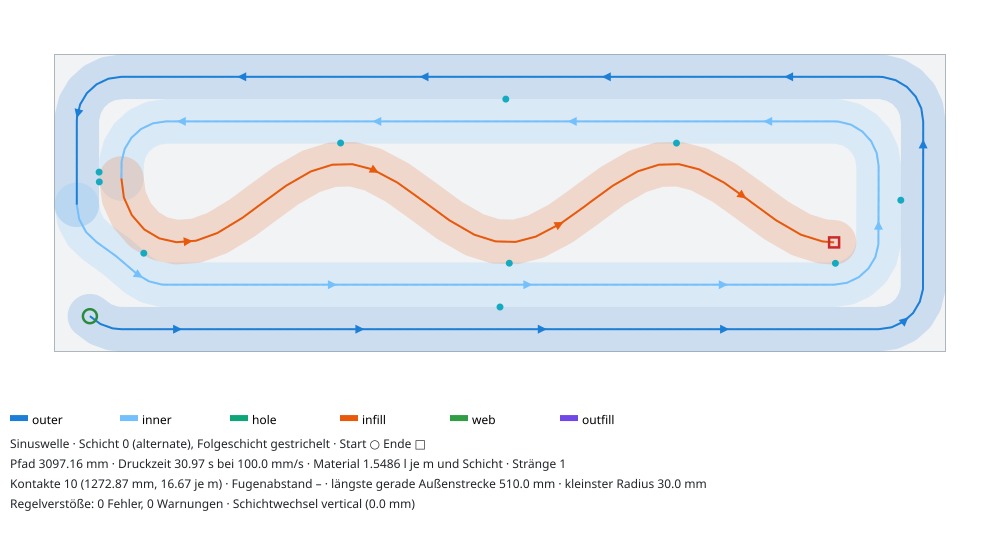
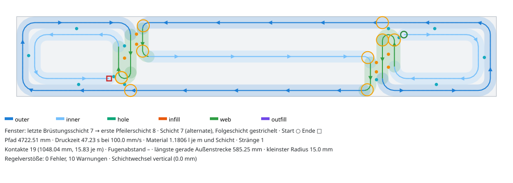

# Morgenbericht Druckmuster (Nachtlauf 20./21.10.2026)

Branch `v2/muster` (Draft-PR nach `v2/strang`). Auftrag: `docs/muster/AUFTRAG.md` mit Nachtrag 18:20.
Verlauf, Aufgabenliste und Belege: `MUSTER-PROGRESS.md`.

<!-- STAND -->
**Stand:** Entwurf 06:15, wird bis 10:00 fortgeschrieben.
<!-- /STAND -->

## Kurzfassung

- **Die Fugenwand aus dem Foto ist gebaut und druckbar.** Empfohlen ist die **Rautenkette**: gerade
  Außenfelder mit stumpfen Fugen, über jeder Fuge eine Raute, Vorder- und Rückseite um eine halbe Teilung
  versetzt. Je Schicht ein geschlossener Strang ohne Kreuzung und ohne Überhang, der Schichtwechsel ist ein
  reiner Z-Hub. Material 0,95–1,1-fach gegenüber zwei Schalen, also nicht mehr.
- **Der parametrische 2D-Musterersteller läuft** als Reiter „Muster“ im Viewer (`/?view=muster`): Muster
  wählen, Regler ziehen, Draufsicht live (Segmentarten, Richtung, Start/Ende, Folgeschicht, Fugen und
  Kontakte, Verstöße rot), Kennzahlen, „An Modullänge anpassen“, Speichern als Vorlage, SVG-Export,
  „Für Lauf verwenden“. Die Geometrie rechnet der Kern (`POST /api/patterns/preview`, 35–110 ms), der
  Browser zeichnet nur. Dazu `roboprint pattern-preview <preset.json> --svg <datei>`.
- **17 Mustervorlagen in 7 Familien**, alle als ein Strang je Schicht und Insel: Schalen (Grundmuster),
  Fugenwand (Rautenkette, Gurt, versetzt, Foto), Wellen-Infill (Sinus, Zickzack, Trapez, Mäander),
  Doppelwelle, Waben, Fermat-Spirale, Topologie (Öffnungen, Laibungsstege, Abschrägung) und gewellte
  Außenschale (O1).
- **Alles ist opt-in.** Ohne Musterparameter sind Toolpath, Trajektorie und DRL von S1 bitgleich zu vorher.
- **12 Testdruck-Programme** (`docs/muster/testdrucke/`), je 10 Schichten am Standard-Druckplatz, vom Planer
  als machbar eingestuft, von `fake_drcf` (v2 und v3) und vom Muster-Orakel akzeptiert.
- **Drei Entscheidungen brauche ich von dir** (unten unter „Weichen“): Abdeckungsregel G3 bei Mustern,
  Standard-Schichtfolge und der Umgang mit Schichten dünner als die Raupe am Wandkopf.

## Was morgens da sein sollte

| Erwartet | Stand |
|---|---|
| Bebilderter Musterkatalog mit Kennzahlen und Empfehlung | `docs/muster/MUSTERKATALOG.md` (17 Muster × 4 Querschnitte, Bilder, Vorschau- und Roboterkennzahlen) |
| Testdruck-DRLs je Muster, vom Planer geprüft | `docs/muster/testdrucke/` (12 Körper, README mit Testdruckplan) |
| Muster im Viewer wählbar, 2D-Vorschau einer Schicht | Kasten „Druckmuster“ in „Zerlegen & prüfen“, Schichtvorschau und Kennzahlen im Teil-Panel |
| Parametrischer 2D-Musterersteller mit der Fugenwand | Reiter „Muster“, API, CLI (siehe oben) |
| G1–G8 grün, Musterprüfung grün | siehe „Gate-Stand“ |
| Morgenbericht, Draft-PR | diese Datei, PR `v2/muster → v2/strang` |

## Empfehlung

1. **Standardmuster für Wände mit Sollbruchziel: `fugenwand_raute` (Rautenkette).** Feldlänge so wählen,
   dass die Modullänge in ganze Felder aufgeht und der Hakenradius w bleibt: bei 200-mm-Wänden und
   600-mm-Modulen Ziel 225 mm → 3 Felder à 200 mm (ohne Warnung); ab 250 mm Wand 300 mm. Begründung: einzige
   Variante mit echten, durchgehenden Fugen auf beiden Seiten, Foto-Optik, kleinster Materialaufwand
   (Gurt +6 … +43 %), kürzeste Druckzeit, auf S1, S6 (alle Wände des Beispielhauses) und im Testkörper
   machbar.
2. **Standard-Schichtfolge: `alternate`** (gerade Schichten außen → innen, ungerade als exakte Umkehrung).
   Der Schichtwechsel ist ein reiner Z-Hub, das Teil wird als **ein** Strang gedruckt (S1: 39/39 senkrechte
   Wechsel, gleiche Planerzeit). Aktivieren erst nach Weiche 1, sonst fällt S1 knapp unter die G3-Abdeckung
   (94,4 % < 95 %, gerundete Ecken).
3. **Ohne Sollbruchziel:** Schalen mit `alternate`; für 300-mm-Wände Waben oder Doppelwelle, wenn Steifigkeit
   gebraucht wird (1,3–1,5-faches Material). Infill-Wellen bringen bei zwei Schalen keine Rissgliederung
   (die Außenhaut bleibt eine lange gerade Raupe).

## Katalog-Auszug

Vorschau-Kennzahlen je Schicht für 1000 × 200 mm (aus `docs/muster/MUSTERKATALOG.md`; Material relativ zu
zwei Schalen):

| Muster | Pfad mm | Zeit s | Material | Kontakte/m | Zelle mm | längste gerade Außenstrecke mm | R min mm |
|---|---|---|---|---|---|---|---|
| schalen | 4152 | 41,5 | 1,00 | 5,0 | 909 | 910 | 30,0 |
| fugenwand_raute | 4024 | 40,2 | 0,97 | 14,0 | 140 | 114 | 27,0 |
| fugenwand_gurt | 5909 | 59,1 | 1,42 | 50,0 | 212 | 198 | 21,0 |
| fugenwand_versetzt | 5891 | 58,9 | 1,42 | 58,0 | 212 | 198 | 21,0 |
| sinus | 5133 | 51,3 | 1,24 | 13,0 | 214 | 910 | 30,0 |
| zickzack | 5124 | 51,2 | 1,23 | 13,0 | 219 | 910 | 30,0 |
| trapez | 5165 | 51,6 | 1,24 | 13,0 | 184 | 910 | 30,0 |
| maeander | 5249 | 52,5 | 1,26 | 13,0 | 154 | 910 | 26,5 |
| fermat | 5929 | 59,3 | 1,43 | 58,0 | 820 | 910 | 15,0 |
| aussenwelle (1 Schale) | 2275 | 22,8 | 0,55 | 0,0 | 1000 | 110 | 30,0 |

Rautenkette 1000 × 300 mm, Schicht 0 mit Folgeschicht gestrichelt (Fugen lila, Knoten orange):

Gurtvariante (Lesart des Nachtrags, zwei Gurte in der Wandmitte) und versetzte Rückseite:

Infill-Sinus und Topologie an einem Fenster (Laibungsstege schon in den Brüstungsschichten):

Weitere Bilder: `docs/muster/bilder/` und `docs/muster/bilder/katalog/`.

## Testdrucke

`docs/muster/testdrucke/README.md` enthält Tabelle und Testdruckplan. Reihenfolge: 1. `schalen_alternate`
(Referenz: Raupenmaße, senkrechter Schichtwechsel), 2. `fugenwand_raute` (Fugen reißen in den Fugen,
Haken sauber, Knoten haften; Fotos nach 1, 3 und 7 Tagen), 3. `sinus`, dann Gurt/versetzt, Wellen,
300-mm-Muster, Fermat. Druckzeit 3,1–7,2 min, Material 5,2–12,6 l je Körper (Annahme w·h·Pfad).
**Trockenlauf mit reduzierter Geschwindigkeit vor dem ersten Druck.**

<!-- GATES -->
## Gate-Stand

| Prüfung | Ergebnis | Kennzahlen |
|---|---|---|
| `scripts/verify.py` (G1–G8, voll, 21.10. 06:28) | **grün**, Exit 0 | G1 12 s, G2 50 s, G3 S1 41 + 32 s, G4 S2/S3 grün, G5 36 s, G6 e2e 108 s, G7 S1 40,8 s ≤ 180, S2 129,1 s ≤ 1800, G8 ruff, pytest core (676 s), web lint/typecheck/test |
| `scripts/verify_muster.py` (Vorschlag G9) | (läuft) | |
<!-- /GATES -->

## Weichen für den Nutzer

1. **Abdeckungsregel G3 bei Mustern (Gate-Einwände 1–3).** G3 verlangt ≥ 95 % Abdeckung des
   Schalenbereichs. Muster unterteilen die Wand gewollt: Rautenkette 64,6 %, Gurt 88,6 %, versetzt 88,1 %,
   und schon „Schalen“ mit gerundeten Ecken (r = w, nötig für M6) 94,4 %. **Empfehlung:** G9 aus
   `docs/muster/SPEC-NACHTRAG-MUSTER.md` übernehmen; für Teile mit Muster ersetzt G9 (M3 überhangfrei,
   M5 im Teil) die Abdeckungsregel, die Abdeckung wird nur berichtet. Ohne Muster bleibt G3 wie es ist.
2. **Standard-Schichtfolge `alternate` und Standardmuster.** **Empfehlung:** `alternate` als Standard nach
   Weiche 1; Muster bleibt opt-in, bis der Testdruck die Rautenkette bestätigt; danach `fugenwand_raute`
   als Standard für Wände mit Sollbruchziel.
3. **Schichten dünner als w am Wandkopf.** In den 20 Kopfmodulen von S6 (45°-Schräge) sind die obersten drei
   Schichten 20,7 / 10,7 / 0,7 mm dick. Mit Muster bleiben sie leer (M1 rot), ohne Muster druckt der Slicer
   dort einen Ring, der über den Querschnitt hinausragt. **Empfehlung:** SPEC-Regel „Schichten mit Dicke < w
   werden nicht gedruckt und im Bericht als Nacharbeit genannt“; alternativ die Zerlegung so schneiden, dass
   die Schräge erst ab Dicke ≥ w beginnt.
4. **Beispiel-IFC ohne Öffnungen.** `examples/Building-Architecture.ifc` hat kein Fenster und keine Tür;
   S5 nutzt eine synthetische Fensterwand (`scripts/muster_s5_ifc.py`). **Empfehlung:** ein Beispiel mit
   Öffnungen ins Repo, damit G4 Laibungen und Stürze prüft.
5. **Prozess am Gerät (nach dem Testdruck zu entscheiden):** Fugenabstand 200/240/300 mm, Gurt ja/nein,
   Rückseite gespiegelt oder versetzt, punktförmiger oder verlängerter Fugenkontakt, Überlappung ε an
   Kontakten (0,05 nominal, Grenze 0,15). **Empfehlung:** erst Testkörper 1 und 2 drucken, dann festlegen.

## Gate-Einwände (Kurzfassung, Belege in MUSTER-PROGRESS.md)

1. G3-Abdeckung gegen Fugenwand (60–89 %), gewollt.
2. Heutiges Format gegen M2/M4/M6: ohne Muster diagonaler Schichtwechsel (42 mm), Mitre-Ecken r ≈ 7,6 mm,
   Verbinder Schale 0 → 1 nah an der Außenraupe. Vorschlag: G9 hart nur für Teile mit Muster.
3. G3-Abdeckung auch beim Grundmuster mit gerundeten Ecken (94,4 %).

## Grenzen (mit Zahlen)

- **Doppelwelle und Waben gehen in S1 nicht** (Band 50 mm, nötig ≥ 55,5 mm): erst ab ≈ 206 mm Wand mit
  zwei Schalen bzw. 145 mm mit einer Schale je Seite.
- **Gurtvarianten brauchen mit Hakenradius w mindestens 230 mm Wand;** bei 200 mm nur mit r ≈ 21 mm
  (M6-Warnung, Haken enger als die Raupe).
- **Fugenwand mit Öffnung (S5) ist nicht überhangfrei** (M3); für Module mit Fenster ist `topologie` das
  Muster (Laibungsstege, 0 mm² Überhang). Je Laibung bleibt eine Fuge auf einer Wandseite, weil ein Strang
  nur zwei Enden hat.
- **Gewellte Außenschale (O1)** bringt bei zwei Schalen nur 2 mm Amplitude (0,15 % Längenpolster); mit einer
  Schale ohne Infill 8 mm (2,2–2,7 %).
- **Vorschau-Laufzeit:** Fugenwand und Schalen 35–70 ms, Wellen 55–110 ms; Mäander 1200 × 200 liegt bei
  95–108 ms und verfehlt das 100-ms-Ziel knapp.
- **Sehnenfehler** der Bahn gegen die Sollkurve 0,48–0,49 mm (Grenze 0,5 mm), knapp eingehalten.
- **Druckzeit** ist das Zeitmodell des Planers; das Überschleifen vieler kurzer `movel` kann an der
  Steuerung langsamer sein. Das zeigt der Trockenlauf.

## Nächste Schritte

1. Trockenlauf und Druck Testkörper 1 (`schalen_alternate`) und 2 (`fugenwand_raute`), Messungen nach dem
   Testdruckplan.
2. Weichen 1–3 entscheiden; danach G9 und die Abdeckungsregel in `spec/` übernehmen (Nachtrag ist
   einfügefertig) und `alternate` als Standard setzen.
3. Nach dem Testdruck: Fugenabstand, Gurt und Rückseite festlegen und als Standardvorlage speichern.
4. Ein IFC mit Öffnungen beschaffen und S2/G4 damit erweitern.

## Ablauf der Nacht

<!-- ABLAUF -->
(wird zum Schluss ergänzt)
<!-- /ABLAUF -->
