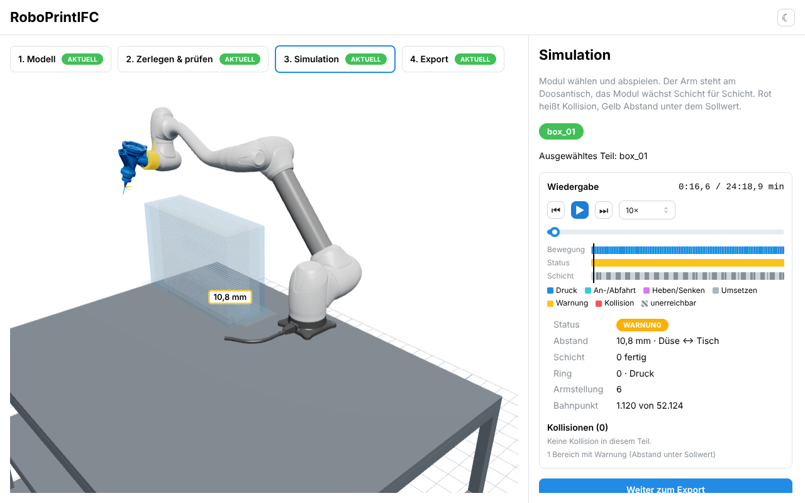
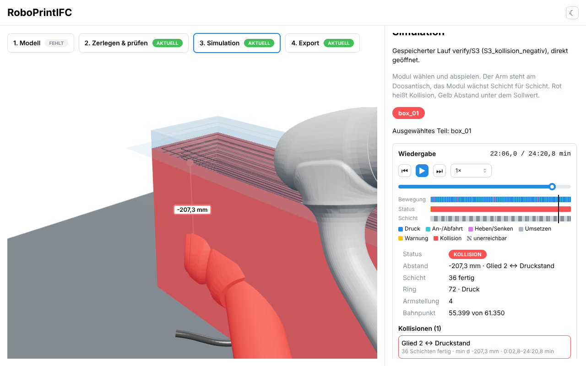

# Morgenbericht Nachtlauf v2 · 19.10.2026

Branch `v2-nachtlauf`, Orchestrator-Session `orchestrator`, Lauf 22:42–07:00 Uhr (Europe/Berlin).
Einzelheiten zu jedem Schritt stehen im Protokoll von `PROGRESS.md`.

## Nachtrag 19.10.2026 vormittags: alle Gates grün

Nach den Nutzerentscheidungen (Prüfer Teil für Teil, Statusregel base_link ↔ link_2) ist der volle Lauf von
`python scripts/verify.py` **vollständig grün (G1–G8)**. Kennzahlen: S1 33,7 s; S2 195 s (vorher 1131 s); check_run S2
556 s mit ~3 GB statt OOM; fake_drcf 34 s statt 954 s; S3 bestätigt. Die folgenden Abschnitte beschreiben den
Stand am Morgen. In Arbeit: Statusregel für alle Gliedpaare i ↔ i+2 und Warnschwelle 20 mm gegen den Druckstand.

## Ergebnis in einem Satz (Stand Morgen)

Sieben von acht Gates sind im vollen Lauf von `python scripts/verify.py` grün. G4 ist rot, weil der gesperrte
Prüfer `verify/check_run.py` für die 172 S2-Module mehr Speicher braucht, als die VM hat. Die Zerlegung selbst
liefert für alle drei geeigneten Wände nur machbare Module, und alle DRL-Programme bestehen den Fake-Controller.

## Gate-Tabelle (voller Lauf, 19.10. ca. 05:30)

| Gate | Status | Kennzahl |
|---|---|---|
| G1 Kinematik | grün | 2000 FK + 2000 IK gegen Pinocchio, Home gültig (8,7 s) |
| G2 Kollision | grün | 500 Posen gegen Coal; roboprint konservativ, bei freien Posen ≤ 4,3 mm Abweichung (39,9 s) |
| G3 Referenzmodul S1 | grün | machbar, d_min 10,83 mm (Düsenspitze ↔ Tisch, Schicht 0), 52 124 Samples, 0 collision, 0 unreachable, 0 Zweigwechsel |
| G4 Beispiel-IFC S2 + S3 | **rot** | S2: 172 Module, alle machbar; check_run nach 1048 s vom OOM-Killer beendet (Exit −9). S3 separat bestätigt, siehe unten |
| G5 DRL | grün | fake_drcf: alle `program.v2.drl` und `program.v3.drl` aus S1 und S2 (173 Teile, 954,6 s) |
| G6 Viewer | grün | Playwright 8/8 gegen echte Läufe S1/S3, Uhr-Invariante an 50 t ≤ 1 mm (52,2 s) |
| G7 Laufzeit | grün | S1 33,6 s (≤ 180 s), S2 1132,8 s (≤ 1800 s) |
| G8 Qualität | grün | ruff, pytest core (192 Tests), web lint/typecheck/test |

### Nachweis für G4 trotz Prüfer-Abbruch

Der Prüfer lädt alle Teile eines Laufs gleichzeitig (gemessen 3,6 GB für 20 Module, hochgerechnet ~30 GB für 172).
Deshalb wurde S2 zusätzlich in Teilmengen mit demselben, unveränderten Prüfer geprüft:

| Wand | Module | Prüfung | Fehler je Modul | Wandprüfung |
|---|---|---|---|---|
| house right front (Giebel) | 30 | komplett in einem Lauf | 0 | bestanden (Volumen, Überlappung, Überhang) |
| house right back | 42 | 3 Blöcke à 14 | 0 | Blockvolumen 6,014 + 6,014 + 5,829 = 17,86e8 mm³ = Wandvolumen 1,786e9 mm³ |
| house left | 100 | 5 Blöcke à 20 | 0 | 5 × 8,462e8 mm³ = Wandvolumen 4,231e9 mm³ |
| plumbing wall | 0 | – | – | ungeeignet: „Wand zu dünn: 24 mm < 60 mm“ |

Also besteht jedes der 172 Module alle G3-Kriterien des Prüfers, liegt auf der Arbeitsfläche und schneidet die
Roboterbasis nicht. Nicht gezeigt ist die Überlappung zwischen Modulen verschiedener Blöcke derselben Wand
(innerhalb jedes Blocks geprüft); die Blockvolumina summieren sich aber exakt zum Wandvolumen. Ein Block mit
allen 42 Modulen der Rückwand lief ebenfalls in den Speicherengpass und wurde abgebrochen.
Die Fehlermeldungen „Teile fehlen (0/0)“ für die jeweils anderen Wände entstehen nur durch die Teilmenge.
Skript und Logs: `experiments/s2_blockpruefung/`. Teilmengen-Laufordner mit Symlinks auf `runs/verify/S2/parts`, unveränderter Aufruf
`python -m verify.check_run <block> --scenario spec/scenarios/S2_beispiel_ifc_modul.json`.

S3 (Negativfall) separat: `check_run` **BESTANDEN**. roboprint meldet 61 011 von 61 350 Samples als `collision`,
der Prüfer bestätigt 61 010 davon. Der Gate-Runner kam nicht bis S3, weil er G4 nach dem S2-Abbruch beendet.

## Was jetzt funktioniert

- **Kinematik** (`robot`, `urdf_chain`): FK exakt aus der URDF-Kette, IK über alle 8 Zweige mit Newton-Korrektur,
  weil die URDF `rpy = 1.571` statt π/2 nutzt (bis 0,4 mm am Flansch). Zweig-Bits nach `sol_space`.
- **Kollisionswelt** (`collision`): alle Paare nach SPEC §5.1, konservative Konvexzerlegung, ~0,6 ms je Pose im Batch.
- **Planer** (`planner/`): Ladder-Graph über Zweig × ψ, Viterbi je Ring, Travel lift → transfer → lower,
  adaptive Verdichtung nach 5 mm / 0,005 rad, jedes Sample mit Status. Platzierungssuche nach SPEC §5.4/3.
- **Zerlegung** (`decompose`): Eignung, Überhang-Regel, H*-Bisektion, Raster, Verfeinerung. Beispiel-IFC:
  3 geeignete Wände → 30 + 42 + 100 Module (600 × 200 × 296–380 mm), plumbing wall (24 mm) mit Grund ungeeignet.
- **Selbstprüfung** (`selfcheck`): Schichtreihenfolge, Travel über dem Druckstand, Teil auf dem Tisch, Druck im
  Material, Start in Home, Teilmaße. Schließt Lücken, die die Gegenprüfung in den Prüfern fand.
- **DRL** (`drl`): Dialekte v2/v3, ZYZ mit korrektem Gimbal-Fall, AO-Kanal 1, Blending ≤ ½ Segment, Pumpe nur im Druck,
  Abschluss und `try/finally` setzen AO 0. Zeitachse und Programm nutzen dieselben Geschwindigkeiten (`params.py`).
- **Viewer** (`web/`): vier Schritte mit Veraltet-Logik, Wandvorschau, Modulraster, Player mit einer Uhr, Timeline,
  Kollisionsliste mit Hervorhebung und Kontaktlinie, Export. API mit Jobs, Fortschritt und Abbruch.

Weitere Screenshots: `web/e2e/screenshots/g6-1-modell.png`, `g6-2-zerlegen.png`, `g6-4-export.png`.

## Was nicht funktioniert und warum

1. **G4 im Gate-Runner rot (Speicher):** siehe oben. Das System ist nicht die Ursache; die Trajektorien wurden
   trotzdem um 16 % verkleinert (A4.6), was am Speicherbedarf des Prüfers kaum etwas ändert. Lösung: Prüfer
   Teil für Teil auswerten lassen. Dafür muss `verify/` entsperrt werden (deine Entscheidung).
2. **Kein Sample ist `ok`:** Das Paar base_link ↔ link_2 hat konstant ~33 mm < d_target 50 mm. Alle Samples sind
   deshalb `warn`. G3 verlangt nur d ≥ d_hard und ist erfüllt.
3. **Knappe Reserve zum Tisch in Schicht 0:** d_min 10,83 mm bei d_hard 10 mm, weil die Düsenspitze nur 1,85 mm
   unter dem TCP endet. Bei h < 8,15 mm wäre jedes Teil unmachbar.
4. **Module sind klein:** H*(600 mm) ≈ 380 mm, daher 172 Module für drei Wände. v1 kam auf 906 mm, aber mit
   d_min 0,09 mm; mit d_hard = 10 mm ist das nicht erreichbar.
5. **Keine VHACD:** VHACD lieferte auf den Doosan-Meshes hohle Schalen (link_1: 1,1e6 statt 4,6e6 mm³). Ersatz ist eine
   eigene konservative Hüllen-Bisektion (Abweichung von SPEC §5.1, belegt in PROGRESS.md).
6. **Tesseract** wurde gespiket und nicht übernommen (`docs/spikes/tesseract-spike.md`).

## Gate-Einwände (Belege in PROGRESS.md)

- G2: Bei Durchdringung verlangt der Prüfer d_rp ≤ 1 mm statt d_rp ≤ d_coal + 1 mm (Eindringtiefe nichtkonvexer
  Meshes nicht eindeutig).
- Paar base_link ↔ link_2 dauerhaft unter d_target (siehe oben).
- Blending 2 mm schneidet Ecken um ~0,8 mm, die geprüfte Bahn modelliert kein Blending.
- Gegenprüfung A2.4 (`docs/gegenpruefung-a2-4.md`): Prüfer übersehen Schichtreihenfolge, Travel durch den
  Druckstand, Düsenspitze ↔ Glieder, Tischfläche im S1-Modus, fehlendes `movej(home)`, erfundene d-Werte.
  Kein falscher Systemstatus gefunden; systemseitig fängt `selfcheck` diese Fälle ab.
- check_run braucht für S2 ~30 GB.

## Annahmen, die du bestätigen musst

- SPEC §10, alle mit **A** markierten Werte: h 10 mm, w 30 mm, v_print 100 mm/s, v_travel 250 mm/s, z_lift 30 mm,
  V_pump 5,0 V auf AO 1, t_tot 3,0 s, r_blend 2 mm, d_hard 10 mm, τ_max 0°, tcp_name `FGC_30GUT`.
- Zusätzlich während der Nacht festgelegt:
  - Zweig-Bits (Righty = Handgelenkzentrum hinter J1, Above = Ellbogen über Schulter→Handgelenk, Flip = q5 < 0);
    Übereinstimmung mit Doosan-`ikin` unbelegt.
  - DRL-Orientierungsgeschwindigkeiten und Beschleunigungen (Druck 60 °/s, 500 mm/s²; Travel 90 °/s, 1000 mm/s²).
  - Ob `try/finally` in DRL 2.x läuft und ein Stopp am Teach Pendant es auslöst.
  - Nach dem letzten Ring nur `lift`, kein Rücktransfer nach Home.
  - G6-Glückspfad: Die beiden Job-Endpunkte beantwortet der Test und verweist auf den Lauf S1; alles andere läuft
    über die echte API. Ein echter Job lässt sich mit `G6_REAL_JOB=1` testen.
- SPEC §13: Firmware-Version ablesen, Rotationssymmetrie der Düse klären, TCP `FGC_30GUT` am Pendant anlegen.

## Nächste Schritte

1. Entscheiden, ob `verify/check_run.py` Teil für Teil prüfen darf, und die Gate-Einwände beantworten. Danach
   M1–M7 aus der Gegenprüfung als Selbsttests in die Prüfer aufnehmen.
2. Größere Module untersuchen: d_target-Regel für das Paar base_link ↔ link_2, τ_max > 0, andere Platzierungen.
3. Am Gerät: Trockenlauf mit `change_operation_speed(10…20)`, dann AO-Latenz und Totzeit messen.
4. Offene UX-Punkte: Export-Bericht, Annahmenliste im DRL-Kopf mit Umlauten (`docs/ux-befund-a4-1.md`).
5. `legacy/` bleibt bis zu deiner Abnahme stehen.
