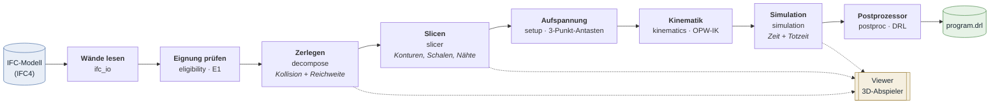
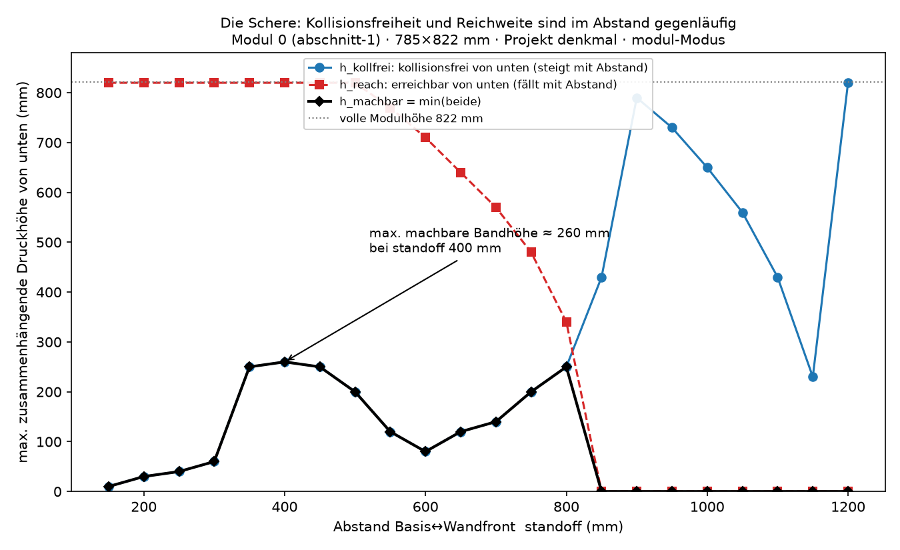
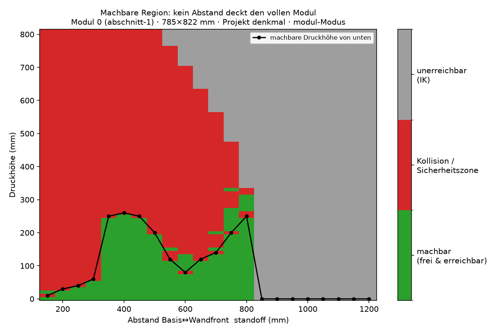

<!-- Titelblock -->
# RoboPrintIFC

**Vom IFC-Gebäudemodell zum ausführbaren Roboterprogramm für den 3D-Druck.**

RoboPrintIFC liest ein IFC-Modell, entscheidet für jede Wand begründet, ob sie
gedruckt werden kann, zerlegt sie kollisions- und reichweitengetrieben in
fertigbare Module, sliced diese, simuliert die Roboterkinematik und exportiert
ein lauffähiges Programm für den Doosan M1013 (DRL).

[](https://github.com/tobiasbartlog/RoboPrintIFC/actions/workflows/ci.yml)
[](LICENSE)

Anwendungsdomäne ist der **funktional gradierte Lehm-3D-Druck**: Eine Wand soll
nicht homogen gedruckt werden, sondern mit über den Querschnitt veränderlicher
Porosität — außen tragfähig, innen dämmend. Das Werkzeug ist der durchgängige
Planungspfad dafür, vom Bauteil im BIM-Modell bis zur Maschinenbewegung. Die
Materialsteuerung ist dafür durchgängig als zwei logische Pumpenkanäle angelegt,
die bis in die analogen Ausgänge des erzeugten Roboterprogramms durchgereicht
werden; die Berechnung des Porositätsfelds selbst steht noch aus (siehe
[Reifegrad](#reifegrad--was-gilt-und-was-nicht)).

---

## Inhalt

- [Was das Werkzeug leistet](#was-das-werkzeug-leistet)
- [Belegter Durchstich](#belegter-durchstich-echte-ausgaben)
- [Die Verarbeitungskette im Einzelnen](#die-verarbeitungskette-im-einzelnen)
- [Forschungsbeitrag: kollisionsgetriebene Zerlegung](#forschungsbeitrag-kollisionsgetriebene-zerlegung)
- [Qualitätssicherung](#qualitätssicherung)
- [Reifegrad — was gilt und was nicht](#reifegrad--was-gilt-und-was-nicht)
- [Installation und Schnellstart](#installation-und-schnellstart)
- [Projektstruktur](#projektstruktur)
- [Dokumentation](#dokumentation)
- [Lizenz, Attribution, Zitation](#lizenz-attribution-zitation)

---

## Was das Werkzeug leistet



Jeder Schritt ist einzeln über die Kommandozeile aufrufbar und schreibt sein
Ergebnis als **schema-geprüftes Artefakt mit Provenienz** (Quelle, Zeitstempel,
Git-Commit) in einen Laufordner. Ein Ergebnis ist damit vollständig aus Dateien
reproduzierbar — Grundvoraussetzung dafür, dass eine gezeigte Konfiguration
später im Paper belegbar bleibt (ADR-004).

Neben der Kommandozeile gibt es einen **Viewer** (TypeScript/three.js), der die
Artefakte lädt und Wand, Zerlegung, Druckpfade und die animierte
Robotertrajektorie darstellt. Der Viewer rechnet bewusst nichts selbst; er ist
ein reiner Abspieler (ADR-007).

## Belegter Durchstich (echte Ausgaben)

Die folgenden Ausgaben stammen aus einem tatsächlichen Lauf auf dem
mitgelieferten Beispielmodell (`examples/Building-Architecture.ifc`), nicht aus
einer Skizze.

**1 — Wände lesen und Eignung beurteilen**

```console
$ fgc walls list examples/Building-Architecture.ifc

GlobalId                 Name                             LxHxD [mm]           eignet sich
------------------------------------------------------------------------------------------
1AQAupaRP1txwK1AGiN61V   house - outer wall - house righ  1800x3626x200        nein  (~workspace)
3wdauVJT5Fx9drrREiDqA$   house - outer wall - house righ  4200x2226x200        nein  (~workspace)
0OfZwWc8j9QP5uX8xPTxDH   house - outer wall - house left  6000x3626x200        nein  (~workspace)
1uS5vfZPn9R8PlAaVd73on   plumbing wall                    3800x2226x24         nein  (~workspace)

candidates.json: runs/20260831-145405_walls-list_Building-Architecture/candidates.json
model.glb:       runs/20260831-145405_walls-list_Building-Architecture/model.glb
```

Das Urteil ist begründet und nachvollziehbar: keine dieser Wände passt **am
Stück** in den Arbeitsraum des Doosan M1013. Genau das ist der Ausgangspunkt der
Zerlegung — und ein Befund, kein Verbot: Die Pipeline arbeitet auf explizite
Auswahl weiter (ADR-013).

**2 — Slicen**

```console
$ fgc slice examples/Building-Architecture.ifc --wall 1AQAupaRP1txwK1AGiN61V

WARNUNG: Wand ist laut E1 nicht druckgeeignet — workspace: außerhalb
         Arbeitsraum doosan_m1013: Höhe 3626 mm > 1000 mm
Slicing läuft trotzdem (explizite Auswahl per GlobalId).

Wand 1AQAupaRP1txwK1AGiN61V (house - outer wall - house right front) gesliced:
  360 Schichten à 10.0 mm, 2 Schalen à 30.0 mm Strangbreite
  5948 Targets (5234 print / 714 travel)
  Gebäudekontext: 11 Elemente (context.json)
```

**3 — Kinematik simulieren**

```console
$ fgc simulate --run <lauf> --setup examples/setup_demo.json

trajectory.json: <lauf>/trajectory.json
  137435 Samples, Gesamtdauer 28861.192 s (Druckzeitschätzung)
  io totzeitkompensiert: ja
```

**4 — Roboterprogramm exportieren**

```console
$ fgc emit-drl --run <lauf> --setup examples/setup_demo.json

program.drl: <lauf>/program.drl
  5948 Targets emittiert
```

Auszug aus dem erzeugten `program.drl` — direkt auf der Steuerung lauffähiger
Doosan-Code, inklusive der beiden analogen Pumpenkanäle für den
Materialgradienten:

```python
# --- Kanal-Modus ---
set_mode_analog_output(ch=0, mod=DR_ANALOG_VOLTAGE)   # pump_a -> AO0, 0.0..10.0
set_mode_analog_output(ch=1, mod=DR_ANALOG_VOLTAGE)   # pump_b -> AO1, 0.0..10.0

# --- Bewegung + IO ---
set_analog_output(ch=0, val=0.000)
set_analog_output(ch=1, val=0.000)
movej(posx([7415.000, -55.000, 4885.000, 90.000, 90.000, -90.000]), vel=250.000, acc=250.000, radius=0.000, ref=DR_BASE)   # travel, layer 0
set_analog_output(ch=0, val=5.000)
set_analog_output(ch=1, val=5.000)
movel(posx([7415.000, -55.000, 3115.000, 90.000, 90.000, -90.000]), vel=100.000, acc=250.000, radius=0.000, ref=DR_BASE)   # print, layer 0
movel(posx([7585.000, -55.000, 3115.000, 90.000, 90.000, -90.000]), vel=100.000, acc=250.000, radius=0.000, ref=DR_BASE)   # print, layer 0
```

Der Laufordner enthält danach den vollständigen, inspizierbaren Zwischenstand:

```
runs/20260831-145415_slice_Building-Architecture/
├── wallspec.json        1.7 KB   was gebaut werden soll
├── context.json         145 KB   Gebäudekontext für Kollision und Anzeige
├── toolpath.json         2.4 MB   roboterunabhängige Druckanweisung
├── trajectory.json      52.5 MB   ausführbare Bewegung, 137 435 Samples
└── program.drl           1.1 MB   Doosan-Programm
```

## Die Verarbeitungskette im Einzelnen

| Stufe | Modul | Eingang → Ausgang | Kernpunkt |
|---|---|---|---|
| IFC-Import | `ifc_io` | IFC4 → `WallSpec` | Tessellierung über IfcOpenShell; Öffnungen und Zielparameter (U-Wert, Tragfähigkeit) werden mitgeführt. Einzige Stelle, an der Meter in Millimeter umgerechnet wird (ADR-006). |
| Eignungsprüfung | `eligibility` | `WallSpec` → Befund | Zweistufig (ADR-013): billige Regelprüfung (Arbeitsraum, Stegbreiten, Mindestradien), danach die teure geometrische Prüfung. Ein Befund warnt, er blockiert nie. |
| Zerlegung | `decompose` | Wand → Module/Abschnitte | Kollisions- und reichweitengetrieben. Greedy-Verfeinerung, Beam-Suche und Beam-Suche mit gelerntem Surrogat-Vorsortierer, alle über **eine** Schnittstelle austauschbar. |
| Slicing | `slicer` | `WallSpec` + Prozessfenster → `Toolpath` | Planare Schnitte, Schalen-Offsets, Nähte, Travel-Erkennung. Jedes Target trägt Geschwindigkeit und die logischen Materialkanäle (`pump_a`/`pump_b`) mit (ADR-011). |
| Aufspannung | `setup` | 3 angetastete Roboterposen → `Setup` | Das 3-Punkt-Antastverfahren ist die **eine** Stelle, an der Bauteilwelt und Roboterwelt verheiratet werden (ADR-006). |
| Kinematik | `kinematics` | `Toolpath` + `Setup` → Achswinkel | Analytischer OPW-Solver (Ortho-Parallel-Basis, sphärisches Handgelenk), Konfigurationswahl, Achsgrenzen, Singularitäts-Klassifikation. |
| Kollisionskontrolle | `collision` | Pose + Umgebung → Befund | Mesh-basiert über FCL, beschleunigt durch vorberechnete Glied-SDFs mit Provenienz-Hash; benennt das verursachende Glied und die Eindringtiefe. |
| Simulation | `simulation` | Achswinkel → `Trajectory` | Zeitinterpolation unter Achsgeschwindigkeits- und Beschleunigungsgrenzen, inklusive Totzeitkompensation der analogen Ausgänge (ADR-012). |
| Postprozessor | `postproc` | `Toolpath` + `Setup` → Programm | DRL für den Doosan M1013: `movel`/`movej` je Target, analoge Ausgänge mit Change-on-Delta. Hinter einer Emitter-Schnittstelle, damit ein KRL-Emitter für KUKA ohne Umbau danebentreten kann (noch nicht gebaut). |
| Viewer | `viewer/` | Artefakte → 3D-Darstellung | Zustandsloser Abspieler: Wand, Zerlegung, Pfade, animierte Trajektorie mit Zeit-Slider. |

Die Abhängigkeiten zeigen strikt nach unten Richtung `domain`. Kein Modul kennt
seinen Nachfolger; die Verkettung liegt allein in `pipeline`.

## Forschungsbeitrag: kollisionsgetriebene Zerlegung

Der inhaltliche Kern des Werkzeugs ist die Frage, **wie** eine Wand zerlegt
werden muss, damit ein Knickarmroboter sie überhaupt drucken kann. Das ist keine
Optimierung im Nachhinein, sondern eine Machbarkeitsbedingung — und das Repo
enthält die Messung, die das belegt.

In `experiments/collision_standoff_sweep/` wird für ein reales Wandmodul
(785 × 822 mm) der Abstand zwischen Roboterbasis und Wandfront von 150 mm bis
1200 mm durchgefahren. Für jeden Abstand simuliert der **produktive** Pfad den
kompletten Modul-Druck und liefert je Bahn-Sample die signierte Mindestdistanz,
das verursachende Roboterglied und die Druckhöhe.

| | |
|---|---|
|  |  |
| **Die Schere.** Kollisionsfreiheit von unten wächst mit dem Abstand, die Erreichbarkeit fällt. | **Die machbare Region** (kollisionsfrei *und* erreichbar) — sie schließt sich nie über die volle Modulhöhe. |

**Kernbefund:** Es gibt **keinen einzigen Abstand**, bei dem der volle 822-mm-Modul
gleichzeitig kollisionsfrei und erreichbar ist.

- **Nah** (≈ 230 mm, der naive Vorschlag): voll erreichbar, aber tief kollidierend
  (≈ 8000 rote Samples, Durchdringung bis −258 mm).
- **Fern** (800–850 mm): vollständig kollisionsfrei, aber **56–61 % des
  Druckpfades sind kinematisch unerreichbar**.
- **Dazwischen** existiert kein Fenster, das beide Bedingungen erfüllt.

Die maximale von unten zusammenhängend machbare Bandhöhe beträgt über alle
Abstände **≈ 260 mm**. Für das Modul folgt daraus zwingend eine Zerlegung in
mindestens **vier** Höhenbänder — nicht zwei, wie die intuitive Schätzung nahelegt.
Das limitierende Glied wandert dabei mit dem Abstand (Unterarm → Oberarm →
Unterarm → Handgelenk); die verbreitete Vorstellung „Schulter unten, Unterarm
oben" ist nur eine Näherung.

Eine Folgestudie im selben Ordner zeigt, dass allein die **Wahl der
IK-Konfiguration** (Schulter-/Ellbogen-/Handgelenk-Flip) die machbare Bandhöhe
von 250 mm auf 450 mm hebt — ein modulweiter Hebel, der in die Zielfunktion der
Zerlegung gehört.

Umgesetzt ist die Zerlegung in drei über dieselbe Schnittstelle austauschbaren
Verfahren — **Greedy**, **Beam-Suche** und **Beam-Suche mit gelerntem
Surrogat-Vorsortierer**. Ein Benchmark-Harness (`fgc benchmark`) vergleicht sie
auf einem eingefrorenen Stand **byte-vergleichbar** bei gleichem
Aufruf-Kontingent; die Provenienz nach ADR-004 macht die Läufe gegeneinander
prüfbar.

## Qualitätssicherung

Das Werkzeug soll Zahlen liefern, auf die sich eine Veröffentlichung stützen
kann. Entsprechend ist der Prüfaufwand angelegt:

| | |
|---|---|
| **Automatisierte Tests** | **2193** — 1129 im Python-Kern (74 Testmodule), 1064 im Viewer |
| **Umfang** | ~27 000 Zeilen Kern-Quellcode, ~19 000 Zeilen Kern-Tests, ~34 000 Zeilen Viewer |
| **Continuous Integration** | GitHub Actions: Lint (ruff), Kern-Tests, Viewer-Tests, Typprüfung und Build bei jedem Push |
| **Datenverträge** | 13 versionierte JSON-Schemas als gemeinsame Wahrheit für Kern und Viewer |
| **Entscheidungshistorie** | 26 Architekturentscheidungen (ADR) mit Begründung, Konsequenz und Revisionstrigger |
| **Vorabklärungen** | 10 dokumentierte Spike-Protokolle (Kollisions-Performance, IK-Roundtrip, Offset-Robustheit, Tessellierung …) |

Drei Prüfstrategien verdienen eine eigene Erwähnung:

**Testorakel statt Selbstbestätigung (ADR-009).** Die Kinematik wird nicht gegen
sich selbst geprüft, sondern über einen FK→IK→FK-Roundtrip mit Toleranzschranke
und gegen eine unabhängige Referenzimplementierung.

**Py↔TS-Parität.** Jede Ableitung, die sowohl der Kern als auch der Viewer
rechnet, ist in einem Manifest registriert und wird beidseitig gegen **geteilte
Golden-Dateien** geprüft — der Kern in pytest, der Viewer in vitest. Ein
Golden ohne Manifest-Eintrag schlägt fehl, ein Manifest-Eintrag ohne Golden
ebenso. Damit kann die Anzeige nicht unbemerkt von der Rechnung abdriften
(siehe [`docs/paritaet.md`](docs/paritaet.md)).

**Provenienz überall.** Jedes Artefakt trägt Quelle, Zeitstempel und
Git-Commit; die vorberechneten Kollisions-SDFs zusätzlich einen Hash ihrer
Quellgeometrie, damit ein veraltetes Artefakt als veraltet auffällt statt still
falsche Zahlen zu liefern.

## Reifegrad — was gilt und was nicht

Dies ist ein **Forschungsdemonstrator**, kein Produkt. Was das konkret heißt:

**Gebaut und testabgedeckt.** Die Kette IFC → Eignungsprüfung → Zerlegung →
Slicing → Aufspannung → IK → Simulation → DRL läuft durchgängig; der
[Durchstich](#belegter-durchstich-echte-ausgaben) oben ist ein realer Lauf. Die
Kollisions- und Reichweitenbefunde beruhen auf der Geometrie des realen
Robotermodells und sind reproduzierbar.

**Ausdrücklich vorläufig.** Die Bewegungsgrenzen im Postprozessor
(Geschwindigkeit, Beschleunigung, Verrundung) sind angenommene Werte, keine am
Gerät gemessenen — die erzeugten Programme weisen das im Kopf jeder Datei selbst
aus. Das Prozessfenster (`materialcards/process_window.provisional.json`) trägt
`provisional: true`: Strangbreite, Schichthöhe und Wanddickengrenzen stehen auf
`null`, bis die Extruderversuche (Spike S1) Zahlen liefern. Die
Druckbarkeitsregeln daneben sind in Strangbreiten normiert und aus Spike S4
belegt.

**Noch nicht gebaut.** Diese Stationen sind in Architektur und Datenverträgen
vorgesehen, aber bislang leere Modulgrenzen:

| Station | Stand |
|---|---|
| `postproc` — KRL-Emitter (KUKA) | Schnittstelle steht, Emitter fehlt |
| Porositätsfeld φ → V_A/V_B | ADR-023 entschieden; die Kanäle werden heute aus dem Prozessfenster konstant belegt, nicht gradiert gerechnet |
| `materials` — Materialkarten | Platzhalter-Modul; wartet auf die Messreihen |
| `thermal` — U-Wert-Rechnung | Platzhalter-Modul (Interface nach ADR-003 vorgesehen) |
| `configurator` — Pareto-Suche | Platzhalter-Modul |

**Nicht im Umfang.** Mehrroboterbetrieb, Online-Regelung mit Sensorfeedback,
nichtplanares Slicing, Rückschreiben ins IFC und Bauteiltypen außer Wänden sind
bewusst ausgeklammert; die Architektur verbaut sie nicht.

Die offenen Entscheidungen stehen benannt und mit Fälligkeit in
[`docs/architektur.md`](docs/architektur.md) §8.

## Installation und Schnellstart

Voraussetzungen: **Python ≥ 3.12** und **Node.js** (für den Viewer).

```powershell
git clone https://github.com/tobiasbartlog/RoboPrintIFC.git
cd RoboPrintIFC
.\setup.cmd          # Windows
./setup.sh           # Linux / macOS
```

Das Bootstrap ist idempotent: Es legt die Python-`.venv` samt Geometrie-Stack und
die Viewer-Abhängigkeiten an und installiert bei erneutem Aufruf nur nach, was
sich gegenüber `core/pyproject.toml` bzw. `viewer/package-lock.json` geändert
hat. Es sucht sich ein vorhandenes Python ≥ 3.12 selbst.

Danach:

```powershell
.\fgc start            # geführter Einstieg: Modell wählen, Wand wählen, slicen, ansehen
.\start_viewer.cmd     # grafischer Einstieg: Projektliste im Browser
```

Oder direkt über die Kommandozeile, wie im [Durchstich](#belegter-durchstich-echte-ausgaben)
oben gezeigt.

Die volle Prüfsuite:

```bash
python -m ruff check core        # Lint
python -m pytest core -q         # Kern-Tests
npm --prefix viewer test         # Viewer-Tests
npm --prefix viewer run build    # Typprüfung + Build
```

## Projektstruktur

```
RoboPrintIFC/
├── core/               Python-Paket fgc + CLI  (99 Module, 74 Testmodule)
│   ├── src/fgc/        domain · ifc_io · eligibility · decompose · slicer
│   │                   kinematics · collision · placement · simulation
│   │                   postproc · project · pipeline
│   └── tests/          Kern-Testsuite
├── viewer/             TypeScript + three.js + Vite — 3D-Abspieler
├── schemas/            13 versionierte JSON-Schemas (Verträge Kern ↔ Viewer)
├── robots/             Roboterdefinition, Kollisionsgeometrie, Reichweitenkarte
├── tools/              Werkzeug-/Düsendefinitionen
├── workstations/       Aufstellungen (Tisch, feste Zelle, mobiler Hub)
├── materialcards/      Prozessfenster und Druckbarkeitsregeln (provisorisch markiert)
├── priors/             Vorwissen für die Platzierungssuche
├── examples/           Beispiel-IFC und Beispiel-Aufspannung
├── experiments/        Messstudien mit Rohdaten, Skripten und Abbildungen
├── third_party/        Doosan-M1013-Modell (eigene Lizenz, siehe NOTICE)
└── docs/               Architektur, ADRs, Spikes, Recherche, Handbuch
```

## Dokumentation

| Dokument | Inhalt |
|---|---|
| [`docs/architektur.md`](docs/architektur.md) | Systemarchitektur: Zielbild, Leitprinzipien, Module, Datenverträge, Meilensteine, offene Entscheidungen |
| [`docs/adr/`](docs/adr/) | 26 Architekturentscheidungen mit Begründung, Konsequenz und Revisionstrigger |
| [`docs/benutzerhandbuch.md`](docs/benutzerhandbuch.md) | Vollständiges Benutzerhandbuch aller Funktionen |
| [`docs/design-log.md`](docs/design-log.md) | Chronologisches Entscheidungstagebuch — Frage, Alternativen, Entscheidung, Begründung |
| [`docs/spikes/`](docs/spikes/) | Protokolle der Vorabklärungen (Kollisions-Performance, IK-Roundtrip, Offset-Robustheit …) |
| [`docs/recherche/`](docs/recherche/) | Stand der Technik zur kollisionsgetriebenen Zerlegung und zur Adaption/Chunking-Literatur |
| [`docs/paritaet.md`](docs/paritaet.md) | Wie der Paritätsbeweis Kern ↔ Viewer funktioniert |
| [`experiments/`](experiments/) | Messstudien inklusive Rohdaten und Auswertungsskripten |

## Lizenz, Attribution, Zitation

Der eigene Code steht unter der **MIT-Lizenz** ([`LICENSE`](LICENSE)).

Fremdbestandteile — der portierte OPW-Kinematik-Solver (MIT/Apache-2.0) und das
Doosan-M1013-Robotermodell — sind mit Herkunft und Lizenz in
[`NOTICE`](NOTICE) ausgewiesen. Urheberrechtlich geschützte Fremddokumente
(Herstellerhandbuch, Literatur-Volltexte) sind bewusst **nicht** Teil dieses
Repositorys.

Zum Zitieren siehe [`CITATION.cff`](CITATION.cff).

---

**Autor:** Tobias Bartlog · RWTH Aachen University · <bartlog@icom.rwth-aachen.de>

Die Entwicklung erfolgte KI-gestützt; fachliche Konzeption, Architektur- und
Domänenentscheidungen sowie Prüfung und Abnahme des Codes liegen beim Autor.
Näheres in [`NOTICE`](NOTICE).
