# Musterkatalog

Vergleich der Druckmuster (Infill und Outfill) für Wandmodule. Alle Zahlen stammen aus der
2D-Vorschau (`roboprint.patterns.preview`, Schicht 0, Strangbreite 30 mm, Schichthöhe 10 mm,
100 mm/s) und gelten für prismatische Querschnitte. Die Roboterspalten (Erreichbarkeit,
Kollisionsabstand, Planerlaufzeit) kommen aus dem Musterlauf `scripts/verify_muster.py`.

Neu erzeugen: `python scripts/muster_katalog.py`. Nur der Text zwischen den Markern wird
überschrieben.

<!-- KATALOG:VERGLEICH:BEGIN -->
## Vergleich

Material je m relativ zu „schalen“ (zwei Schalen ohne Infill = 1,00). Zeit und Pfad je Schicht. Die Spalte „Roboter machbar“ kommt aus `runs/verify_muster/report.json` („offen“ = Muster nicht im Musterlauf, nicht etwa unbestanden).

**600x200 mm** (Schicht 0)

| Muster | Status | Pfad mm | Zeit s | Material rel. | Kontakte/m | Zelle mm | gerade Außen mm | R min mm | Roboter machbar |
|---|---|---|---|---|---|---|---|---|---|
| [schalen](#schalen) | ok | 2552 | 25,5 | 1,00 | 8,3 | 509 | 510 | 30,0 | ja |
| [aussenwelle](#aussenwelle) | ok | 1449 | 14,5 | 0,57 | 0,0 | 600 | 110 | 30,0 | ja |
| [aussenwelle_zickzack](#aussenwelle_zickzack) | ok | 1443 | 14,4 | 0,57 | 0,0 | 600 | 110 | 30,0 | offen |
| [aussenwelle_zwei_schalen](#aussenwelle_zwei_schalen) | ok | 2554 | 25,5 | 1,00 | 11,7 | 600 | 110 | 30,0 | offen |
| [doppelwelle](#doppelwelle) | ok | 2552 | 25,5 | 1,00 | 8,3 | 509 | 510 | 30,0 | ja |
| [fermat](#fermat) | ok, 12 Warn. | 3529 | 35,3 | 1,38 | 106,7 | 420 | 510 | 15,0 | ja |
| [fugenwand](#fugenwand) | ok, 30 Warn. | 2420 | 24,2 | 0,95 | 13,3 | 140 | 110 | 27,0 | offen |
| [fugenwand_foto](#fugenwand_foto) | ok, 16 Warn. | 3540 | 35,4 | 1,39 | 23,3 | 481 | 220 | 20,0 | offen |
| [fugenwand_gurt](#fugenwand_gurt) | ok, 16 Warn. | 3550 | 35,5 | 1,39 | 43,3 | 182 | 170 | 21,0 | ja |
| [fugenwand_raute](#fugenwand_raute) | ok, 30 Warn. | 2420 | 24,2 | 0,95 | 13,3 | 140 | 110 | 27,0 | nein |
| [fugenwand_versetzt](#fugenwand_versetzt) | ok, 24 Warn. | 3533 | 35,3 | 1,38 | 60,0 | 182 | 170 | 21,0 | ja |
| [maeander](#maeander) | ok, 16 Warn. | 3160 | 31,6 | 1,24 | 16,7 | 145 | 510 | 26,5 | ja |
| [sinus](#sinus) | ok | 3097 | 31,0 | 1,21 | 16,7 | 195 | 510 | 30,0 | ja |
| [topologie](#topologie) | ok | 2552 | 25,5 | 1,00 | 8,3 | 509 | 510 | 30,0 | ja |
| [trapez](#trapez) | ok | 3119 | 31,2 | 1,22 | 16,7 | 167 | 510 | 30,0 | ja |
| [waben](#waben) | ok | 2552 | 25,5 | 1,00 | 8,3 | 509 | 510 | 30,0 | ja |
| [zickzack](#zickzack) | ok | 3093 | 30,9 | 1,21 | 16,7 | 199 | 510 | 29,9 | ja |

**1000x200 mm** (Schicht 0)

| Muster | Status | Pfad mm | Zeit s | Material rel. | Kontakte/m | Zelle mm | gerade Außen mm | R min mm | Roboter machbar |
|---|---|---|---|---|---|---|---|---|---|
| [schalen](#schalen) | ok | 4152 | 41,5 | 1,00 | 5,0 | 909 | 910 | 30,0 | ja |
| [aussenwelle](#aussenwelle) | ok | 2275 | 22,8 | 0,55 | 0,0 | 1000 | 110 | 30,0 | ja |
| [aussenwelle_zickzack](#aussenwelle_zickzack) | ok | 2259 | 22,6 | 0,54 | 0,0 | 1000 | 110 | 30,0 | offen |
| [aussenwelle_zwei_schalen](#aussenwelle_zwei_schalen) | ok | 4155 | 41,5 | 1,00 | 5,0 | 1000 | 110 | 30,0 | offen |
| [doppelwelle](#doppelwelle) | ok | 4152 | 41,5 | 1,00 | 5,0 | 909 | 910 | 30,0 | ja |
| [fermat](#fermat) | ok, 12 Warn. | 5929 | 59,3 | 1,43 | 58,0 | 820 | 910 | 15,0 | ja |
| [fugenwand](#fugenwand) | ok, 50 Warn. | 4024 | 40,2 | 0,97 | 14,0 | 140 | 114 | 27,0 | offen |
| [fugenwand_foto](#fugenwand_foto) | ok, 48 Warn. | 5841 | 58,4 | 1,41 | 36,0 | 286 | 181 | 20,0 | offen |
| [fugenwand_gurt](#fugenwand_gurt) | ok, 32 Warn. | 5909 | 59,1 | 1,42 | 50,0 | 212 | 198 | 21,0 | ja |
| [fugenwand_raute](#fugenwand_raute) | ok, 50 Warn. | 4024 | 40,2 | 0,97 | 14,0 | 140 | 114 | 27,0 | nein |
| [fugenwand_versetzt](#fugenwand_versetzt) | ok, 40 Warn. | 5891 | 58,9 | 1,42 | 58,0 | 212 | 198 | 21,0 | ja |
| [maeander](#maeander) | ok, 28 Warn. | 5249 | 52,5 | 1,26 | 13,0 | 154 | 910 | 26,5 | ja |
| [sinus](#sinus) | ok | 5133 | 51,3 | 1,24 | 13,0 | 214 | 910 | 30,0 | ja |
| [topologie](#topologie) | ok | 4152 | 41,5 | 1,00 | 5,0 | 909 | 910 | 30,0 | ja |
| [trapez](#trapez) | ok | 5165 | 51,6 | 1,24 | 13,0 | 184 | 910 | 30,0 | ja |
| [waben](#waben) | ok | 4152 | 41,5 | 1,00 | 5,0 | 909 | 910 | 30,0 | ja |
| [zickzack](#zickzack) | ok | 5124 | 51,2 | 1,23 | 13,0 | 219 | 910 | 30,0 | ja |

**1000x300 mm** (Schicht 0)

| Muster | Status | Pfad mm | Zeit s | Material rel. | Kontakte/m | Zelle mm | gerade Außen mm | R min mm | Roboter machbar |
|---|---|---|---|---|---|---|---|---|---|
| [schalen](#schalen) | ok | 4552 | 45,5 | 1,00 | 5,0 | 909 | 910 | 30,0 | ja |
| [aussenwelle](#aussenwelle) | ok | 2475 | 24,8 | 0,54 | 0,0 | 1000 | 210 | 30,0 | ja |
| [aussenwelle_zickzack](#aussenwelle_zickzack) | ok | 2459 | 24,6 | 0,54 | 0,0 | 1000 | 210 | 30,0 | offen |
| [aussenwelle_zwei_schalen](#aussenwelle_zwei_schalen) | ok | 4555 | 45,5 | 1,00 | 6,0 | 1000 | 210 | 30,0 | offen |
| [doppelwelle](#doppelwelle) | ok | 6574 | 65,7 | 1,44 | 19,0 | 231 | 910 | 30,0 | ja |
| [fermat](#fermat) | ok | 4552 | 45,5 | 1,00 | 5,0 | 909 | 910 | 30,0 | ja |
| [fugenwand](#fugenwand) | ok | 4968 | 49,7 | 1,09 | 14,0 | 240 | 210 | 30,0 | offen |
| [fugenwand_foto](#fugenwand_foto) | ok, 48 Warn. | 6149 | 61,5 | 1,35 | 36,0 | 286 | 181 | 20,0 | offen |
| [fugenwand_gurt](#fugenwand_gurt) | ok | 6268 | 62,7 | 1,38 | 25,0 | 411 | 244 | 30,0 | ja |
| [fugenwand_raute](#fugenwand_raute) | ok | 4968 | 49,7 | 1,09 | 14,0 | 240 | 210 | 30,0 | nein |
| [fugenwand_versetzt](#fugenwand_versetzt) | ok | 6287 | 62,9 | 1,38 | 28,0 | 411 | 244 | 30,0 | ja |
| [maeander](#maeander) | ok | 6328 | 63,3 | 1,39 | 13,0 | 165 | 910 | 30,0 | ja |
| [sinus](#sinus) | ok | 5773 | 57,7 | 1,27 | 11,0 | 314 | 910 | 30,0 | ja |
| [topologie](#topologie) | ok | 4552 | 45,5 | 1,00 | 5,0 | 909 | 910 | 30,0 | ja |
| [trapez](#trapez) | ok | 6098 | 61,0 | 1,34 | 13,0 | 202 | 910 | 30,0 | ja |
| [waben](#waben) | ok | 6838 | 68,4 | 1,50 | 22,0 | 146 | 910 | 30,0 | ja |
| [zickzack](#zickzack) | ok | 6022 | 60,2 | 1,32 | 13,0 | 221 | 910 | 30,0 | ja |

**1000x365 mm** (Schicht 0)

| Muster | Status | Pfad mm | Zeit s | Material rel. | Kontakte/m | Zelle mm | gerade Außen mm | R min mm | Roboter machbar |
|---|---|---|---|---|---|---|---|---|---|
| [schalen](#schalen) | ok | 4812 | 48,1 | 1,00 | 5,0 | 909 | 910 | 30,0 | ja |
| [aussenwelle](#aussenwelle) | ok | 2605 | 26,1 | 0,54 | 0,0 | 1000 | 275 | 30,0 | ja |
| [aussenwelle_zickzack](#aussenwelle_zickzack) | ok | 2589 | 25,9 | 0,54 | 0,0 | 1000 | 275 | 30,0 | offen |
| [aussenwelle_zwei_schalen](#aussenwelle_zwei_schalen) | ok | 4815 | 48,1 | 1,00 | 5,0 | 1000 | 275 | 30,0 | offen |
| [doppelwelle](#doppelwelle) | ok | 7111 | 71,1 | 1,48 | 19,0 | 223 | 910 | 30,0 | ja |
| [fermat](#fermat) | ok | 4812 | 48,1 | 1,00 | 5,0 | 909 | 910 | 30,0 | ja |
| [fugenwand](#fugenwand) | ok | 5687 | 56,9 | 1,18 | 14,0 | 305 | 275 | 30,0 | offen |
| [fugenwand_foto](#fugenwand_foto) | ok, 48 Warn. | 6487 | 64,9 | 1,35 | 36,0 | 286 | 181 | 20,0 | offen |
| [fugenwand_gurt](#fugenwand_gurt) | ok | 6434 | 64,3 | 1,34 | 25,0 | 411 | 244 | 30,0 | ja |
| [fugenwand_raute](#fugenwand_raute) | ok | 5687 | 56,9 | 1,18 | 14,0 | 305 | 275 | 30,0 | nein |
| [fugenwand_versetzt](#fugenwand_versetzt) | ok | 6478 | 64,8 | 1,35 | 28,0 | 411 | 244 | 30,0 | ja |
| [maeander](#maeander) | ok | 7043 | 70,4 | 1,46 | 13,0 | 230 | 910 | 30,0 | ja |
| [sinus](#sinus) | ok | 6113 | 61,1 | 1,27 | 10,0 | 397 | 910 | 30,0 | ja |
| [topologie](#topologie) | ok | 4812 | 48,1 | 1,00 | 5,0 | 909 | 910 | 30,0 | ja |
| [trapez](#trapez) | ok | 6767 | 67,7 | 1,41 | 13,0 | 257 | 910 | 30,0 | ja |
| [waben](#waben) | ok | 7052 | 70,5 | 1,47 | 16,0 | 253 | 910 | 30,0 | ja |
| [zickzack](#zickzack) | ok | 6697 | 67,0 | 1,39 | 13,0 | 260 | 910 | 30,0 | ja |

### Entwurf der Empfehlung

**Entwurf aus den Zahlen (rein rechnerisch nach Material, Kontakten und Zellgröße; maßgeblich ist der Abschnitt „Empfehlung“ unten).**

1. **fermat**: Material im Mittel 1,20-fach gegenüber „schalen“, bis 106,7 Kontaktzonen je m, größte Zelle 909 mm, Druckzeit 35 s je Schicht auf 600x200.
2. **fugenwand_versetzt**: Material im Mittel 1,38-fach gegenüber „schalen“, bis 60,0 Kontaktzonen je m, größte Zelle 411 mm, Druckzeit 35 s je Schicht auf 600x200.
3. **aussenwelle_zickzack**: Material im Mittel 0,55-fach gegenüber „schalen“, bis 0,0 Kontaktzonen je m, größte Zelle 1000 mm, Druckzeit 14 s je Schicht auf 600x200.

Rangfolge nach Materialverbrauch, Kontaktzonen und Zellgröße. Erreichbarkeit und Kollision des Roboters fließen nicht ein, solange die Roboterspalten „offen“ sind.
<!-- KATALOG:VERGLEICH:END -->

## Empfehlung

*Entwurf, vom Nutzer noch nicht abgestimmt.* Kriterien in dieser Reihenfolge: Sollbruchstellen-Ziel
(Nachtrag 18:20), Druckbarkeit (M1–M7 und Roboterlauf), Material, Zeit. Die Zahlen stehen oben
und je Muster unten.

1. **Standard: `fugenwand_raute` (Rautenkette, Fuge 300 mm).** Einziges Muster mit echten,
   durchgehenden Fugen beider Seiten und Foto-Optik. Material 1,09 (1000x200) bis 1,18 (1000x365)
   gegenüber zwei Schalen, Druckzeit je Schicht 50 bis 57 s auf 1000 mm. Offen: Im Musterlauf
   Szenario S4 machbar, aber nur bei 200 mm Wanddicke gerechnet. Die Schalenabdeckung liegt bei
   65 % (Gate-Einwand 1: gewollt, Stege statt Vollschale).
2. **Falls die Fugenwand am Gerät nicht sauber läuft: `fugenwand_versetzt` oder `fugenwand_gurt`.**
   Beide im Musterlauf machbar (S4). Mehr Material (1,35 bis 1,38) und mehr Zeit (63 s), dafür
   steifer und mit mehr Kontakten je m. Gurt erst ab 300 mm Wanddicke.
3. **Wände ohne Sollbruchziel: `waben_300` oder `doppelwelle_300`.** Beide ohne Einwand im
   Musterlauf, aber 1,3- bis 1,5-faches Material. `fermat` bleibt eine Option für Module, die
   nur Schalen und Füllung brauchen (Material wie schalen, ein Strang).
4. **Zusatz `aussenwelle` (O1)** nur bei einer Schale je Seite ohne Infill: 0,54-faches Material,
   kürzeste Zeit (24 s je Schicht auf 1000x300), keine Kontaktzonen. Bei zwei Schalen kein Ersatz
   für Fugen (siehe aussenwelle.md).
5. **Nicht empfohlen als Standard:** `fugenwand_foto` (viele Warnungen, kleinster Radius 20 mm),
   `maeander`/`zickzack`/`trapez` (1,3- bis 1,5-faches
   Material ohne Vorteil bei Fugen).

Weichen für den Nutzer: Fugenabstand 300 mm ist ohne Testdruck unbelegt; Gurt ja/nein;
Rückseite gespiegelt oder versetzt. Entscheidung nach dem Testdruck mit den Körpern aus
`testdrucke/` (Trockenlauf mit reduzierter Geschwindigkeit zuerst).

<!-- KATALOG:DETAILS:BEGIN -->
## Muster im Einzelnen

### schalen

*Zwei Schalen, senkrechter Schichtwechsel*  
Preset: `core/src/roboprint/patterns/presets/schalen.json`

Grundmuster: zwei Schalen als ein Strang, S-Kurve beim Schalenwechsel, Naht im Eckbogen.

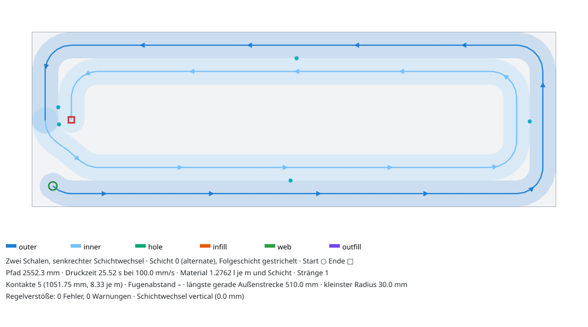

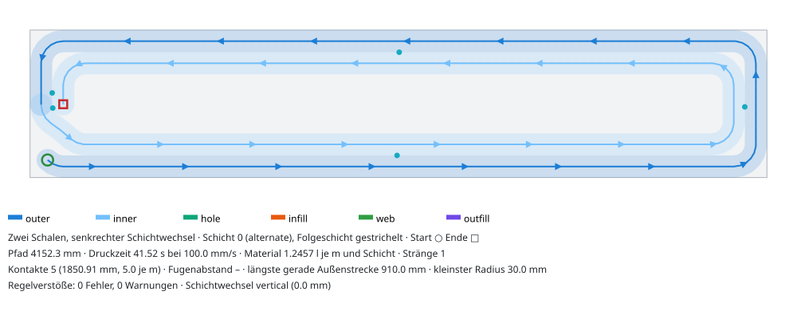

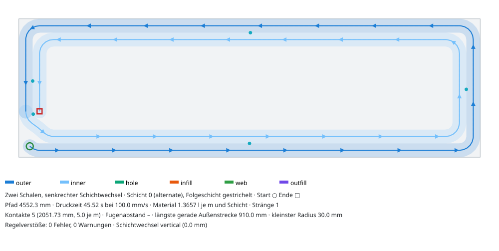

Kennzahlen (Schicht 0):

| Kennzahl | 600x200 | 1000x200 | 1000x300 | 1000x365 |
|---|---|---|---|---|
| Status (M1–M7) | ok | ok | ok | ok |
| Pfadlänge je Schicht | 2552 mm | 4152 mm | 4552 mm | 4812 mm |
| Druckzeit je Schicht (100 mm/s) | 25,5 s | 41,5 s | 45,5 s | 48,1 s |
| Material je m, relativ zu „schalen“ | 1,00 | 1,00 | 1,00 | 1,00 |
| Kontaktzonen je m | 8,3 | 5,0 | 5,0 | 5,0 |
| Größte Zellspannweite | 509 mm | 909 mm | 909 mm | 909 mm |
| Längste gerade ungestützte Außenstrecke | 510 mm | 910 mm | 910 mm | 910 mm |
| Fugenabstand | – | – | – | – |
| Kleinster Krümmungsradius | 30,0 mm | 30,0 mm | 30,0 mm | 30,0 mm |
| Verstöße (Fehler / Warnungen) | 0 / 0 | 0 / 0 | 0 / 0 | 0 / 0 |
| Schalenabdeckung | 94,4 % | 96,5 % | 96,8 % | 97,0 % |
| Stränge je Schicht | 1 | 1 | 1 | 1 |

Roboter (aus `verify_muster`):

| Szenario | machbar | d_min mm | Stränge/Schicht | senkrechte Wechsel | Druckzeit s | Planerlaufzeit s |
|---|---|---|---|---|---|---|
| S4_muster_schalen_alternate | ja | 10,83 | 1 | 100 % | 1031,70 | 88,17 |

**Vorteile**

- Regelkonform (keine M1–M7-Fehler) auf 600x200, 1000x200, 1000x300, 1000x365.
- Material 1,00- bis 1,00-fach gegenüber „schalen“.
- Viele Kontaktzonen (bis 8,3 je m) verzahnen Schalen und Füllung.
- Ein Strang je Schicht und Insel (M1).

**Nachteile**

- Große Zellen (Spannweite bis 909 mm).
- Auf 600x200 verläuft die Außenhaut ungegliedert gerade (510 mm): Rissgefahr beim Trocknen.

Kurzdoku: [topologie.md](topologie.md)

Kurzdoku: [mehrfach.md](mehrfach.md)

### aussenwelle

*Gewellte Außenschale (O1)*  
Preset: `core/src/roboprint/patterns/presets/aussenwelle.json`

O1: eine Schale je Seite, die langen Außenseiten als Sinuswelle nach innen (A = 8 mm, λ = 150 mm, bündig mit der IFC-Fläche); Stoßflächen gerade, Ecken gerundet.

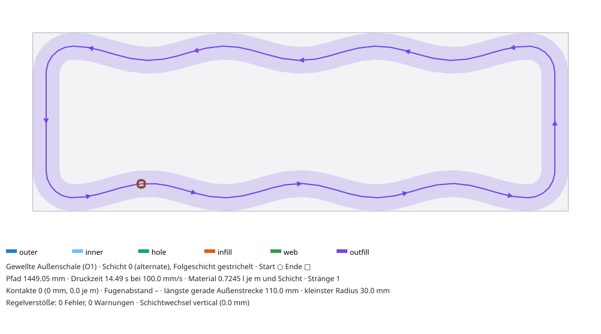

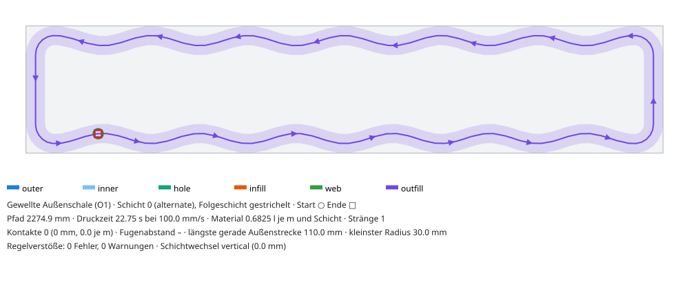

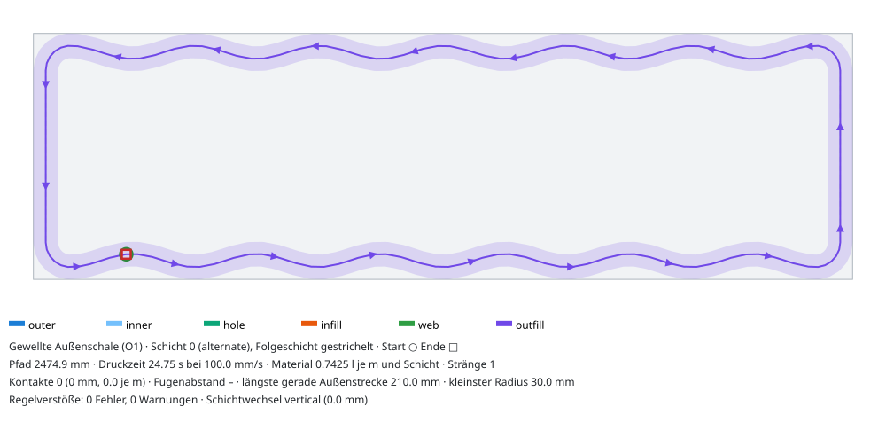

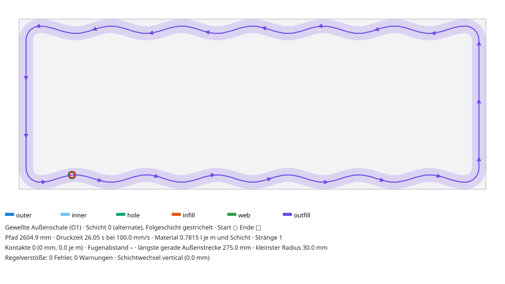

Kennzahlen (Schicht 0):

| Kennzahl | 600x200 | 1000x200 | 1000x300 | 1000x365 |
|---|---|---|---|---|
| Status (M1–M7) | ok | ok | ok | ok |
| Pfadlänge je Schicht | 1449 mm | 2275 mm | 2475 mm | 2605 mm |
| Druckzeit je Schicht (100 mm/s) | 14,5 s | 22,8 s | 24,8 s | 26,1 s |
| Material je m, relativ zu „schalen“ | 0,57 | 0,55 | 0,54 | 0,54 |
| Kontaktzonen je m | 0,0 | 0,0 | 0,0 | 0,0 |
| Größte Zellspannweite | 600 mm | 1000 mm | 1000 mm | 1000 mm |
| Längste gerade ungestützte Außenstrecke | 110 mm | 110 mm | 210 mm | 275 mm |
| Fugenabstand | – | – | – | – |
| Kleinster Krümmungsradius | 30,0 mm | 30,0 mm | 30,0 mm | 30,0 mm |
| Verstöße (Fehler / Warnungen) | 0 / 0 | 0 / 0 | 0 / 0 | 0 / 0 |
| Schalenabdeckung | 78,3 % | 77,1 % | 79,0 % | 80,0 % |
| Stränge je Schicht | 1 | 1 | 1 | 1 |

Roboter (aus `verify_muster`):

| Szenario | machbar | d_min mm | Stränge/Schicht | senkrechte Wechsel | Druckzeit s | Planerlaufzeit s |
|---|---|---|---|---|---|---|
| S4_muster_aussenwelle | ja | 10,83 | 1 | 100 % | 590,30 | 36,73 |

**Vorteile**

- Regelkonform (keine M1–M7-Fehler) auf 600x200, 1000x200, 1000x300, 1000x365.
- Material 0,54- bis 0,57-fach gegenüber „schalen“.
- Ein Strang je Schicht und Insel (M1).

**Nachteile**

- Keine Kontaktzonen: Schalen und Füllung sind nur über den Strang verbunden.
- Große Zellen (Spannweite bis 1000 mm).

Kurzdoku: [aussenwelle.md](aussenwelle.md)

### aussenwelle_zickzack

*Gewellte Außenschale, Zickzack (O1)*  
Preset: `docs/muster/presets/aussenwelle_zickzack.json`

O1 als gerundetes Zickzack (Scheitelradius 60 mm), eine Schale je Seite.

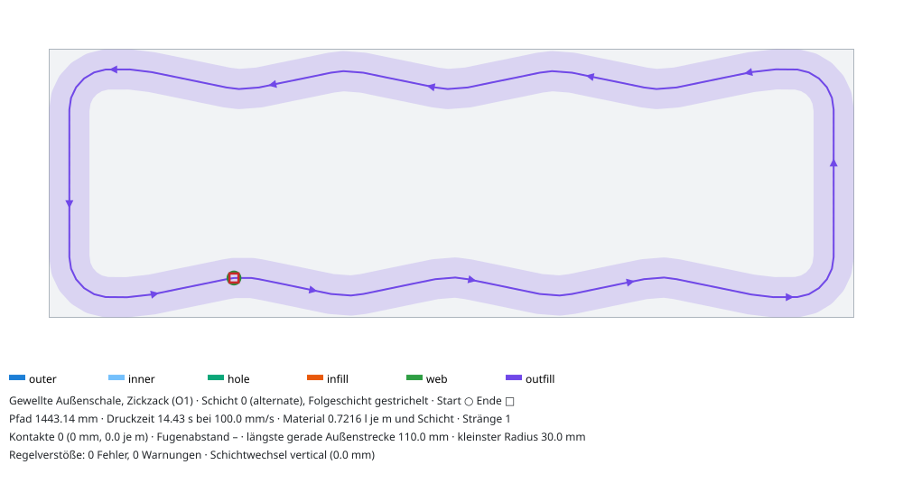

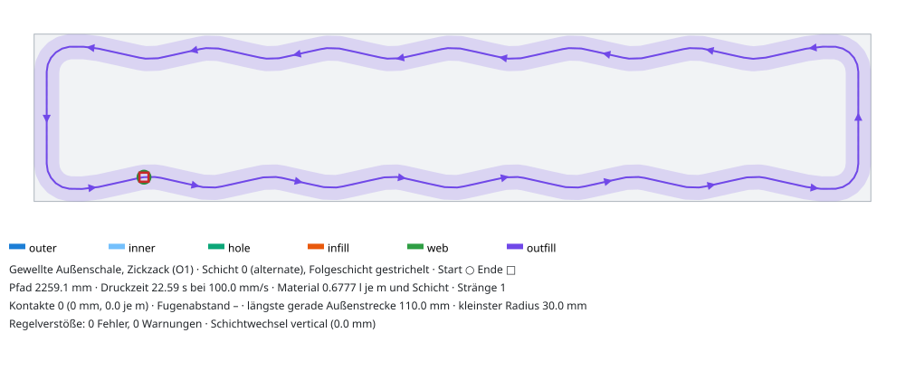

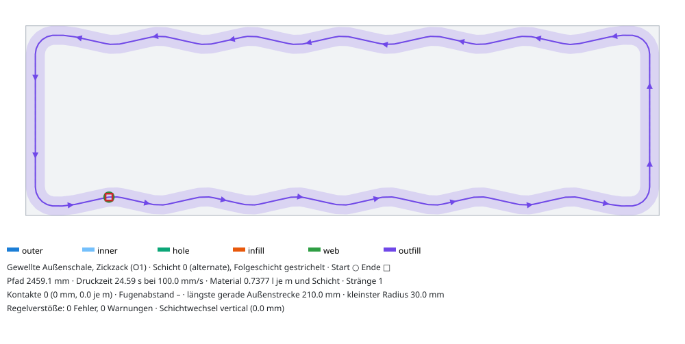

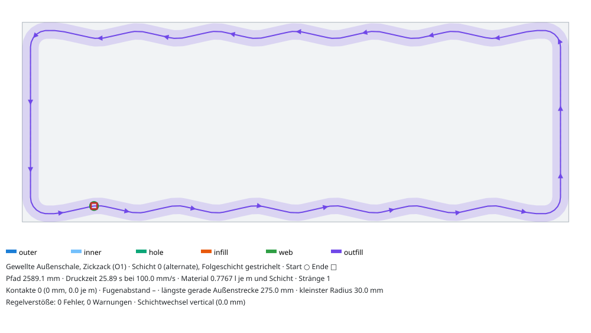

Kennzahlen (Schicht 0):

| Kennzahl | 600x200 | 1000x200 | 1000x300 | 1000x365 |
|---|---|---|---|---|
| Status (M1–M7) | ok | ok | ok | ok |
| Pfadlänge je Schicht | 1443 mm | 2259 mm | 2459 mm | 2589 mm |
| Druckzeit je Schicht (100 mm/s) | 14,4 s | 22,6 s | 24,6 s | 25,9 s |
| Material je m, relativ zu „schalen“ | 0,57 | 0,54 | 0,54 | 0,54 |
| Kontaktzonen je m | 0,0 | 0,0 | 0,0 | 0,0 |
| Größte Zellspannweite | 600 mm | 1000 mm | 1000 mm | 1000 mm |
| Längste gerade ungestützte Außenstrecke | 110 mm | 110 mm | 210 mm | 275 mm |
| Fugenabstand | – | – | – | – |
| Kleinster Krümmungsradius | 30,0 mm | 30,0 mm | 30,0 mm | 30,0 mm |
| Verstöße (Fehler / Warnungen) | 0 / 0 | 0 / 0 | 0 / 0 | 0 / 0 |
| Schalenabdeckung | 79,6 % | 77,8 % | 79,6 % | 80,6 % |
| Stränge je Schicht | 1 | 1 | 1 | 1 |

Roboter (aus `verify_muster`):

machbar offen, d_min offen, Stränge je Schicht offen, senkrechte Schichtwechsel offen, Druckzeit offen, Planerlaufzeit offen.

**Vorteile**

- Regelkonform (keine M1–M7-Fehler) auf 600x200, 1000x200, 1000x300, 1000x365.
- Material 0,54- bis 0,57-fach gegenüber „schalen“.
- Ein Strang je Schicht und Insel (M1).

**Nachteile**

- Keine Kontaktzonen: Schalen und Füllung sind nur über den Strang verbunden.
- Große Zellen (Spannweite bis 1000 mm).

Kurzdoku: [aussenwelle.md](aussenwelle.md)

### aussenwelle_zwei_schalen

*Gewellte Außenschale, zwei Schalen (O1)*  
Preset: `docs/muster/presets/aussenwelle_zwei_schalen.json`

O1 mit zwei Schalen: Die Amplitude wird auf 2 mm gekappt (Wellentäler berühren Schale 1 mit 26 mm Mittellinienabstand).

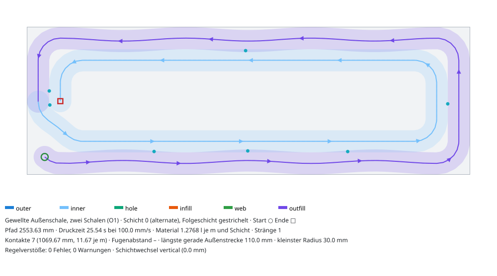

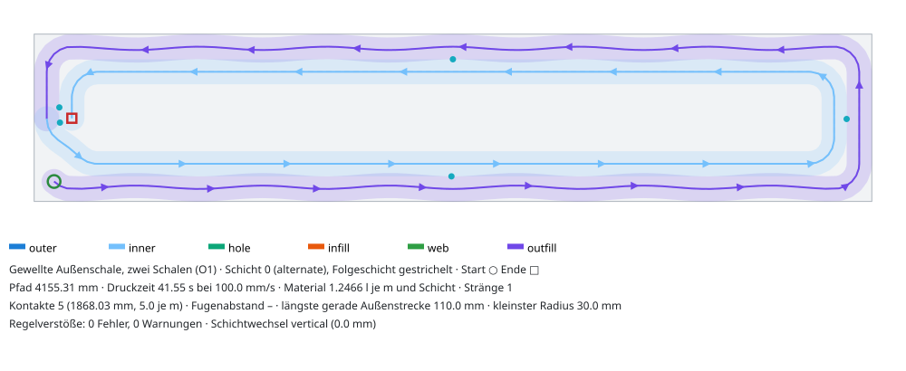

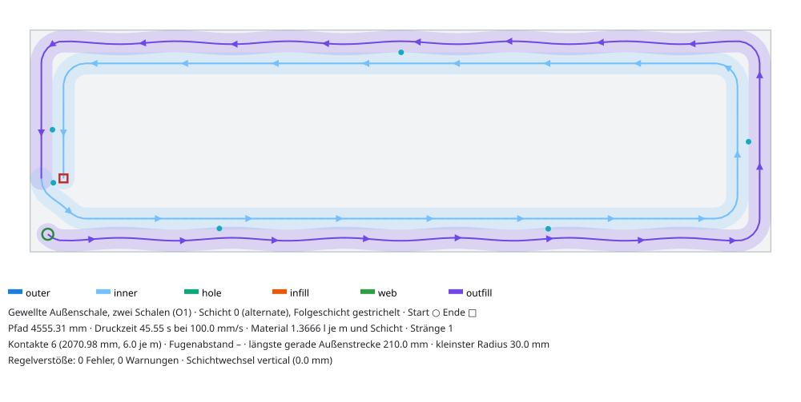

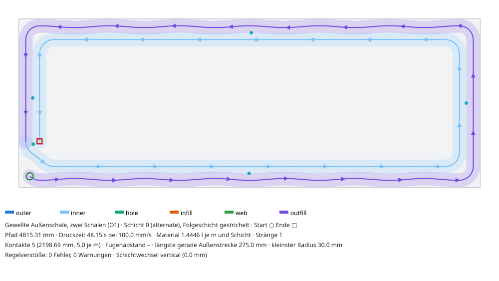

Kennzahlen (Schicht 0):

| Kennzahl | 600x200 | 1000x200 | 1000x300 | 1000x365 |
|---|---|---|---|---|
| Status (M1–M7) | ok | ok | ok | ok |
| Pfadlänge je Schicht | 2554 mm | 4155 mm | 4555 mm | 4815 mm |
| Druckzeit je Schicht (100 mm/s) | 25,5 s | 41,5 s | 45,5 s | 48,1 s |
| Material je m, relativ zu „schalen“ | 1,00 | 1,00 | 1,00 | 1,00 |
| Kontaktzonen je m | 11,7 | 5,0 | 6,0 | 5,0 |
| Größte Zellspannweite | 600 mm | 1000 mm | 1000 mm | 1000 mm |
| Längste gerade ungestützte Außenstrecke | 110 mm | 110 mm | 210 mm | 275 mm |
| Fugenabstand | – | – | – | – |
| Kleinster Krümmungsradius | 30,0 mm | 30,0 mm | 30,0 mm | 30,0 mm |
| Verstöße (Fehler / Warnungen) | 0 / 0 | 0 / 0 | 0 / 0 | 0 / 0 |
| Schalenabdeckung | 92,0 % | 93,7 % | 94,3 % | 94,6 % |
| Stränge je Schicht | 1 | 1 | 1 | 1 |

Roboter (aus `verify_muster`):

machbar offen, d_min offen, Stränge je Schicht offen, senkrechte Schichtwechsel offen, Druckzeit offen, Planerlaufzeit offen.

**Vorteile**

- Regelkonform (keine M1–M7-Fehler) auf 600x200, 1000x200, 1000x300, 1000x365.
- Material 1,00- bis 1,00-fach gegenüber „schalen“.
- Viele Kontaktzonen (bis 11,7 je m) verzahnen Schalen und Füllung.
- Ein Strang je Schicht und Insel (M1).

**Nachteile**

- Große Zellen (Spannweite bis 1000 mm).

Kurzdoku: [aussenwelle.md](aussenwelle.md)

### doppelwelle

*Doppelwelle (Kettenglied)*  
Preset: `core/src/roboprint/patterns/presets/doppelwelle.json`

Zwei gegenphasige Sinuswellen, die sich in der Bandmitte berühren; hin, Wende, zurück als ein Strang. Für Wände ≥ 300 mm oder eine Schale je Seite.

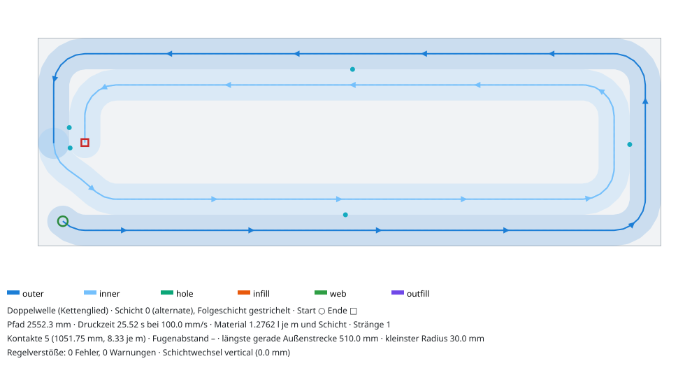

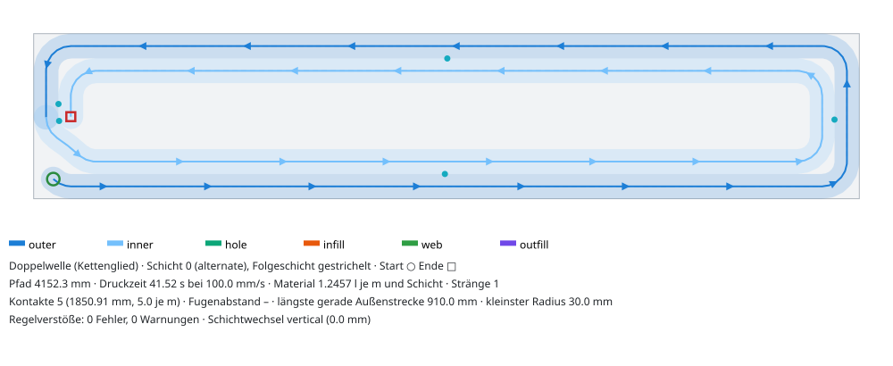

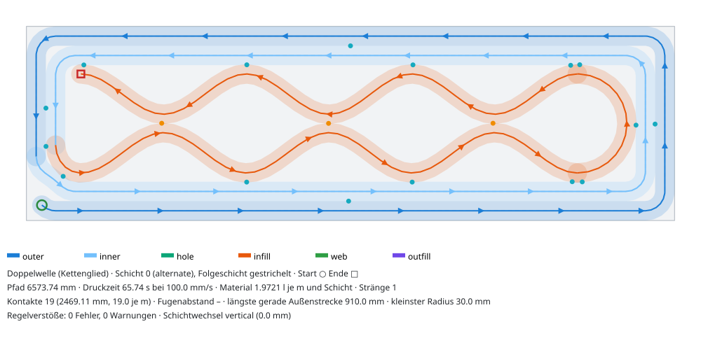

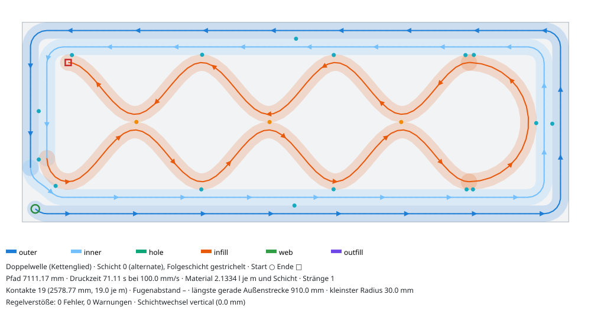

Kennzahlen (Schicht 0):

| Kennzahl | 600x200 | 1000x200 | 1000x300 | 1000x365 |
|---|---|---|---|---|
| Status (M1–M7) | ok | ok | ok | ok |
| Pfadlänge je Schicht | 2552 mm | 4152 mm | 6574 mm | 7111 mm |
| Druckzeit je Schicht (100 mm/s) | 25,5 s | 41,5 s | 65,7 s | 71,1 s |
| Material je m, relativ zu „schalen“ | 1,00 | 1,00 | 1,44 | 1,48 |
| Kontaktzonen je m | 8,3 | 5,0 | 19,0 | 19,0 |
| Größte Zellspannweite | 509 mm | 909 mm | 231 mm | 223 mm |
| Längste gerade ungestützte Außenstrecke | 510 mm | 910 mm | 910 mm | 910 mm |
| Fugenabstand | – | – | – | – |
| Kleinster Krümmungsradius | 30,0 mm | 30,0 mm | 30,0 mm | 30,0 mm |
| Verstöße (Fehler / Warnungen) | 0 / 0 | 0 / 0 | 0 / 0 | 0 / 0 |
| Schalenabdeckung | 94,4 % | 96,5 % | 96,9 % | 97,1 % |
| Stränge je Schicht | 1 | 1 | 1 | 1 |

Roboter (aus `verify_muster`):

| Szenario | machbar | d_min mm | Stränge/Schicht | senkrechte Wechsel | Druckzeit s | Planerlaufzeit s |
|---|---|---|---|---|---|---|
| S4_muster_doppelwelle_300 | ja | 10,83 | 1 | 100 % | 1618,90 | 81,62 |

**Vorteile**

- Regelkonform (keine M1–M7-Fehler) auf 600x200, 1000x200, 1000x300, 1000x365.
- Viele Kontaktzonen (bis 19,0 je m) verzahnen Schalen und Füllung.
- Ein Strang je Schicht und Insel (M1).

**Nachteile**

- Material 1,00- bis 1,48-fach gegenüber „schalen“.
- Große Zellen (Spannweite bis 909 mm).
- Auf 600x200 verläuft die Außenhaut ungegliedert gerade (510 mm): Rissgefahr beim Trocknen.

Kurzdoku: [mehrfach.md](mehrfach.md)

Testdruck: [testdrucke/doppelwelle_300](testdrucke/doppelwelle_300/README.md)

### fermat

*Fermat-Spirale (Pfeiler)*  
Preset: `core/src/roboprint/patterns/presets/fermat.json`

Connected Fermat Spiral für kleine Inseln (Pfeiler 300 × 200): einwärts auf Ring 0 und 2, Kehre, auswärts auf Ring 1; Start und Ende am Rand nebeneinander.

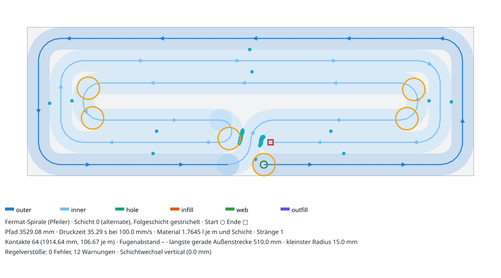

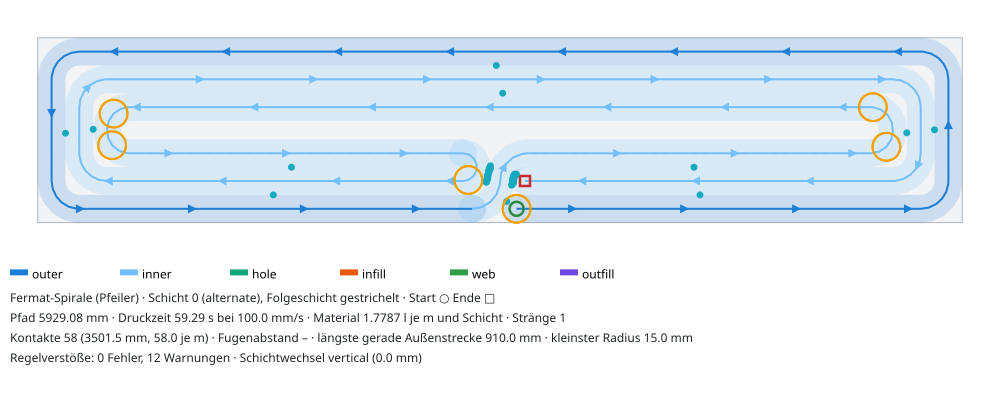

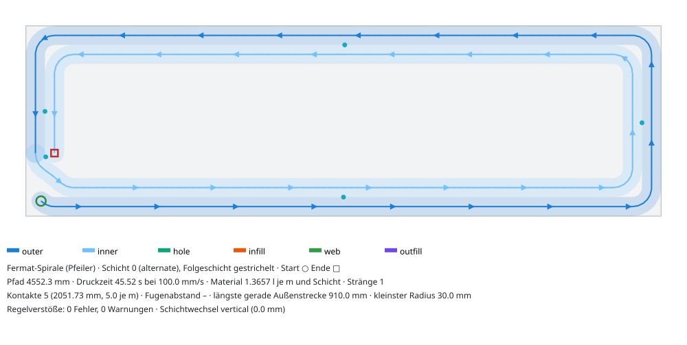

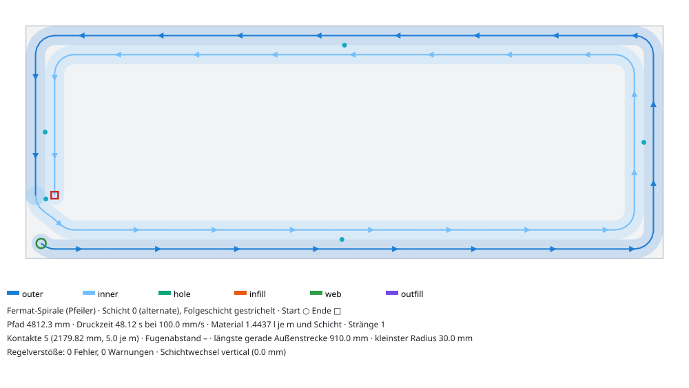

Kennzahlen (Schicht 0):

| Kennzahl | 600x200 | 1000x200 | 1000x300 | 1000x365 |
|---|---|---|---|---|
| Status (M1–M7) | ok, 12 Warn. | ok, 12 Warn. | ok | ok |
| Pfadlänge je Schicht | 3529 mm | 5929 mm | 4552 mm | 4812 mm |
| Druckzeit je Schicht (100 mm/s) | 35,3 s | 59,3 s | 45,5 s | 48,1 s |
| Material je m, relativ zu „schalen“ | 1,38 | 1,43 | 1,00 | 1,00 |
| Kontaktzonen je m | 106,7 | 58,0 | 5,0 | 5,0 |
| Größte Zellspannweite | 420 mm | 820 mm | 909 mm | 909 mm |
| Längste gerade ungestützte Außenstrecke | 510 mm | 910 mm | 910 mm | 910 mm |
| Fugenabstand | – | – | – | – |
| Kleinster Krümmungsradius | 15,0 mm | 15,0 mm | 30,0 mm | 30,0 mm |
| Verstöße (Fehler / Warnungen) | 0 / 12 (M4, M6) | 0 / 12 (M4, M6) | 0 / 0 | 0 / 0 |
| Schalenabdeckung | 95,5 % | 97,2 % | 96,8 % | 97,0 % |
| Stränge je Schicht | 1 | 1 | 1 | 1 |

Roboter (aus `verify_muster`):

| Szenario | machbar | d_min mm | Stränge/Schicht | senkrechte Wechsel | Druckzeit s | Planerlaufzeit s |
|---|---|---|---|---|---|---|
| S4_muster_fermat | ja | 10,83 | 1 | 100 % | 1422,70 | 64,57 |

**Vorteile**

- Regelkonform (keine M1–M7-Fehler) auf 600x200, 1000x200, 1000x300, 1000x365.
- Viele Kontaktzonen (bis 106,7 je m) verzahnen Schalen und Füllung.
- Ein Strang je Schicht und Insel (M1).

**Nachteile**

- Material 1,00- bis 1,43-fach gegenüber „schalen“.
- Große Zellen (Spannweite bis 909 mm).
- Kleinster Radius 15,0 mm liegt unter der Strangbreite (M6-Warnung).
- Auf 600x200 verläuft die Außenhaut ungegliedert gerade (510 mm): Rissgefahr beim Trocknen.

Kurzdoku: [mehrfach.md](mehrfach.md)

Testdruck: [testdrucke/fermat](testdrucke/fermat/README.md)

### fugenwand

*Fugenwand (Rautenkette)*  
Preset: `core/src/roboprint/patterns/presets/fugenwand.json`

Empfehlung: An jeder Fuge eine Raute, Rauten berühren sich an Knoten in der Wandmitte, Rautenspitze stützt das Feld der Gegenseite; Fugen der Rückseite um F/2 versetzt.

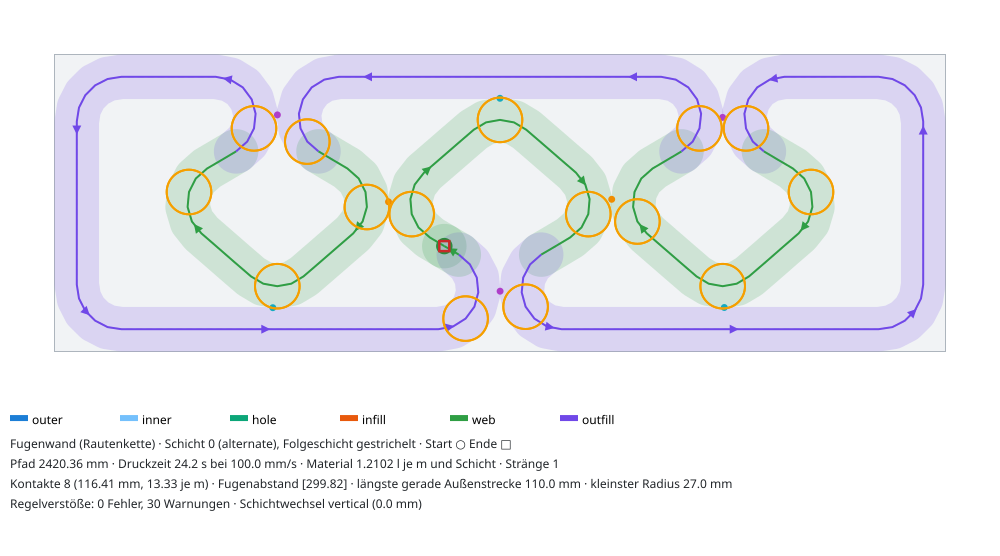

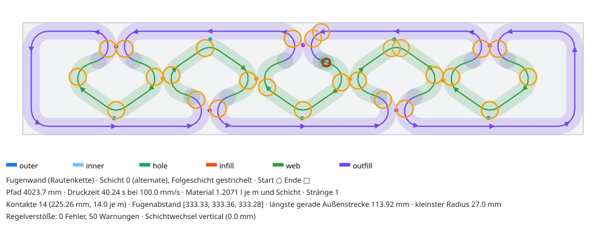

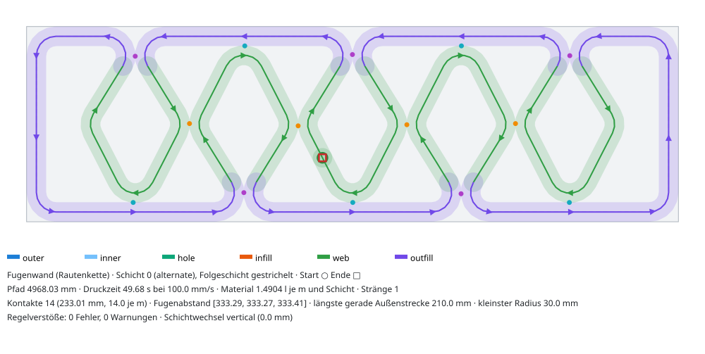

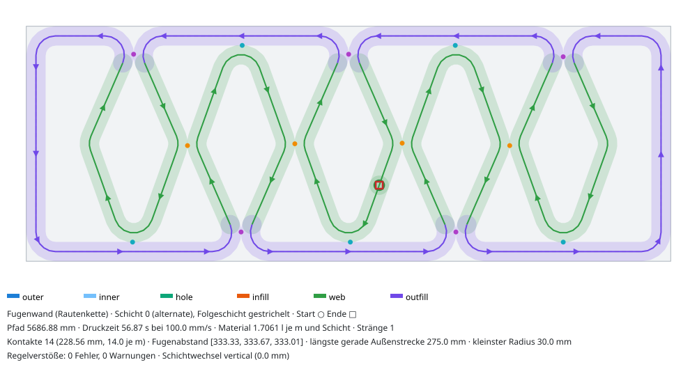

Kennzahlen (Schicht 0):

| Kennzahl | 600x200 | 1000x200 | 1000x300 | 1000x365 |
|---|---|---|---|---|
| Status (M1–M7) | ok, 30 Warn. | ok, 50 Warn. | ok | ok |
| Pfadlänge je Schicht | 2420 mm | 4024 mm | 4968 mm | 5687 mm |
| Druckzeit je Schicht (100 mm/s) | 24,2 s | 40,2 s | 49,7 s | 56,9 s |
| Material je m, relativ zu „schalen“ | 0,95 | 0,97 | 1,09 | 1,18 |
| Kontaktzonen je m | 13,3 | 14,0 | 14,0 | 14,0 |
| Größte Zellspannweite | 140 mm | 140 mm | 240 mm | 305 mm |
| Längste gerade ungestützte Außenstrecke | 110 mm | 114 mm | 210 mm | 275 mm |
| Fugenabstand | 300 mm | 333, 333, 333 mm | 333, 333, 333 mm | 333, 334, 333 mm |
| Kleinster Krümmungsradius | 27,0 mm | 27,0 mm | 30,0 mm | 30,0 mm |
| Verstöße (Fehler / Warnungen) | 0 / 30 (M6) | 0 / 50 (M6) | 0 / 0 | 0 / 0 |
| Schalenabdeckung | 64,6 % | 65,0 % | 62,0 % | 61,3 % |
| Stränge je Schicht | 1 | 1 | 1 | 1 |

Roboter (aus `verify_muster`):

machbar offen, d_min offen, Stränge je Schicht offen, senkrechte Schichtwechsel offen, Druckzeit offen, Planerlaufzeit offen.

**Vorteile**

- Regelkonform (keine M1–M7-Fehler) auf 600x200, 1000x200, 1000x300, 1000x365.
- Viele Kontaktzonen (bis 14,0 je m) verzahnen Schalen und Füllung.
- Ein Strang je Schicht und Insel (M1).

**Nachteile**

- Material 0,95- bis 1,18-fach gegenüber „schalen“.
- Kleinster Radius 27,0 mm liegt unter der Strangbreite (M6-Warnung).

Kurzdoku: [fugenwand.md](fugenwand.md)

Einschätzung der Kurzdoku:

> 1. **Standard: Rautenkette (b), F = 300 mm, r = w.** Sie verbraucht am wenigsten Material
>    (600 × 200: 1,21 l/(m·Schicht), weniger als zwei Schalen mit 1,28) und hat die kürzeste Druckzeit.
>    Jede Fuge beider Seiten ist echt. Das Feld der Gegenseite wird in der Mitte gestützt. Sie sieht
>    aus wie das Foto: Raute über der Fuge, Dreieck über dem Feld, Knoten berühren sich. Ab 300 mm
>    Dicke gibt es keine Warnung, bei 200 mm r = 27 mm (M6-Warnung, Ziel knapp verfehlt).
> 2. **Gurt (a, c)** nur bei Wänden ≥ 365 mm oder mit r ≈ 20 mm (Preset `foto`). Er ist steifer
>    (Doppelgurt, viele Kontakte), braucht aber mehr Material als die Rautenkette (600 × 200: +47 %, 1000 × 300: +26 %, 1200 × 365: +6 %). In
>    200–300 mm Wänden wird er bei r = w zum Mäander. Gespiegelt (a) gibt eine durchgehende
>    Sollbruchebene durch die Wand, versetzt (c) verteilt die Fugen.
> 3. **Fugenabstand:** 300 mm, wie in der Recherche (160–300 mm, Fugenöffnung ≤ 3 mm bei 1 %
>    Schwinden). Sie belegt aber keinen Wert für gedruckten Lehm. Das ist eine Weiche für den Testdruck.

### fugenwand_foto

*Fugenwand mit Gurt wie Foto (a, Haken r = 20 mm)*  
Preset: `docs/muster/presets/fugenwand_foto.json`

Variante (a) mit engeren Haken (r = 20 mm < w: M6-Warnung, kein Fehler), damit die Stege bei 300 mm Wand schräg (V-förmig, 14–31°) laufen wie auf dem Foto. Bei 200 mm Wand bleibt auch dieses Preset ein Mäander (Stegwinkel ≈ 3°).

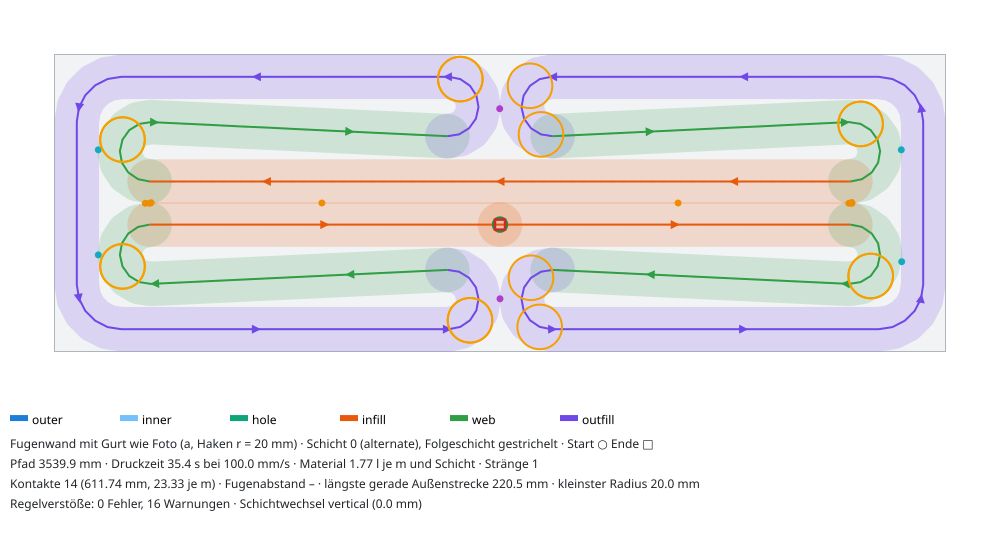

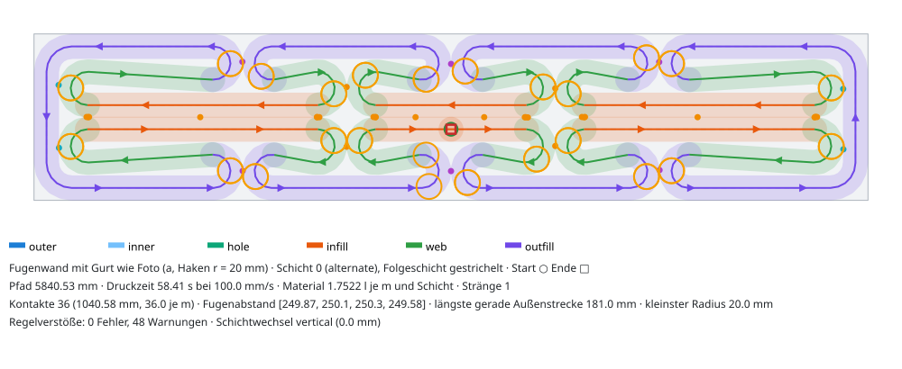

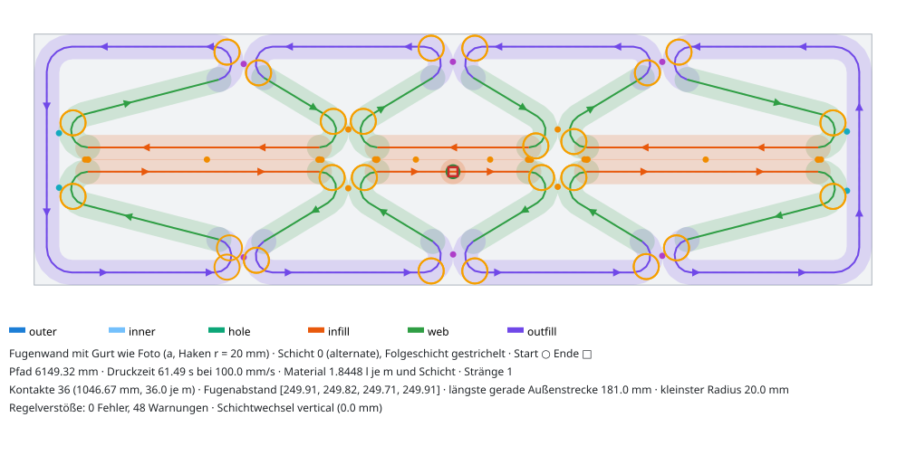

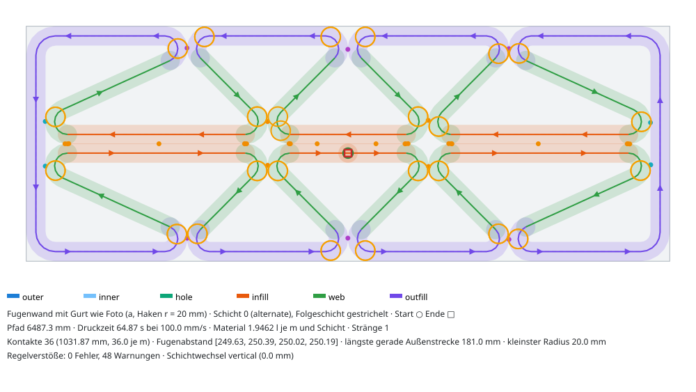

Kennzahlen (Schicht 0):

| Kennzahl | 600x200 | 1000x200 | 1000x300 | 1000x365 |
|---|---|---|---|---|
| Status (M1–M7) | ok, 16 Warn. | ok, 48 Warn. | ok, 48 Warn. | ok, 48 Warn. |
| Pfadlänge je Schicht | 3540 mm | 5841 mm | 6149 mm | 6487 mm |
| Druckzeit je Schicht (100 mm/s) | 35,4 s | 58,4 s | 61,5 s | 64,9 s |
| Material je m, relativ zu „schalen“ | 1,39 | 1,41 | 1,35 | 1,35 |
| Kontaktzonen je m | 23,3 | 36,0 | 36,0 | 36,0 |
| Größte Zellspannweite | 481 mm | 286 mm | 286 mm | 286 mm |
| Längste gerade ungestützte Außenstrecke | 220 mm | 181 mm | 181 mm | 181 mm |
| Fugenabstand | – | 250, 250, 250, 250 mm | 250, 250, 250, 250 mm | 250, 250, 250, 250 mm |
| Kleinster Krümmungsradius | 20,0 mm | 20,0 mm | 20,0 mm | 20,0 mm |
| Verstöße (Fehler / Warnungen) | 0 / 16 (M6) | 0 / 48 (M6) | 0 / 48 (M6) | 0 / 48 (M6) |
| Schalenabdeckung | 88,7 % | 87,9 % | 65,5 % | 63,0 % |
| Stränge je Schicht | 1 | 1 | 1 | 1 |

Roboter (aus `verify_muster`):

machbar offen, d_min offen, Stränge je Schicht offen, senkrechte Schichtwechsel offen, Druckzeit offen, Planerlaufzeit offen.

**Vorteile**

- Regelkonform (keine M1–M7-Fehler) auf 600x200, 1000x200, 1000x300, 1000x365.
- Viele Kontaktzonen (bis 36,0 je m) verzahnen Schalen und Füllung.
- Ein Strang je Schicht und Insel (M1).

**Nachteile**

- Material 1,35- bis 1,41-fach gegenüber „schalen“.
- Große Zellen (Spannweite bis 481 mm).
- Kleinster Radius 20,0 mm liegt unter der Strangbreite (M6-Warnung).

Kurzdoku: [fugenwand.md](fugenwand.md)

### fugenwand_gurt

*Fugenwand mit Gurt, gespiegelt (a)*  
Preset: `docs/muster/presets/fugenwand_gurt.json`

Vorschlag des Nutzers: je Fuge Schleife Haken – Steg – Knoten – Gurt – Knoten – Steg – Haken; Doppelgurt in Wandmitte, Fugen beider Seiten gegenüber (durchgehende Sollbruchebene).

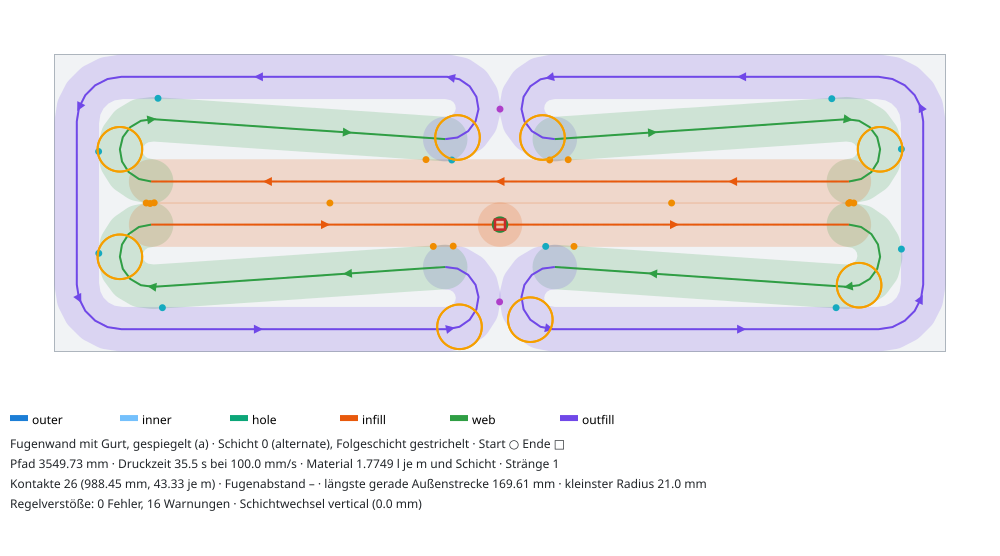

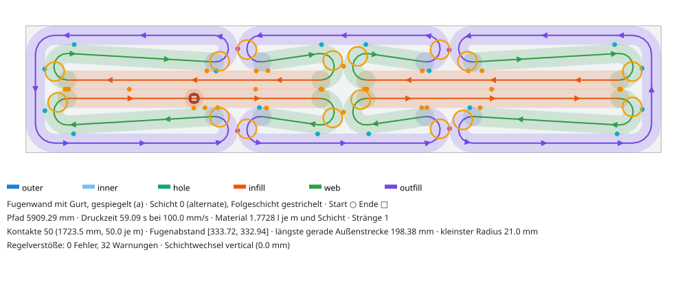

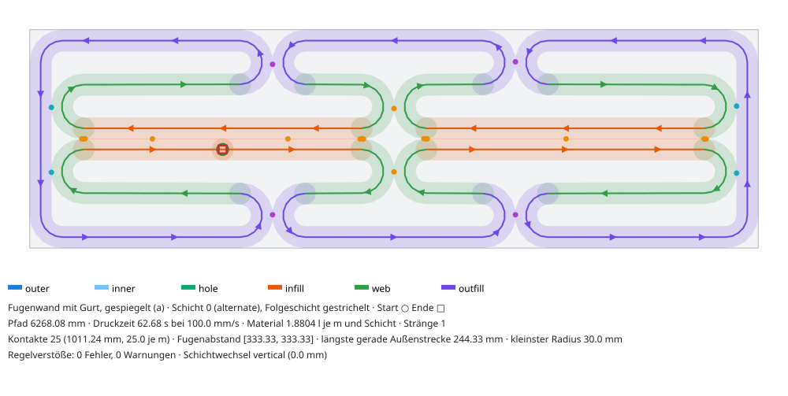

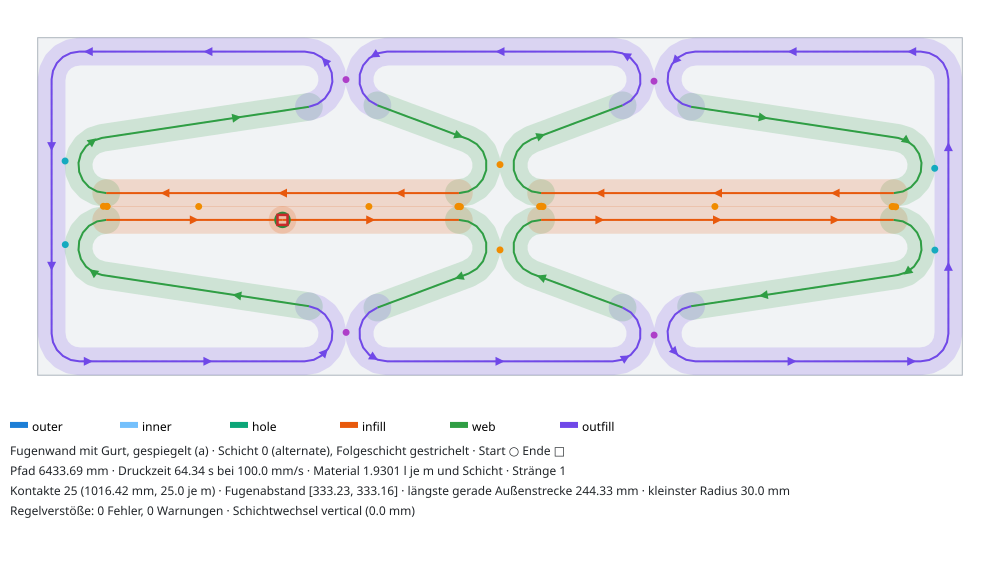

Kennzahlen (Schicht 0):

| Kennzahl | 600x200 | 1000x200 | 1000x300 | 1000x365 |
|---|---|---|---|---|
| Status (M1–M7) | ok, 16 Warn. | ok, 32 Warn. | ok | ok |
| Pfadlänge je Schicht | 3550 mm | 5909 mm | 6268 mm | 6434 mm |
| Druckzeit je Schicht (100 mm/s) | 35,5 s | 59,1 s | 62,7 s | 64,3 s |
| Material je m, relativ zu „schalen“ | 1,39 | 1,42 | 1,38 | 1,34 |
| Kontaktzonen je m | 43,3 | 50,0 | 25,0 | 25,0 |
| Größte Zellspannweite | 182 mm | 212 mm | 411 mm | 411 mm |
| Längste gerade ungestützte Außenstrecke | 170 mm | 198 mm | 244 mm | 244 mm |
| Fugenabstand | – | 334, 333 mm | 333, 333 mm | 333, 333 mm |
| Kleinster Krümmungsradius | 21,0 mm | 21,0 mm | 30,0 mm | 30,0 mm |
| Verstöße (Fehler / Warnungen) | 0 / 16 (M6) | 0 / 32 (M6) | 0 / 0 | 0 / 0 |
| Schalenabdeckung | 88,6 % | 88,8 % | 60,0 % | 59,4 % |
| Stränge je Schicht | 1 | 1 | 1 | 1 |

Roboter (aus `verify_muster`):

| Szenario | machbar | d_min mm | Stränge/Schicht | senkrechte Wechsel | Druckzeit s | Planerlaufzeit s |
|---|---|---|---|---|---|---|
| S4_muster_fugenwand_gurt | ja | 10,83 | 1 | 100 % | 1431,00 | 90,40 |
| S4_muster_fugenwand_gurt_300 | ja | 10,83 | 1 | 100 % | 1543,00 | 75,92 |

**Vorteile**

- Regelkonform (keine M1–M7-Fehler) auf 600x200, 1000x200, 1000x300, 1000x365.
- Viele Kontaktzonen (bis 50,0 je m) verzahnen Schalen und Füllung.
- Ein Strang je Schicht und Insel (M1).

**Nachteile**

- Material 1,34- bis 1,42-fach gegenüber „schalen“.
- Große Zellen (Spannweite bis 411 mm).
- Kleinster Radius 21,0 mm liegt unter der Strangbreite (M6-Warnung).

Kurzdoku: [fugenwand.md](fugenwand.md)

Testdruck: [testdrucke/fugenwand_gurt](testdrucke/fugenwand_gurt/README.md), [testdrucke/fugenwand_gurt_300](testdrucke/fugenwand_gurt_300/README.md)

### fugenwand_raute

*Fugenwand Rautenkette (b, ohne Gurt)*  
Preset: `docs/muster/presets/fugenwand_raute.json`

Empfehlung: An jeder Fuge eine Raute, Rauten berühren sich an Knoten in der Wandmitte, Rautenspitze stützt das Feld der Gegenseite; Fugen der Rückseite um F/2 versetzt.

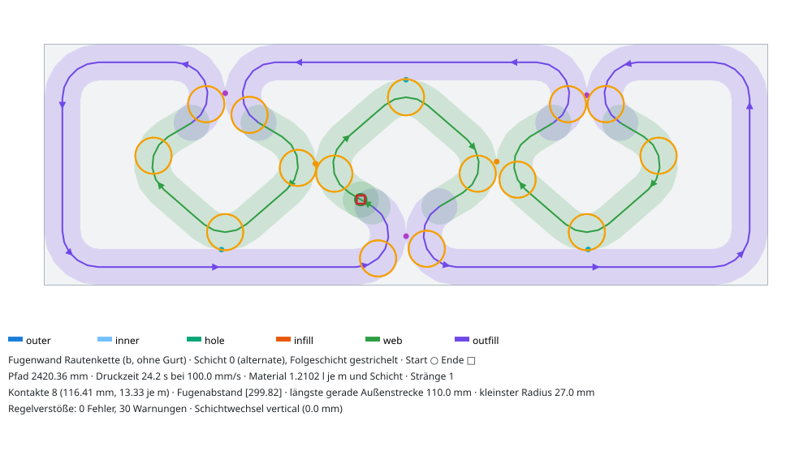

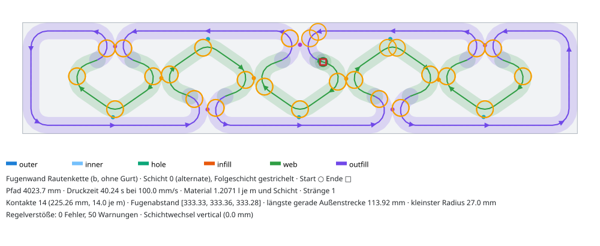

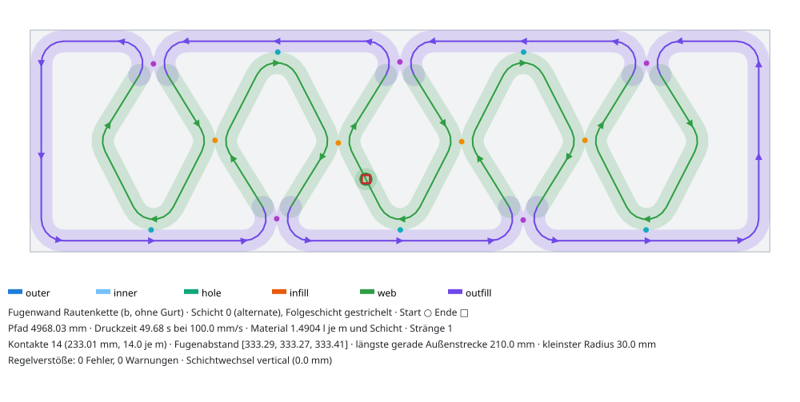

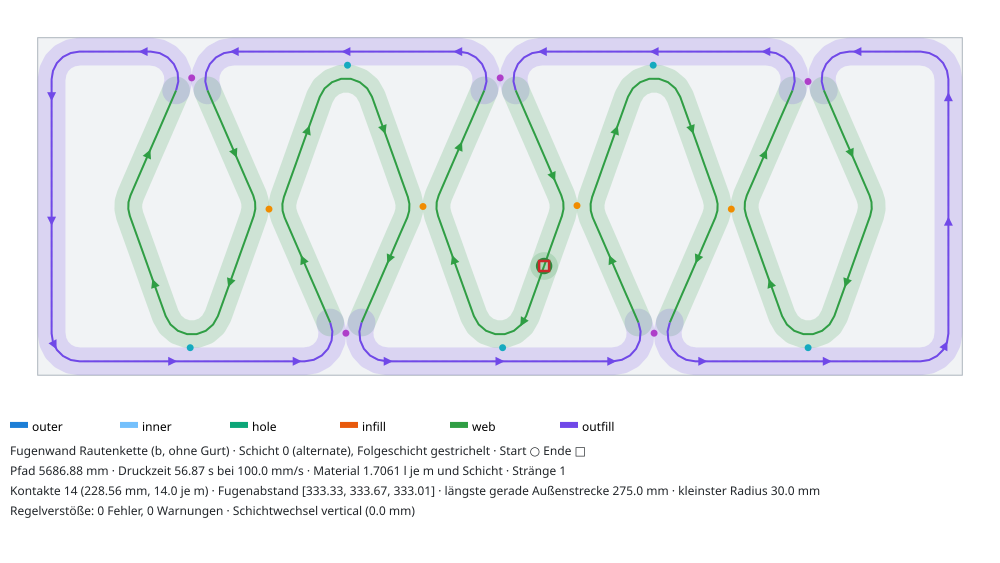

Kennzahlen (Schicht 0):

| Kennzahl | 600x200 | 1000x200 | 1000x300 | 1000x365 |
|---|---|---|---|---|
| Status (M1–M7) | ok, 30 Warn. | ok, 50 Warn. | ok | ok |
| Pfadlänge je Schicht | 2420 mm | 4024 mm | 4968 mm | 5687 mm |
| Druckzeit je Schicht (100 mm/s) | 24,2 s | 40,2 s | 49,7 s | 56,9 s |
| Material je m, relativ zu „schalen“ | 0,95 | 0,97 | 1,09 | 1,18 |
| Kontaktzonen je m | 13,3 | 14,0 | 14,0 | 14,0 |
| Größte Zellspannweite | 140 mm | 140 mm | 240 mm | 305 mm |
| Längste gerade ungestützte Außenstrecke | 110 mm | 114 mm | 210 mm | 275 mm |
| Fugenabstand | 300 mm | 333, 333, 333 mm | 333, 333, 333 mm | 333, 334, 333 mm |
| Kleinster Krümmungsradius | 27,0 mm | 27,0 mm | 30,0 mm | 30,0 mm |
| Verstöße (Fehler / Warnungen) | 0 / 30 (M6) | 0 / 50 (M6) | 0 / 0 | 0 / 0 |
| Schalenabdeckung | 64,6 % | 65,0 % | 62,0 % | 61,3 % |
| Stränge je Schicht | 1 | 1 | 1 | 1 |

Roboter (aus `verify_muster`):

| Szenario | machbar | d_min mm | Stränge/Schicht | senkrechte Wechsel | Druckzeit s | Planerlaufzeit s |
|---|---|---|---|---|---|---|
| S4_muster_fugenwand_raute | ja | 10,83 | 1 | 100 % | 979,10 | 109,77 |
| S5_muster_oeffnung_fugenwand | nein | 10,83 | 1–2 | 97 % | 946,30 | 65,43 |

**Vorteile**

- Regelkonform (keine M1–M7-Fehler) auf 600x200, 1000x200, 1000x300, 1000x365.
- Viele Kontaktzonen (bis 14,0 je m) verzahnen Schalen und Füllung.
- Ein Strang je Schicht und Insel (M1).

**Nachteile**

- Material 0,95- bis 1,18-fach gegenüber „schalen“.
- Kleinster Radius 27,0 mm liegt unter der Strangbreite (M6-Warnung).

Kurzdoku: [fugenwand.md](fugenwand.md)

Testdruck: [testdrucke/fugenwand_raute](testdrucke/fugenwand_raute/README.md)

### fugenwand_versetzt

*Fugenwand mit Gurt, versetzt (c)*  
Preset: `docs/muster/presets/fugenwand_versetzt.json`

Wie (a), Fugen der Rückseite um eine halbe Teilung versetzt; Endfeldknoten an der Endkappe.

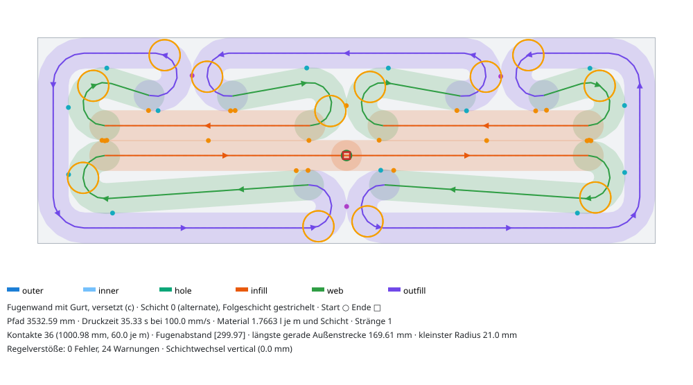

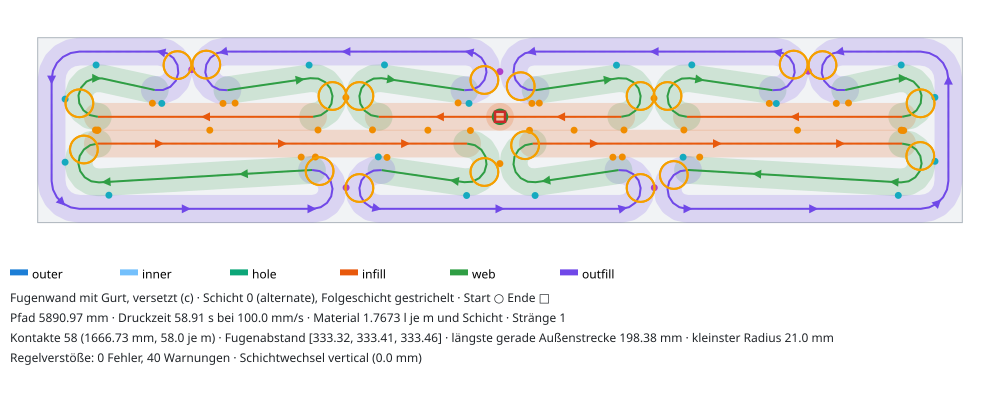

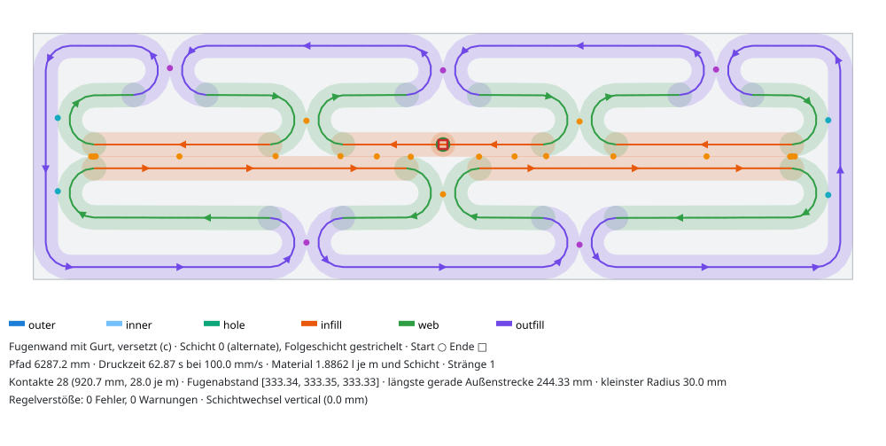

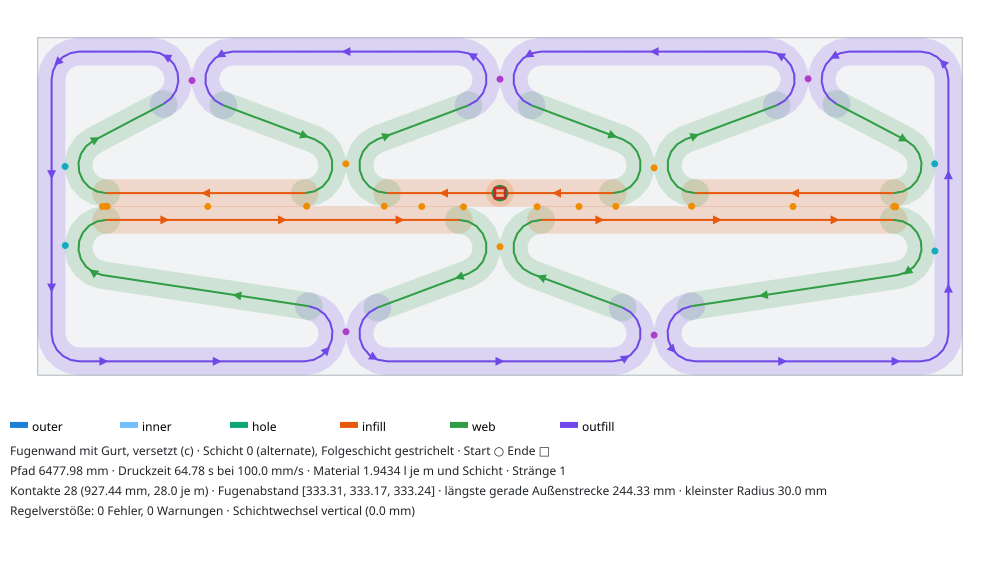

Kennzahlen (Schicht 0):

| Kennzahl | 600x200 | 1000x200 | 1000x300 | 1000x365 |
|---|---|---|---|---|
| Status (M1–M7) | ok, 24 Warn. | ok, 40 Warn. | ok | ok |
| Pfadlänge je Schicht | 3533 mm | 5891 mm | 6287 mm | 6478 mm |
| Druckzeit je Schicht (100 mm/s) | 35,3 s | 58,9 s | 62,9 s | 64,8 s |
| Material je m, relativ zu „schalen“ | 1,38 | 1,42 | 1,38 | 1,35 |
| Kontaktzonen je m | 60,0 | 58,0 | 28,0 | 28,0 |
| Größte Zellspannweite | 182 mm | 212 mm | 411 mm | 411 mm |
| Längste gerade ungestützte Außenstrecke | 170 mm | 198 mm | 244 mm | 244 mm |
| Fugenabstand | 300 mm | 333, 333, 333 mm | 333, 333, 333 mm | 333, 333, 333 mm |
| Kleinster Krümmungsradius | 21,0 mm | 21,0 mm | 30,0 mm | 30,0 mm |
| Verstöße (Fehler / Warnungen) | 0 / 24 (M6) | 0 / 40 (M6) | 0 / 0 | 0 / 0 |
| Schalenabdeckung | 88,1 % | 88,5 % | 60,8 % | 60,2 % |
| Stränge je Schicht | 1 | 1 | 1 | 1 |

Roboter (aus `verify_muster`):

| Szenario | machbar | d_min mm | Stränge/Schicht | senkrechte Wechsel | Druckzeit s | Planerlaufzeit s |
|---|---|---|---|---|---|---|
| S4_muster_fugenwand_versetzt | ja | 10,83 | 1 | 100 % | 1424,30 | 275,09 |

**Vorteile**

- Regelkonform (keine M1–M7-Fehler) auf 600x200, 1000x200, 1000x300, 1000x365.
- Viele Kontaktzonen (bis 60,0 je m) verzahnen Schalen und Füllung.
- Ein Strang je Schicht und Insel (M1).

**Nachteile**

- Material 1,35- bis 1,42-fach gegenüber „schalen“.
- Große Zellen (Spannweite bis 411 mm).
- Kleinster Radius 21,0 mm liegt unter der Strangbreite (M6-Warnung).

Kurzdoku: [fugenwand.md](fugenwand.md)

Testdruck: [testdrucke/fugenwand_versetzt](testdrucke/fugenwand_versetzt/README.md)

### maeander

*Mäander*  
Preset: `core/src/roboprint/patterns/presets/maeander.json`

Mäander mit senkrechten Flanken; im 50-mm-Band ist r ≤ 26,5 mm (M6-Warnung).

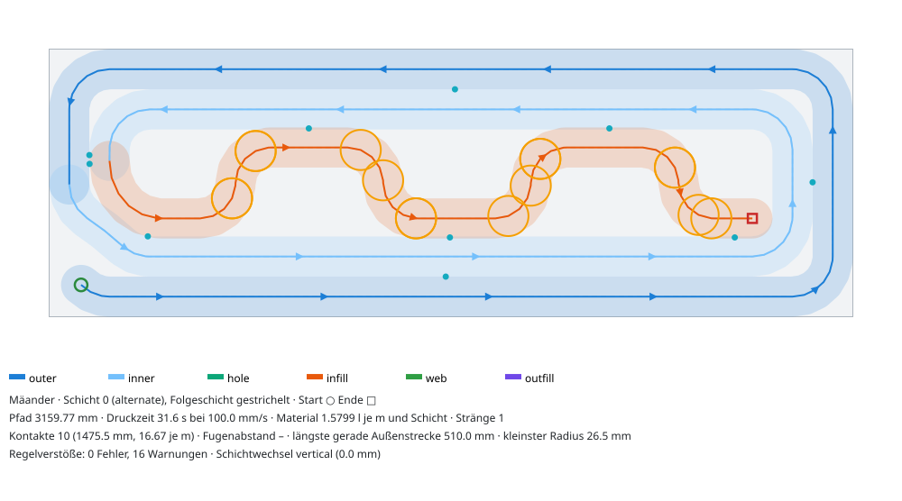

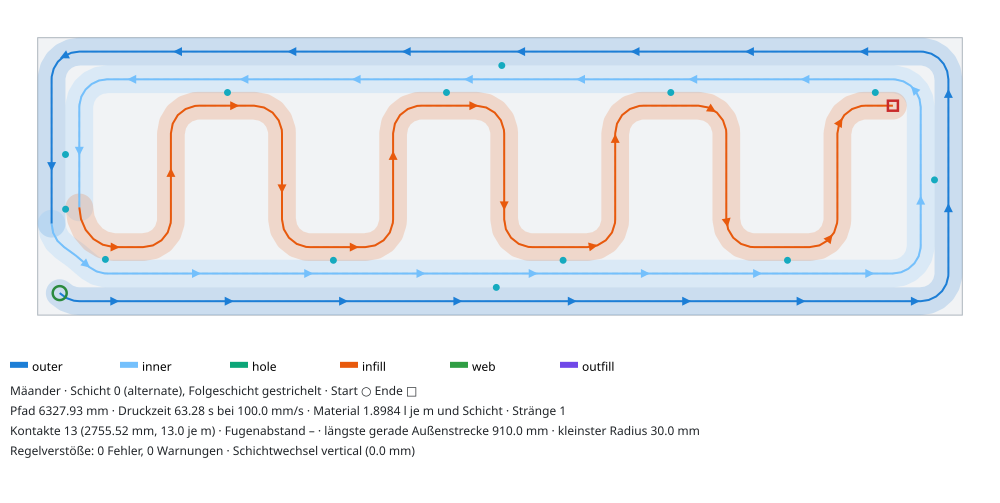

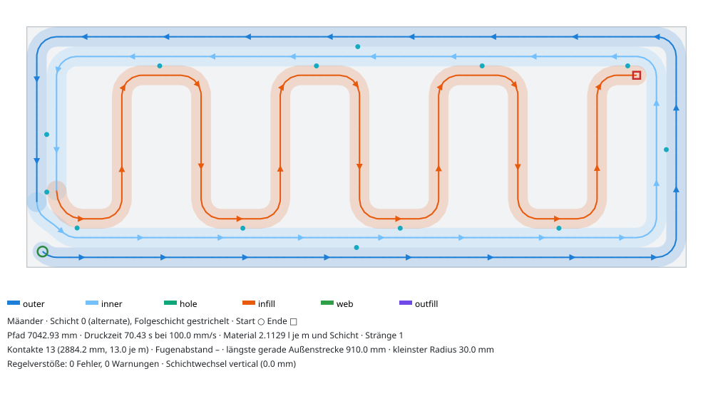

Kennzahlen (Schicht 0):

| Kennzahl | 600x200 | 1000x200 | 1000x300 | 1000x365 |
|---|---|---|---|---|
| Status (M1–M7) | ok, 16 Warn. | ok, 28 Warn. | ok | ok |
| Pfadlänge je Schicht | 3160 mm | 5249 mm | 6328 mm | 7043 mm |
| Druckzeit je Schicht (100 mm/s) | 31,6 s | 52,5 s | 63,3 s | 70,4 s |
| Material je m, relativ zu „schalen“ | 1,24 | 1,26 | 1,39 | 1,46 |
| Kontaktzonen je m | 16,7 | 13,0 | 13,0 | 13,0 |
| Größte Zellspannweite | 145 mm | 154 mm | 165 mm | 230 mm |
| Längste gerade ungestützte Außenstrecke | 510 mm | 910 mm | 910 mm | 910 mm |
| Fugenabstand | – | – | – | – |
| Kleinster Krümmungsradius | 26,5 mm | 26,5 mm | 30,0 mm | 30,0 mm |
| Verstöße (Fehler / Warnungen) | 0 / 16 (M6) | 0 / 28 (M6) | 0 / 0 | 0 / 0 |
| Schalenabdeckung | 94,6 % | 96,6 % | 96,9 % | 97,1 % |
| Stränge je Schicht | 1 | 1 | 1 | 1 |

Roboter (aus `verify_muster`):

| Szenario | machbar | d_min mm | Stränge/Schicht | senkrechte Wechsel | Druckzeit s | Planerlaufzeit s |
|---|---|---|---|---|---|---|
| S4_muster_maeander | ja | 10,83 | 1 | 100 % | 1274,70 | 162,98 |

**Vorteile**

- Regelkonform (keine M1–M7-Fehler) auf 600x200, 1000x200, 1000x300, 1000x365.
- Viele Kontaktzonen (bis 16,7 je m) verzahnen Schalen und Füllung.
- Kleine Zellen (Spannweite höchstens 230 mm).
- Ein Strang je Schicht und Insel (M1).

**Nachteile**

- Material 1,24- bis 1,46-fach gegenüber „schalen“.
- Kleinster Radius 26,5 mm liegt unter der Strangbreite (M6-Warnung).
- Auf 600x200 verläuft die Außenhaut ungegliedert gerade (510 mm): Rissgefahr beim Trocknen.

Kurzdoku: [wellen.md](wellen.md)

Einschätzung der Kurzdoku:

> - **S1-Wand 200 mm, zwei Schalen:** **Sinus** oder **Zickzack** mit λ ≈ 220 mm (Wunsch 250 mm). Beide
>   haben 8,3 Kontakte je m, 21 % mehr Material und Radius ≥ w. Das Trapez hat die längsten
>   Kontaktzonen (257 mm je 0,6 m) bei gleicher Pfadlänge (+0,7 %). Der Mäander verfehlt das
>   Radiusziel (26,5 mm).
> - **300 bzw. 365 mm Wand:** **Trapez** oder **Zickzack** mit zwei Schalen (λ ≈ 220 mm, 8,3 Kontakte
>   je m, Zellen ≤ Wanddicke). Mit einer Schale je Seite sinkt das Material auf 0,91–0,96 bei gleicher
>   Kontaktzahl.
> - **Eine Schale je Seite** spart bei 200 mm Wand 11–20 % Material gegenüber zwei Schalen ohne
>   Infill. Dafür ist die Außenhaut nur eine Raupe dick. Ob das reicht, muss der Testdruck zeigen.

Testdruck: [testdrucke/maeander](testdrucke/maeander/README.md)

### sinus

*Sinuswelle*  
Preset: `core/src/roboprint/patterns/presets/sinus.json`

Sinus-Infill zwischen den Innenschalen, Berge und Täler berühren beide Schalen.

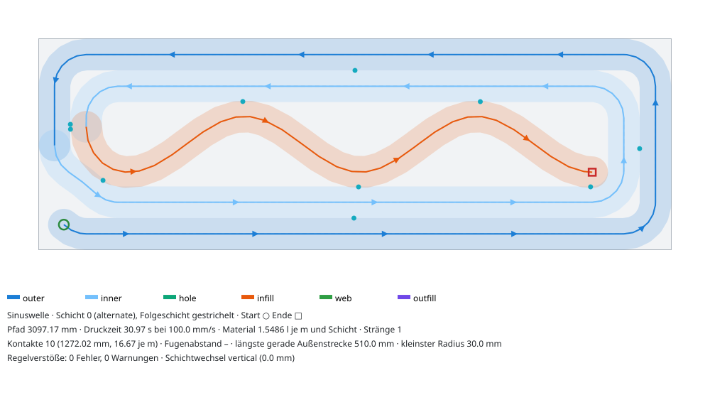

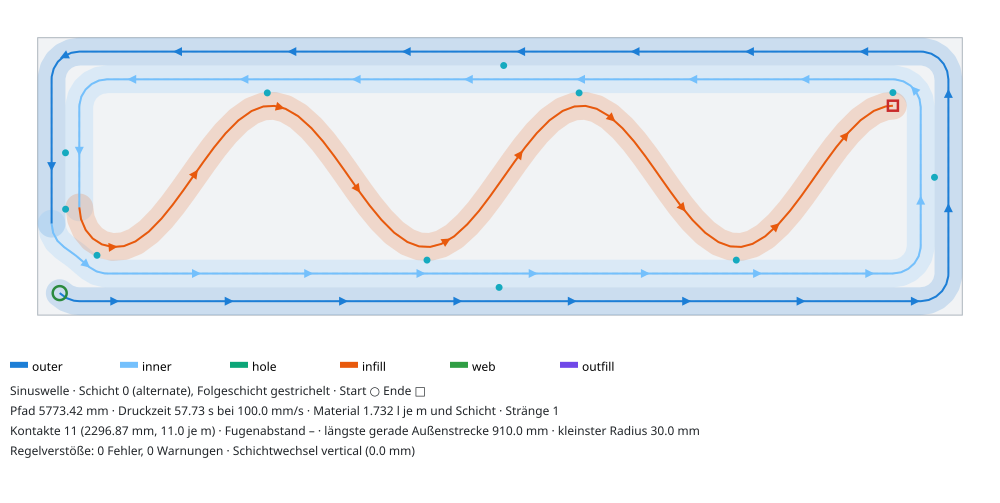

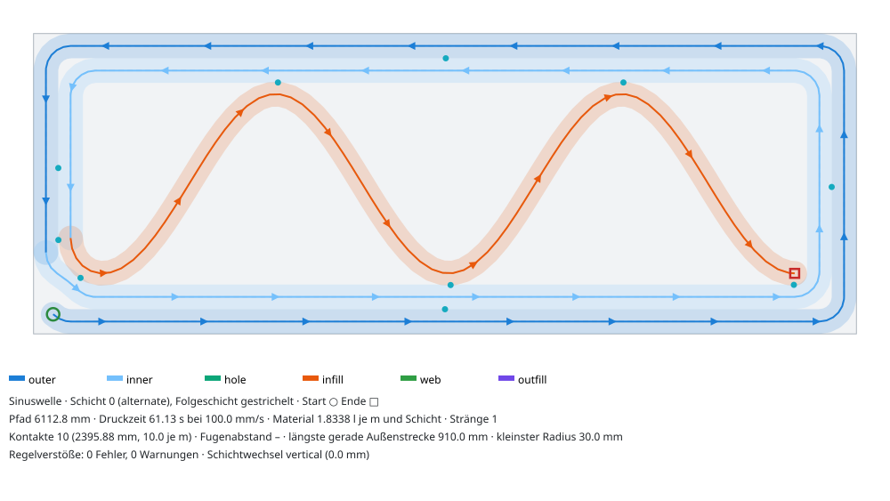

Kennzahlen (Schicht 0):

| Kennzahl | 600x200 | 1000x200 | 1000x300 | 1000x365 |
|---|---|---|---|---|
| Status (M1–M7) | ok | ok | ok | ok |
| Pfadlänge je Schicht | 3097 mm | 5133 mm | 5773 mm | 6113 mm |
| Druckzeit je Schicht (100 mm/s) | 31,0 s | 51,3 s | 57,7 s | 61,1 s |
| Material je m, relativ zu „schalen“ | 1,21 | 1,24 | 1,27 | 1,27 |
| Kontaktzonen je m | 16,7 | 13,0 | 11,0 | 10,0 |
| Größte Zellspannweite | 195 mm | 214 mm | 314 mm | 397 mm |
| Längste gerade ungestützte Außenstrecke | 510 mm | 910 mm | 910 mm | 910 mm |
| Fugenabstand | – | – | – | – |
| Kleinster Krümmungsradius | 30,0 mm | 30,0 mm | 30,0 mm | 30,0 mm |
| Verstöße (Fehler / Warnungen) | 0 / 0 | 0 / 0 | 0 / 0 | 0 / 0 |
| Schalenabdeckung | 94,6 % | 96,6 % | 96,9 % | 97,1 % |
| Stränge je Schicht | 1 | 1 | 1 | 1 |

Roboter (aus `verify_muster`):

| Szenario | machbar | d_min mm | Stränge/Schicht | senkrechte Wechsel | Druckzeit s | Planerlaufzeit s |
|---|---|---|---|---|---|---|
| S4_muster_sinus | ja | 10,83 | 1 | 100 % | 1249,70 | 56,17 |

**Vorteile**

- Regelkonform (keine M1–M7-Fehler) auf 600x200, 1000x200, 1000x300, 1000x365.
- Viele Kontaktzonen (bis 16,7 je m) verzahnen Schalen und Füllung.
- Ein Strang je Schicht und Insel (M1).

**Nachteile**

- Material 1,21- bis 1,27-fach gegenüber „schalen“.
- Auf 600x200 verläuft die Außenhaut ungegliedert gerade (510 mm): Rissgefahr beim Trocknen.

Kurzdoku: [wellen.md](wellen.md)

Testdruck: [testdrucke/sinus](testdrucke/sinus/README.md)

### topologie

*Topologie: Öffnungen, Inseln, Laibungsstege*  
Preset: `core/src/roboprint/patterns/presets/topologie.json`

Ein Strang je Insel mit geprüfter Naht; Abschrägung als Fermat-Doppelring, der zu U-Formen abbaut; Öffnungen mit Querstegen an den künftigen Laibungen und Fuge zwischen Brüstungsfeld und Pfeilern.

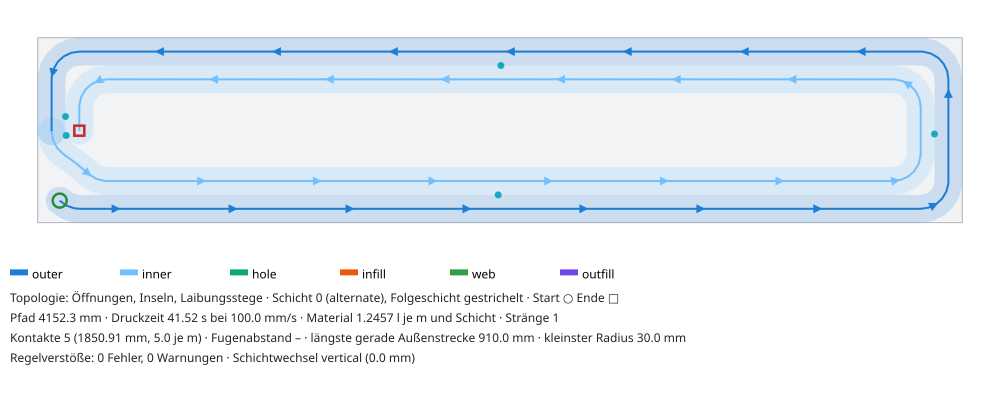

Kennzahlen (Schicht 0):

| Kennzahl | 600x200 | 1000x200 | 1000x300 | 1000x365 |
|---|---|---|---|---|
| Status (M1–M7) | ok | ok | ok | ok |
| Pfadlänge je Schicht | 2552 mm | 4152 mm | 4552 mm | 4812 mm |
| Druckzeit je Schicht (100 mm/s) | 25,5 s | 41,5 s | 45,5 s | 48,1 s |
| Material je m, relativ zu „schalen“ | 1,00 | 1,00 | 1,00 | 1,00 |
| Kontaktzonen je m | 8,3 | 5,0 | 5,0 | 5,0 |
| Größte Zellspannweite | 509 mm | 909 mm | 909 mm | 909 mm |
| Längste gerade ungestützte Außenstrecke | 510 mm | 910 mm | 910 mm | 910 mm |
| Fugenabstand | – | – | – | – |
| Kleinster Krümmungsradius | 30,0 mm | 30,0 mm | 30,0 mm | 30,0 mm |
| Verstöße (Fehler / Warnungen) | 0 / 0 | 0 / 0 | 0 / 0 | 0 / 0 |
| Schalenabdeckung | 94,4 % | 96,5 % | 96,8 % | 97,0 % |
| Stränge je Schicht | 1 | 1 | 1 | 1 |

Roboter (aus `verify_muster`):

| Szenario | machbar | d_min mm | Stränge/Schicht | senkrechte Wechsel | Druckzeit s | Planerlaufzeit s |
|---|---|---|---|---|---|---|
| S5_muster_oeffnung | ja | 10,83 | 1–2 | 97 % | 1016,40 | 39,69 |

**Vorteile**

- Regelkonform (keine M1–M7-Fehler) auf 600x200, 1000x200, 1000x300, 1000x365.
- Material 1,00- bis 1,00-fach gegenüber „schalen“.
- Viele Kontaktzonen (bis 8,3 je m) verzahnen Schalen und Füllung.
- Ein Strang je Schicht und Insel (M1).

**Nachteile**

- Große Zellen (Spannweite bis 909 mm).
- Auf 600x200 verläuft die Außenhaut ungegliedert gerade (510 mm): Rissgefahr beim Trocknen.

Kurzdoku: [topologie.md](topologie.md)

### trapez

*Trapezwelle*  
Preset: `core/src/roboprint/patterns/presets/trapez.json`

Trapezwelle mit 60-mm-Plateaus an den Schalen (lange Kontaktzonen).

Kennzahlen (Schicht 0):

| Kennzahl | 600x200 | 1000x200 | 1000x300 | 1000x365 |
|---|---|---|---|---|
| Status (M1–M7) | ok | ok | ok | ok |
| Pfadlänge je Schicht | 3119 mm | 5165 mm | 6098 mm | 6767 mm |
| Druckzeit je Schicht (100 mm/s) | 31,2 s | 51,6 s | 61,0 s | 67,7 s |
| Material je m, relativ zu „schalen“ | 1,22 | 1,24 | 1,34 | 1,41 |
| Kontaktzonen je m | 16,7 | 13,0 | 13,0 | 13,0 |
| Größte Zellspannweite | 167 mm | 184 mm | 202 mm | 257 mm |
| Längste gerade ungestützte Außenstrecke | 510 mm | 910 mm | 910 mm | 910 mm |
| Fugenabstand | – | – | – | – |
| Kleinster Krümmungsradius | 30,0 mm | 30,0 mm | 30,0 mm | 30,0 mm |
| Verstöße (Fehler / Warnungen) | 0 / 0 | 0 / 0 | 0 / 0 | 0 / 0 |
| Schalenabdeckung | 94,6 % | 96,6 % | 96,9 % | 97,1 % |
| Stränge je Schicht | 1 | 1 | 1 | 1 |

Roboter (aus `verify_muster`):

| Szenario | machbar | d_min mm | Stränge/Schicht | senkrechte Wechsel | Druckzeit s | Planerlaufzeit s |
|---|---|---|---|---|---|---|
| S4_muster_trapez | ja | 10,83 | 1 | 100 % | 1258,60 | 76,16 |

**Vorteile**

- Regelkonform (keine M1–M7-Fehler) auf 600x200, 1000x200, 1000x300, 1000x365.
- Viele Kontaktzonen (bis 16,7 je m) verzahnen Schalen und Füllung.
- Kleine Zellen (Spannweite höchstens 257 mm).
- Ein Strang je Schicht und Insel (M1).

**Nachteile**

- Material 1,22- bis 1,41-fach gegenüber „schalen“.
- Auf 600x200 verläuft die Außenhaut ungegliedert gerade (510 mm): Rissgefahr beim Trocknen.

Kurzdoku: [wellen.md](wellen.md)

Testdruck: [testdrucke/trapez](testdrucke/trapez/README.md)

### waben

*Waben*  
Preset: `core/src/roboprint/patterns/presets/waben.json`

Sechseckzellen aus zwei gegenphasigen Trapezwellen mit Kontakt in der Mitte; Wellenlänge 0 = regelmäßiges Sechseck. Für Wände ≥ 300 mm oder eine Schale je Seite.

Kennzahlen (Schicht 0):

| Kennzahl | 600x200 | 1000x200 | 1000x300 | 1000x365 |
|---|---|---|---|---|
| Status (M1–M7) | ok | ok | ok | ok |
| Pfadlänge je Schicht | 2552 mm | 4152 mm | 6838 mm | 7052 mm |
| Druckzeit je Schicht (100 mm/s) | 25,5 s | 41,5 s | 68,4 s | 70,5 s |
| Material je m, relativ zu „schalen“ | 1,00 | 1,00 | 1,50 | 1,47 |
| Kontaktzonen je m | 8,3 | 5,0 | 22,0 | 16,0 |
| Größte Zellspannweite | 509 mm | 909 mm | 146 mm | 253 mm |
| Längste gerade ungestützte Außenstrecke | 510 mm | 910 mm | 910 mm | 910 mm |
| Fugenabstand | – | – | – | – |
| Kleinster Krümmungsradius | 30,0 mm | 30,0 mm | 30,0 mm | 30,0 mm |
| Verstöße (Fehler / Warnungen) | 0 / 0 | 0 / 0 | 0 / 0 | 0 / 0 |
| Schalenabdeckung | 94,4 % | 96,5 % | 96,9 % | 97,1 % |
| Stränge je Schicht | 1 | 1 | 1 | 1 |

Roboter (aus `verify_muster`):

| Szenario | machbar | d_min mm | Stränge/Schicht | senkrechte Wechsel | Druckzeit s | Planerlaufzeit s |
|---|---|---|---|---|---|---|
| S4_muster_waben_300 | ja | 10,83 | 1 | 100 % | 1692,50 | 66,95 |

**Vorteile**

- Regelkonform (keine M1–M7-Fehler) auf 600x200, 1000x200, 1000x300, 1000x365.
- Viele Kontaktzonen (bis 22,0 je m) verzahnen Schalen und Füllung.
- Ein Strang je Schicht und Insel (M1).

**Nachteile**

- Material 1,00- bis 1,50-fach gegenüber „schalen“.
- Große Zellen (Spannweite bis 909 mm).
- Auf 600x200 verläuft die Außenhaut ungegliedert gerade (510 mm): Rissgefahr beim Trocknen.

Kurzdoku: [mehrfach.md](mehrfach.md)

Testdruck: [testdrucke/waben_300](testdrucke/waben_300/README.md)

### zickzack

*Zickzack gerundet*  
Preset: `core/src/roboprint/patterns/presets/zickzack.json`

Zickzack mit Scheitelradius w.

Kennzahlen (Schicht 0):

| Kennzahl | 600x200 | 1000x200 | 1000x300 | 1000x365 |
|---|---|---|---|---|
| Status (M1–M7) | ok | ok | ok | ok |
| Pfadlänge je Schicht | 3093 mm | 5124 mm | 6022 mm | 6697 mm |
| Druckzeit je Schicht (100 mm/s) | 30,9 s | 51,2 s | 60,2 s | 67,0 s |
| Material je m, relativ zu „schalen“ | 1,21 | 1,23 | 1,32 | 1,39 |
| Kontaktzonen je m | 16,7 | 13,0 | 13,0 | 13,0 |
| Größte Zellspannweite | 199 mm | 219 mm | 221 mm | 260 mm |
| Längste gerade ungestützte Außenstrecke | 510 mm | 910 mm | 910 mm | 910 mm |
| Fugenabstand | – | – | – | – |
| Kleinster Krümmungsradius | 29,9 mm | 30,0 mm | 30,0 mm | 30,0 mm |
| Verstöße (Fehler / Warnungen) | 0 / 0 | 0 / 0 | 0 / 0 | 0 / 0 |
| Schalenabdeckung | 94,6 % | 96,6 % | 96,9 % | 97,1 % |
| Stränge je Schicht | 1 | 1 | 1 | 1 |

Roboter (aus `verify_muster`):

| Szenario | machbar | d_min mm | Stränge/Schicht | senkrechte Wechsel | Druckzeit s | Planerlaufzeit s |
|---|---|---|---|---|---|---|
| S4_muster_zickzack | ja | 10,83 | 1 | 100 % | 1247,90 | 72,92 |

**Vorteile**

- Regelkonform (keine M1–M7-Fehler) auf 600x200, 1000x200, 1000x300, 1000x365.
- Viele Kontaktzonen (bis 16,7 je m) verzahnen Schalen und Füllung.
- Kleine Zellen (Spannweite höchstens 260 mm).
- Ein Strang je Schicht und Insel (M1).

**Nachteile**

- Material 1,21- bis 1,39-fach gegenüber „schalen“.
- Kleinster Radius 29,9 mm liegt unter der Strangbreite (M6-Warnung).
- Auf 600x200 verläuft die Außenhaut ungegliedert gerade (510 mm): Rissgefahr beim Trocknen.

Kurzdoku: [wellen.md](wellen.md)

Testdruck: [testdrucke/zickzack](testdrucke/zickzack/README.md)

<!-- KATALOG:DETAILS:END -->
