# Parameterstudie: Fugenwand und Wellen

Stand 21.10.2026, Nachtlauf „Druckmuster“ (Backlog aus `AUFTRAG.md`, Nachtrag 18:20). Gerechnet mit
`python scripts/muster_studie.py` (nur Kern-Vorschau `patterns.preview`/`measure`, kein Roboter, kein
Testdruck). Daten und Diagramme liegen unter `studie/`. Kennzeichnung wie in `recherche.md`: **E** aus Rechnung
oder Messung der Vorschau, **A** Annahme. Alle Schwellen und Empfehlungen sind A, weil es für gedruckten Lehm
keinen belegten Fugenabstand gibt (`recherche.md` §8). Der Testdruck entscheidet.

## Was gerechnet wurde

| Raster | Parameter | Läufe |
|---|---|---|
| (a) Fugenwand | Rautenkette (b) und Gurt gespiegelt (a), Feldlänge 200…600 mm (Schritt 25) × Wanddicke 200/250/300/365 × Modul 600/900/1200 mm | 408 |
| (a) Stegwinkel | Ziel-Stegwinkel 10…70° (Schritt 5), Modul 1200 mm | 104 |
| (a) Hakenradius | 15/20/25/30/40/50 mm bei F = 300 mm, Modul 1200 mm (ParamSpec 0…100, M6 hart 15 mm) | 48 |
| (b) Wellen | Sinus, Zickzack, Trapez × Wellenlänge 80/100/125/150/175/200/250/300/400/500/700/1000/1500/2000 mm (ParamSpec 80…2000) × Wanddicke 200/300/365 × 1 und 2 Schalen je Seite × Modul 600/1200 mm | 504 |

Gesamt 1064 Läufe in **77 s** auf der Cloud-VM (Fugenwand 36 s, Wellen 30 s, Rest Diagramme; Ø 55 ms je
Vorschau, Maximum 157 ms). Das Raster wurde nicht vergröbert. `--coarse` halbiert es (≈ 40 s). w = 30 mm, h = 10 mm,
`layer_order = alternate`, v = 100 mm/s, Sinus/Zickzack/Trapez mit Muster-Standardwerten (Phase 0°, Überlappung 5 %,
Rundungsradius 30 mm, Plateau 60 mm).

Kennzahlen je Lauf (Spalten der CSV): gültig (`measure` ohne Fehler und kein Rückfall auf das Grundmuster), Fugenabstand
tatsächlich (`fit_to_length`, bei den Wellen die ausgeführte Wellenlänge), Kontaktzonen je m und Summe der
Kontaktlänge, Pfadlänge, Druckzeit je Schicht und je m Wand, Material je m und **relativ zu zwei Schalen ohne Infill**
bei gleicher Dicke und Länge (zugleich die relative Druckzeit, beide folgen der Pfadlänge), größte Zellspannweite, längste
gerade ungestützte Außenstrecke, kleinster Radius, Zahl der M6-Warnungen.

**Lesehinweise.**

- *M6-Warnungen* zählen Abtastpunkte der Schicht 0 mit Radius < w, nicht Ecken. 35 Punkte entsprechen etwa vier Haken
  mit r = 27 mm. Zum Vergleich taugt die Null gegen Nicht-Null und der kleinste Radius.
- *Längste Außenstrecke.* Bei der Fugenwand hat sie einen Boden: Die Endkappe am Modulende ist eine gerade Strecke
  von d − 90 mm (110/160/210/275 mm bei 200/250/300/365 mm). Unter diesem Wert unterscheidet die Kennzahl nichts.
  Als Maß der Rissgliederung dient deshalb bei der Fugenwand der **Fugenabstand** (Rissöffnung ≈ Schwindmaß × Abstand), bei
  den Wellen die **größte Zellspannweite**. Die Außenstrecke steht daneben.
- *Wellen mit zwei Schalen:* Die Außenstrecke ist dort immer die ganze Modullänge (510 mm bei Modul 600 mm), denn die Welle
  berührt nur die Innenschale. Eine Stützung der Außenhaut durch die Welle zeigt die Kennzahl nur bei **einer** Schale je Seite.
- *Kontaktlänge bei zwei Schalen* (1180…1680 mm je Schicht) besteht überwiegend aus der Berührung Schale an Schale. Der Anteil
  der Welle steht in der Kontaktzahl je m.

## Fugenwand

### Befund

**Gültigkeit.** 559 von 560 Läufen sind gültig, kein einziger hat einen Regelfehler. Der eine Rückfall ist der Gurt bei 200 mm
Wand mit Hakenradius 50 mm (Grundmuster). Die Rautenkette kennt Warnungen nur bei 200 mm Wand und Feldlängen 275…475 mm, der Gurt
bei 200 mm Wand immer (mindestens 8 Punkte, Radius 18…21 mm) und bei 250 mm Wand bis Ziel-Feldlänge 275 mm
(`studie/fugenwand_machbarkeit.svg`).

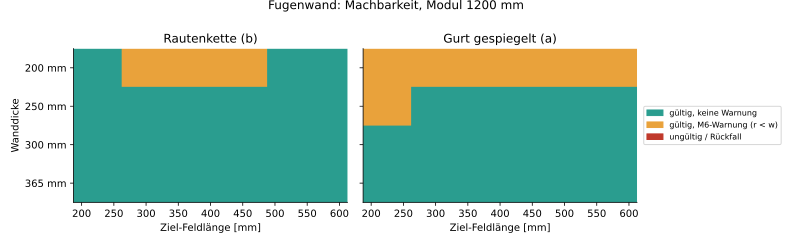

**Fugenabstand.** `fit_to_length` teilt die Modullänge in eine ganze Zahl gleicher Felder. Die Ziel-Feldlänge springt deshalb:
Rautenkette 300 mm Wand, Ziel 250…400 mm ergibt bei Modul 600 mm überall 300 mm (2 Felder), bei Modul 900 mm 300 mm (Ziel 275…375) bzw.
450 mm, bei Modul 1200 mm 240, 300, 400 oder 600 mm. Wer 300 mm will, wählt das Ziel als Modullänge / ganze Zahl
(`studie/fugenwand_fugenabstand.svg`).

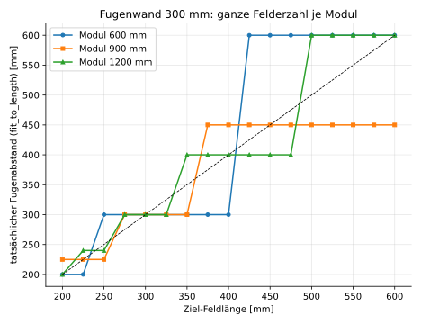

**Material und Zeit.** Je feiner die Gliederung, desto mehr Pfad. Rautenkette, Modul 1200 mm, Material relativ zu zwei Schalen:

| Fugenabstand | 200 mm Wand | 250 mm | 300 mm | 365 mm |
|---|---|---|---|---|
| 600 mm | 0,91 | 0,91 | 0,92 | 0,94 |
| 400 mm | 0,96 (M6) | 0,99 | 1,04 | 1,11 |
| 300 mm | 1,00 (M6) | 1,08 | 1,17 | 1,29 |
| 240 mm | 1,06 | 1,19 | 1,32 | 1,49 |
| 200 mm | 1,13 | 1,31 | 1,48 | 1,69 |

„(M6)“: Radius auf 27 mm verkleinert, Warnungen. Die Rautenkette liegt bei 0,79…1,69 je nach Dicke und Feldlänge, der Gurt bei
1,24…1,45, also bei F = 300 mm **+43 %** (200 mm Wand), +34 % (250), +20 % (300), +6 % (365 mm) gegenüber der Rautenkette. Die
Druckzeit je m folgt dem Material: Rautenkette 34…79 s/m und Schicht, Gurt 57…68 s/m.

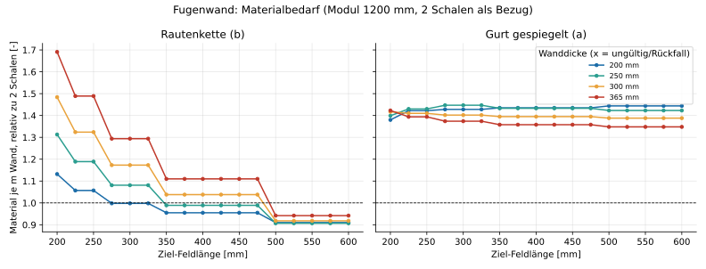
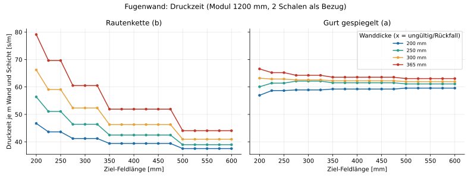

**Kontakte.** Rautenkette 3,3…54 Zonen je m (bei F = 300 mm 16,7), Kontaktlänge 29…695 mm je Schicht. Der Gurt hat durch den
Doppelgurt 12…79 Zonen je m und 0,6…2,2 m Kontaktlänge je Schicht, ist also fester verbunden, aber nur bei 365 mm Wand mit
schrägen Stegen (4…20°).

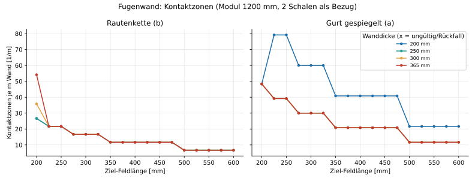

**Zellen und Stege.** Rautenkette: größte Zelle 140…309 mm Spannweite bei F ≤ 400 mm, 261…305 mm bei F = 600 mm, kleinster Stegwinkel
10…81° bei F ≤ 400 mm (bei F = 200…300 mm: 30…81°, außer 200 mm Wand F = 300 mm: 30,6°). Gurt: Stege nahezu waagrecht (0,1…10° bei 250…365 mm Wand, F = 300 mm), also ein Mäander, und
Zellen bis 1081 mm (F = 600 mm). Die Gurt-Zelle ist keine Gliederung, die Fuge schon.

**Stegwinkel als Eingabe.** Der Winkel wirkt nur über die ganze Felderzahl: Rautenkette 300 mm Wand, Modul 1200 mm: Ziel 10…20° ergibt
1 Feld (1200 mm, Winkel 11,7°, Rissgliederung fehlt), 25…40° ergibt 2×600 mm (30,2°), 45…70° ergibt 3×400 mm (49,4°). Beim Gurt mit
300 mm Wand ist der Winkel nicht erreichbar: Jede Vorgabe 10…70° endet bei 7×171 mm und 0,5° (Mäander). Bei 365 mm Wand trifft
der Gurt den Winkel (10° → 600 mm, 30° → 240 mm, 50° → 171 mm).

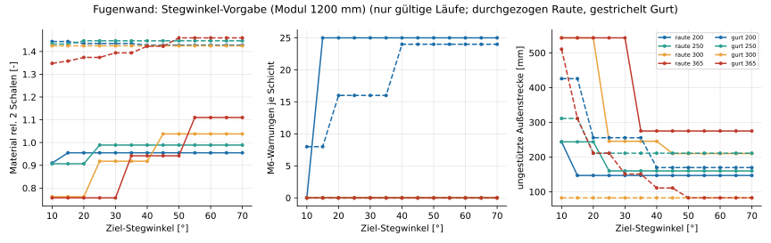

**Hakenradius.** Material und Kontakte ändern sich kaum (±1 %). Entscheidend ist M6: Rautenkette ab 250 mm Wand und r = 30 mm ohne Warnung.
Ein größerer Wunschradius (40/50 mm) wird auf 30…36 mm bzw. bei 200 mm Wand auf 25…28 mm zurückgenommen und flacht den Stegwinkel ab (200 mm Wand:
30,6° → 24,6° bei r = 40 mm). Kleinere Radien (15…25 mm) geben Warnungen und steilere Stege (200 mm: 38…42°). Der Gurt bleibt bei 200 mm Wand
auf 18…22,5 mm begrenzt und fällt bei r = 50 mm zurück.

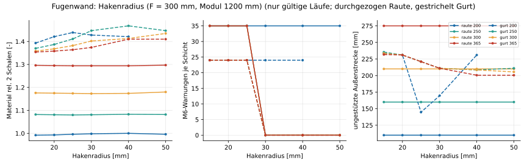

**Rissneigung (Kennzahl).** Die längste ungestützte Außenstrecke ist bei der Rautenkette 110/160/210/275 mm (200/250/300/365 mm Wand) bis
F ≈ 300 mm und wächst erst darüber (F = 600 mm: 244…275 mm). Sie ist also immer kleiner als die Grenze von 300 mm, auch bei sehr
langen Feldern, weil die Rautenspitze das Feld in der Mitte stützt. Der Gurt liegt ab 250 mm Wand bei F = 300 mm bei 211 mm, bei F = 600 mm bei 511 mm.

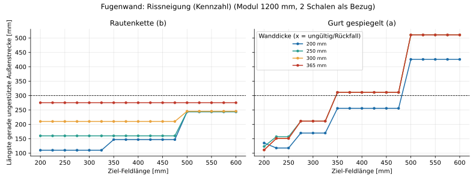

### Pareto-Abwägung

Ziele: **Rissgliederung** (Fugenabstand, klein), **Material/Zeit** (relativ zu zwei Schalen, klein), **Druckbarkeit** (M6-Warnungen, null).
Je Familie, Muster, Dicke und Modul bleiben die nichtdominierten Läufe (`studie/pareto.csv`): 3…5 je Dicke, Muster und Modul.

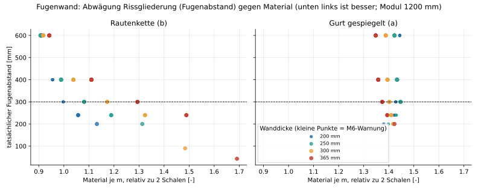

- Die Front der **Rautenkette** ist eine Treppe: Jede Halbierung des Fugenabstands kostet 10…37 % Material und Zeit (300 mm Wand: 600 → 300 mm
  = +27 %, 300 → 200 mm = +26 %). Material unter 1,0 gibt es nur mit Fugenabstand ≥ 400 mm (bei 200 mm Wand ≥ 600 mm ohne Warnung und
  mit 4,9° Stegwinkel, also Mäander).
- **200 mm Wand:** Die billigste Rautenkette bei F = 300 mm (1,00) hat M6-Warnungen (r = 27 mm). Warnungsfrei geht es erst ab F ≤ 250 mm
  (Ist 240 mm: 1,06, 200 mm: 1,13) oder bei F ≥ 500 mm (Mäander). Hier erkauft man Druckbarkeit mit 6 % Material.
- Der **Gurt** ist nirgends auf der Front der Rautenkette, weil er bei gleichem Fugenabstand 6…43 % mehr Material kostet. Er gewinnt nur bei den
  Kontaktzonen (2× bis 4×) und im Zusammenhalt. Das ist ein Argument für Bauteile mit hoher Last, nicht für die Rissgliederung.
- Modullänge: Im Raster 200…600 mm sind bei Modul 600 mm nur 200/300/600 mm Felder möglich, bei 900 mm 225/300/450 mm. Die Rautenkette mit F = 300 mm kostet
  bei Modul 600 mm weniger (1,05 bei 300 mm Wand) als bei 1200 mm (1,17). Die Ursache wurde nicht untersucht; der Modulrand geht anteilig stärker ein.

### Empfehlung (Kennzeichnung A)

Regel: gültig, keine M6-Warnung, Fugenabstand ≤ 300 mm (Grenze der Kennzahl, `recherche.md` §7), Rautenkette mit Stegwinkel ≥ 30°
(`recherche.md` §7), dann kleinstes Material (`studie/empfehlung.csv`, Modul 1200 mm).

| Wanddicke | Muster | Ziel-Feldlänge → Ist (Modul 1200 / 900 / 600 mm) | Winkel/Radius | Material (rel.) | Alternative |
|---|---|---|---|---|---|
| **200 mm** | Rautenkette | **225…250 mm** → 240 / 225 / 200 mm | Steg 43° (1200), r = 30 mm, 0 Warnungen | 1,06 | F = 300 mm spart 6 % Material, kostet 35 M6-Punkte (r = 27 mm). Gurt entfällt: nie warnungsfrei (r ≤ 21 mm). |
| **250 mm** | Rautenkette | **275…300 mm** → 300 / 300 / 300 mm | 52…63°, r = 30 mm | 1,08 (1200), 1,00 (600) | Gurt erst ab F ≥ 300 mm ohne Warnung (+34 % Material, Mäander 8°). |
| **300 mm** | Rautenkette | **275…300 mm** → 300 / 300 / 300 mm | 63°, r = 30 mm | 1,17 (1200), 1,05 (600) | F = 400 mm: 1,04 (−11 %), 49°. Gurt (+20 %) nur mit Winkel ≈ 0 (Mäander). |
| **365 mm** | Rautenkette | **275…300 mm** → 300 / 300 / 300 mm | 70°, r = 30 mm | 1,29 (1200), 1,12 (600) | F = 400 mm: 1,11 (−14 %), 60°. Gurt (+6 %, 10° Steg, 1,2 m Kontaktlänge) bei hohem Zusammenhalt. |

Begründung (A, E):

1. **Rautenkette statt Gurt:** gleiche Rissgliederung bei 6…43 % weniger Material, Stege im Winkel der Recherche (≥ 30°, E), keine Warnungen ab
   250 mm Wand. Der Gurt wird bei 200…300 mm Wand zum Mäander.
2. **Fugenabstand 240…300 mm:** innerhalb der Kennzahl-Grenze von 300 mm, Rissöffnung bei 1 % Schwinden 2,4…3 mm (`recherche.md` §7). Die
   Recherche nannte 240/340/430 mm für 200/300/365 mm Wand (Winkel 35°). Die Rautenkette läuft bei diesen Feldlängen steiler (43…70°), weil
   ihr Winkel aus der Rautengeometrie folgt, nicht aus dem Gurtmodell.
3. **200 mm Wand: 240 statt 300 mm:** der Preis ist 6 % Material, der Gewinn null M6-Punkte. Die Vorschau hält r = 30 mm nur bis F ≤ 250 mm
   (Tangente Fugenhaken → Spitze, `fugenwand.md` „Grenzen“).
4. **Fugenabstand an das Modul binden:** Ziel = Modullänge / ganze Zahl. Sonst springt der Ist-Wert (siehe oben).
5. **Schwelle des Fugenabstands ist die offene Weiche.** Bei 300/365 mm Wand spart F = 400 mm 11…14 % Material und Zeit bei gleicher
   Außenstrecke (275 mm bei 365 mm Wand), kostet aber 33 % mehr Rissöffnung. Der Testdruck mit F = 300 und 400 mm entscheidet (Weiche 1).

## Wellen (Sinus, Zickzack, Trapez)

### Befund

**Gültigkeit.** Alle 504 Läufe sind gültig, ohne Fehler, ohne Rückfall und ohne Warnung. Der kleinste Radius ist 28,8 mm (Ziel ≥ w im
Rahmen der Toleranz des Kerns). Ein Infill entfällt nirgends, auch nicht bei λ = 80 mm.

**Die Ziel-Wellenlänge wird auf ganze Halbwellen angepasst.** Ist-Werte bei Modul 600 mm, 200 mm Wand, 1 Schale: Zickzack/Trapez 136, 159, 190, 238, 317, 476, 951 mm
(7, 6, 5, 4, 3, 2, 1 Halbwellen), Sinus nur 317, 476, 951 mm. Ziele unter 136 mm (und für den Sinus unter 317 mm) landen am selben
Wert, es gibt also kein Raster unterhalb davon. Bei Wanddicke ≥ 300 mm und Sinus ist die kürzeste Welle 441 mm (2 Schalen) bzw. 476 mm (1 Schale),
weil R ≥ w ein λ ≥ 2π·√(w·A) verlangt (301 bzw. 359 mm).

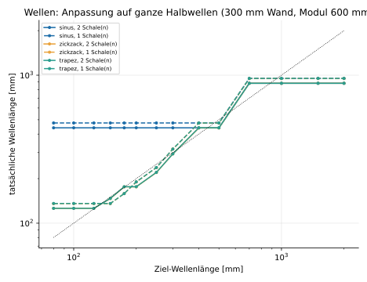

**Material und Zeit (Modul 600 mm).** Eine Schale je Seite: 0,73…1,24 (Zickzack/Trapez 0,98 bei 135 mm Wellenlänge und 200 mm Wand; 1,15…1,24 bei
300/365 mm Wand und kürzester Welle). Zwei Schalen: 1,17…1,57 (die Welle kommt zu den Schalen dazu). Von Wellenlänge 136 auf 238 mm sinkt das Material bei 365 mm Wand und einer Schale von 1,24 auf 0,96 (−22 %), von 238 auf 476 mm auf 0,79 (−18 %). Der Sinus ist am billigsten (0,73…0,80 bei einer Schale), hat aber die größten Zellen. Die Druckzeit folgt:
32…84 s/m und Schicht.

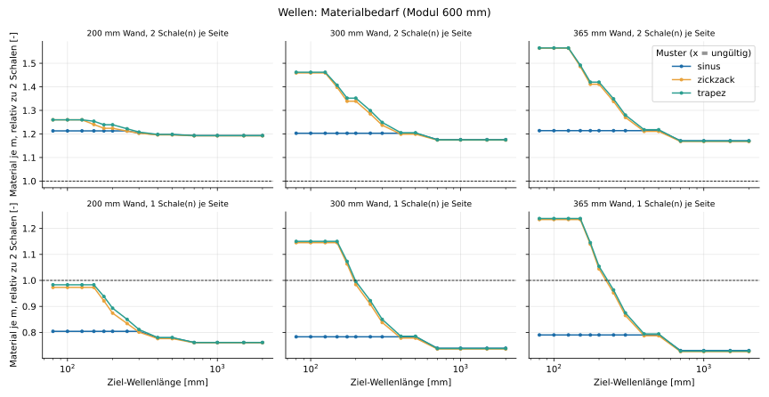
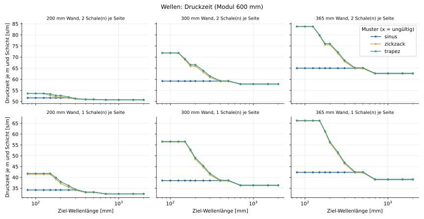

**Kontakte (Modul 600 mm).** 6,7…21,7 Zonen je m. Zickzack/Trapez mit 2 Schalen: 21,7 je m bei Wellenlänge 126 mm, 16,7 bei 220 mm,
13,3 bei 441 mm; mit 1 Schale 16,7 bei 136 mm, 11,7 bei 238 mm, 8,3 bei 476 mm; Sinus 1 Schale 10 bei 317 mm, 8,3 bei 476 mm. Die Kontaktlänge je Schicht der Welle (1 Schale) liegt bei 115…310 mm, das Trapez mit dem Plateau erreicht
1…59 % mehr als der Zickzack (Median 35 %), der Sinus 34…184 mm.

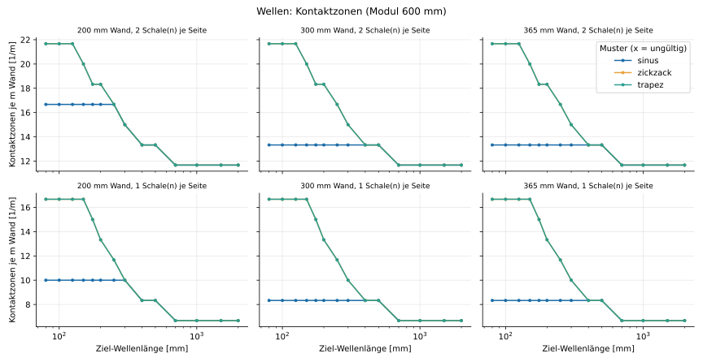
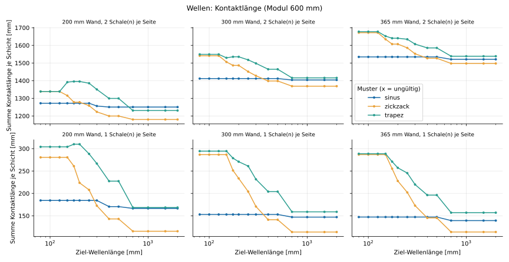

**Zellen.** Größte Zellspannweite = Hohlraumzelle zwischen Welle und Schale. Eine Schale, 200 mm Wand: 142…513 mm (Zickzack/Trapez 136…951 mm Wellenlänge), 300 mm
Wand 235…529 mm, 365 mm Wand 298…561 mm. Bei zwei Schalen liegen die Zellen zwischen 106 und 501 mm.

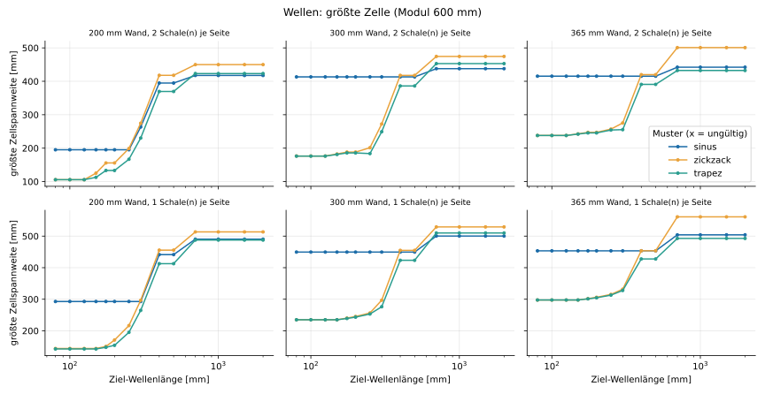

**Radius und Druckbarkeit.** Kein Muster unterschreitet 28,8 mm. Der kleinste Wert (Zickzack, 2 Schalen, 365 mm Wand, λ = 294 mm) liegt 4 % unter w und damit in der
Toleranz des Kerns (`RADIUS_TOL`, 5 %). Die M6-Warnung der Kernmessung tritt in keinem Lauf auf.

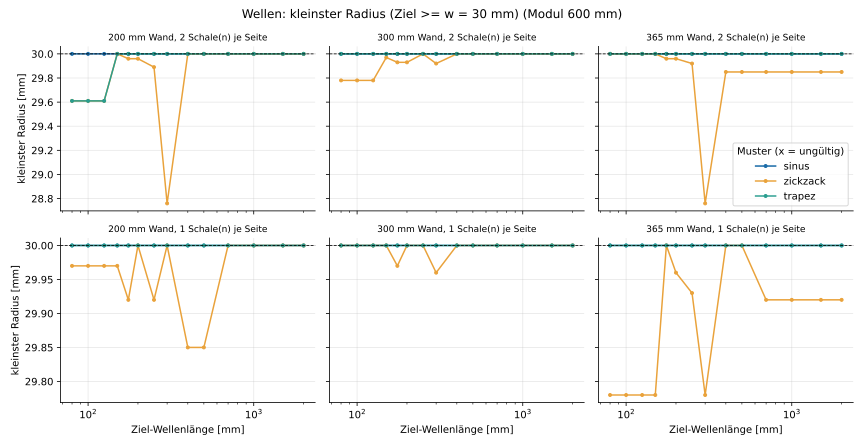
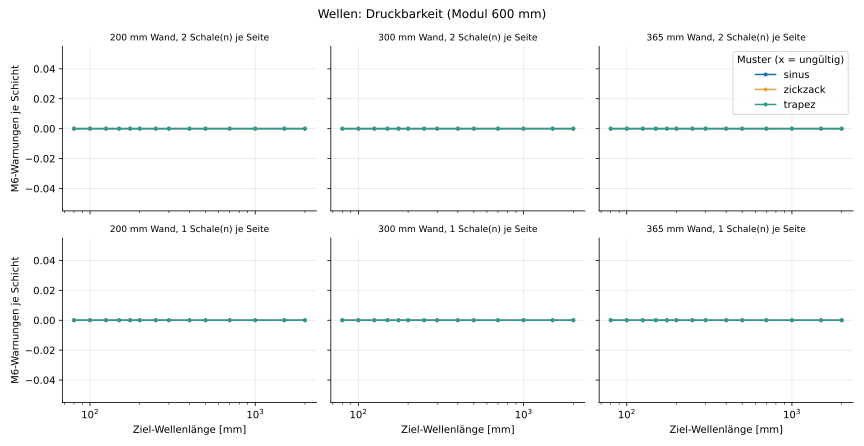

**Rissneigung.** Nur mit einer Schale je Seite reicht die Welle an die Außenhaut und verkürzt die ungestützte Außenstrecke: 200 mm Wand
Zickzack/Trapez 108…290 mm bei Wellenlänge 136…317 mm, 300/365 mm Wand 206…290 mm (Boden: Endkappe 210/275 mm). Mit zwei Schalen bleibt es bei 510 mm
(Modul 600 mm), die Welle gliedert dann nur die Füllung. Der Sinus (1 Schale) hat 286 mm bei λ = 317 mm (200 mm Wand) und 435…485 mm bei λ ≥ 441 mm.

### Pareto-Abwägung

Ziele: Zellspannweite (klein), Material relativ zu zwei Schalen (klein), M6-Warnungen (null, hier überall erfüllt). Je Muster, Dicke, Modul und Schalenzahl
bleiben die nichtdominierten Läufe (`studie/pareto.csv`, 2…11 je Gruppe).

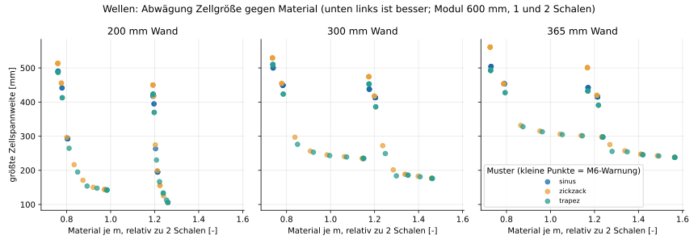

- **Zellgröße gegen Material ist ein klarer Zielkonflikt.** Eine Schale, 200 mm Wand, Trapez: 136 mm Welle → Zelle 142 mm, Material 0,98. 238 mm → 195 mm, 0,85.
  317 mm → 265 mm, 0,81. 476 mm → 413 mm, 0,78. Jede Stufe spart 4…13 %, die Zelle wächst um 25…55 mm.
- **Eine Schale schlägt zwei Schalen** in beiden Zielen (Material 0,73…1,24 gegen 1,17…1,57) und ist die einzige Variante, in der die Welle die
  Außenhaut stützt. Dafür besteht die Außenhaut nur aus einer Raupe (30 mm), das ist durch den Testdruck zu klären (`wellen.md`, Weiche 2).
- **Sinus liegt auf der Front nur an den Extremen** (λ ≥ 317 mm bei 200 mm Wand, λ ≥ 441 mm sonst), weil er keine feinen Wellen erlaubt.
- Zickzack und Trapez liegen fast gleichauf: Der Zickzack ist 0,1…2 % billiger, das Trapez hat im Median 35 % längere Kontaktzonen (1 Schale) und bei 2 Schalen
  die kleinere Zelle (167 gegen 199 mm bei 200 mm Wand, λ = 220 mm).

### Empfehlung (Kennzeichnung A)

Regel: gültig, keine M6-Warnung, größte Zellspannweite ≤ Wanddicke („Zelle nicht länger als dick“, A), dann kleinstes Material
(`studie/empfehlung.csv`). Das Raster hat Ziel-Wellenlängen 200/250/300 mm; Ist-Werte gelten für Modul 600 / 1200 mm.

| Wanddicke | Schalen | Muster | Ziel-λ → Ist | Material (rel.) | Zelle | Kontakte/m | Alternative |
|---|---|---|---|---|---|---|---|
| **200 mm** | 2 | Zickzack | **250 mm** → 220 mm | 1,21 | 199 mm | 16,7 | Trapez 220 mm: 1,22, Zelle 167 mm, längere Kontakte (1,0 % mehr Material). Sinus 220 mm gleichwertig (1,21, 195 mm). |
| **200 mm** | 1 | Trapez | **250 mm** → 238 mm | 0,85 | 195 mm | 11,7 | Zickzack 237 mm: 0,83, Zelle 217 mm, Kontaktlänge 208 gegen 288 mm. |
| **300 mm** | 2 | Zickzack | **300 mm** → 294 mm | 1,24 | 272 mm | 15,0 | Trapez 294 mm: 1,25, Zelle 249 mm. Kein Sinus (λ ≥ 441 mm, Zelle 413 mm). |
| **300 mm** | 1 | Zickzack | **300 mm** → 317 mm | 0,84 | 297 mm | 10,0 | Trapez 238 mm: 0,92, Zelle 253 mm, Außenstrecke 206 mm (+10 % Material). |
| **365 mm** | 2 | Zickzack | **300 mm** → 294 mm | 1,27 | 275 mm | 15,0 | Trapez 294 mm: 1,28. |
| **365 mm** | 1 | Zickzack | **300 mm** → 316 mm | 0,87 | 332 mm | 10,0 | Trapez 238 mm: 0,96, Zelle 313 mm (Zelle ≤ 365 mm hält bis λ ≈ 317 mm). |

Begründung (A, E): Die Wellenlänge 220…320 mm hält den Radius ≥ w ohne Anpassung, hat 10…17 Kontaktzonen je m und eine Zelle von höchstens der Wanddicke.
Feinere Wellen (176 mm, 2 Schalen, Zickzack) kosten 8 % (300 mm Wand) bzw. 11 % (365 mm) mehr Material, die Zelle schrumpft dabei um 31 % (272 → 188 mm) bzw. 10 %. Gröbere Wellen (≥ 441 mm) lassen Zellen von 410…450 mm zu (1 Schale: nur 6,7…8,3 Zonen je m).
Die Empfehlung der Recherche (λ = 250 mm bei 200 mm Wand) bestätigt sich. Zwei Schalen wählt man, wenn die Außenhaut zwei Raupen dick sein muss.

## Vergleich der Familien und Weichen für den Testdruck

| | Fugenwand Rautenkette | Wellen, 1 Schale | Wellen, 2 Schalen |
|---|---|---|---|
| Material relativ zu 2 Schalen | 1,06 (200) · 1,08 (250) · 1,17 (300) · 1,29 (365 mm), F empfohlen | 0,84…0,87 | 1,21…1,27 |
| Außenhaut gegliedert durch | echte Sollbruchstellen alle 240…300 mm je Seite | Stützung alle λ/2, keine Fuge | nicht gegliedert |
| Kontaktzonen je m | 13,3…23,3 | 10…11,7 | 15…16,7 |
| Druckbarkeit | M6 frei ab 200 mm (F ≤ 250) bzw. 250 mm | M6 frei | M6 frei |

Die Fugenwand ist die einzige Variante mit **Fuge**, die Welle gliedert nur durch Stützung und nur mit einer Schale. Die Wahl zwischen beiden ist
eine Frage der Rissphysik, nicht der Geometrie, und gehört in den Testdruck.

**Weichen für den Testdruck (alle A):**

1. Fugenabstand 300 mm gegen 400 mm bei 300/365 mm Wand (Rissöffnung gegen 11…14 % Material).
2. Wellen mit 1 Schale: genügt die einzelne Raupe als Außenhaut?
3. 200 mm Wand: Fugenabstand 240 mm (r = 30 mm) gegen 300 mm (r = 27 mm, 6 % weniger Material).
4. Punktförmiger Fugenkontakt (10…14 mm) gegen verlängerte Kontaktlänge (`joint_contact_mm`).

## Grenzen der Studie

- Nur Geometrie und Pfad. Schwinden, Haftung, Quetschung und Rissbild sind nicht modelliert (nur die Kennzahlen aus `recherche.md`).
- Modul 600/900/1200 mm bei der Fugenwand, 600/1200 mm bei den Wellen, Rechteckquerschnitt ohne Öffnung. Laibungen, Ecken und L-Querschnitte
  (Rückfall auf das Grundmuster, siehe `fugenwand.md`, `topologie.md`) sind nicht Teil der Studie.
- Die Stegwinkel- und Hakenradius-Läufe nutzen nur Modul 1200 mm und F = 300 mm.
- Die Gurtvarianten sind „gespiegelt“ (a). Die versetzte Variante (c) und das Preset `foto` sind in `fugenwand.md` behandelt.
- Wellen mit Phase ≠ 0° und andere Plateaulängen/Rundungsradien sind nicht gerastert (Tests in `test_patterns_wellen.py`: 288 Kombinationen ohne Fehler).

## Dateien und Neuberechnung

`python scripts/muster_studie.py [--coarse] [--skip-plots]` erzeugt unter `docs/muster/studie/`: `fugenwand.csv` (560 Zeilen: 408 Hauptraster, 104
Winkel, 48 Radius; Spalte `familie` trennt), `wellen.csv` (504), `pareto.csv`, `empfehlung.csv`, `laufzeit.json` und 19 SVG-Diagramme.
Spalten und Einheiten stehen im Kopf der CSV (`_mm`, `_s`, `_deg`, `_je_m`). Das Skript ändert weder `core/src` noch `spec/` und `verify/`.
