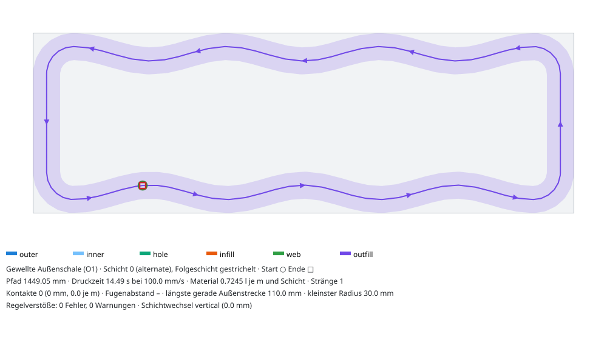

# Gewellte Außenschale (Outfill O1)

Stand 21.10.2026, Backlog O1, Branch `v2/muster-o1`. Code:
`core/src/roboprint/patterns/families/aussenwelle.py` (Muster `aussenwelle`, Rolle `outfill`).
Tests: `core/tests/test_patterns_aussenwelle.py`. Preset:
`core/src/roboprint/patterns/presets/aussenwelle.json` (eine Schale je Seite), dazu
`docs/muster/presets/aussenwelle_zwei_schalen.json` und `aussenwelle_zickzack.json`. Szenario:
`docs/muster/szenarien/S4_muster_aussenwelle.json`.

Weitere Bilder: [zwei Schalen](bilder/aussenwelle-zwei-schalen.svg),
[Zickzack](bilder/aussenwelle-zickzack.svg).

## Idee

Eine lange gerade Raupe reißt, wenn sie beim Trocknen schwindet und am Fuß gehalten wird. Läuft die
Außenschale als Welle, kann sie Längsschwinden durch Verformung aufnehmen (recherche.md §6). Maß
dafür ist der Bogenlängenzuwachs gegenüber der Geraden, etwa (π·A/λ)². Kennzahl für die
Rissneigung ist die längste gerade Strecke an der Außenseite.

## Geometrie

- Grundlage ist der gerundete Ring von Schale 0 aus dem Kern (Offset w/2, Eckradius w). Gewellt
  werden nur seine geraden Stücke an den **langen Außenseiten** (y-Flächen des Teils). Die
  **Stoßflächen** (x-Flächen) bleiben gerade, die **Ecken** bleiben Bögen mit Radius w.
- Die Welle weicht nur **nach innen** aus, d ∈ [0, D] mit D = 2·A. Die Außenkante der Raupe liegt
  in den Wellenbergen genau auf der IFC-Fläche. Nichts steht über die Wand hinaus (M5 ohne die
  1-mm-Toleranz).
- `sinus`: d(s) = A·(1 − cos(2π·s/λ)). An den Zonenenden ist d = 0 und d' = 0, der Übergang ist
  tangentenstetig. Kleinster Radius λ²/(4π²·A).
- `zickzack`: Dreieck 0 → D → 0 mit Scheitelradius `outer_round_radius_mm` (Standard 60 mm). Die
  Fußpunkte an den Zonenenden haben einen Übergangsbogen mit r_b = step²/(8·chord_tol) = 100 mm.
  Mit einem kurzen Bogen r = 60 mm neben der Geraden schätzt metrics nach dem Neu-Abtasten einen
  Sehnenfehler von 0,63 mm (M6-Warnung bei 1000 mm Länge).
- **Wellenzonen aus dem ganzen Teil (M3).** Gewellt wird nur, wo jede Schicht des Teils an
  dieser Fläche ein gerades Stück hat. Je Zone wird eine ganze Zahl von Wellen eingepasst
  (`fit_to_length`). Ändert sich der Querschnitt (Brüstung, Sturz), bleiben die Stücke über bzw.
  unter der Öffnung in allen Schichten gerade. Die Wellen neben der Öffnung liegen in allen
  Schichten deckungsgleich. Test: Wand 1200 × 200 mit Fenster 400 mm, Zonen [−555, −245] und
  [245, 555]. Der Überhang ist mit und ohne Welle gleich groß (Brüstung 8249 mm², Sturz
  25 336 mm²). Er stammt nur von den neuen Laibungen; die gehören zur Familie Topologie.
- **Naht:** `choose_seam` des Kerns. Bei D < 8,8 mm (zwei Schalen, Infill) bleibt sie in der Mitte
  des Eckbogens bei (x_min, y_min). Bei einer Schale ohne Infill (D = 16 mm) wandert sie in das
  erste Wellental der Fläche y_min. Die Raupenkante liegt dort 16 mm hinter der Außenfläche
  (recherche.md §7: „Naht im Wellental“).

## Amplitude: wie viel Welle in die Wanddicke passt

Die Outfill-Rolle ersetzt nur den Ring von Schale 0 (`shell_chain(ring0=…)`). Die innere
Nachbarbahn bleibt am Sollort, also w neben der geraden Lage von Schale 0. Daraus folgen harte
Grenzen für die Auslenkung D nach innen (w = 30 mm, ε = 0,15):

| Aufbau | Nachbarbahn | Grenze D | A (Start 8 mm) | Bogenzuwachs λ ≈ 150–170 mm |
|---|---|---|---|---|
| 2 Schalen je Seite | Schale 1 | ε·w − 0,5 = 4,0 mm (Täler berühren Schale 1 mit 26 mm Mittellinienabstand) | **2,0 mm** (gekappt) | 0,14–0,17 % |
| 1 Schale + Infill | Infill an Schale 0 (eigene Überlappung 5 %) | ε·w/2 − 0,25 = 2,0 mm | **1,0 mm** (gekappt) | 0,03 % |
| 1 Schale ohne Infill | Hohlraum | (t − 2w)/2 − 1 = 69 mm (200 mm Wand) | **8,0 mm** | 2,2–2,7 % |

Die Kappung ist gewollt: Mit A = 8 mm bei zwei Schalen kämen die Wellentäler Schale 1 auf
30 − 16 = 14 mm nahe, also Doppelmaterial (M2-Fehler). `meta.outfill` nennt die angeforderte und
die gebaute Amplitude sowie den Grund (`amplitude_limited_by`).

**Folgerung.** Nur mit **einer Schale ohne Infill** liefert O1 die Startwerte aus der Recherche
(A = 8 mm, λ = 150 mm). Der Bogenzuwachs von 2,2–2,7 % liegt dann in der Größenordnung des
Schwindens guter Mischungen (2,6–3,5 %). Bei zwei Schalen bleiben 4 mm Relief und 0,15 %
Zuwachs. Das ist eine Gliederung der Oberfläche, aber kein nennenswertes Längenpolster.

**Kerneinwand (für den Nutzer, nicht umgesetzt).** Eine volle 8-mm-Welle bei zwei Schalen
bräuchte eine Schale 1, die um D nach innen rückt oder mitwellt. Die Outfill-Schnittstelle kann
das nicht ausdrücken, weil sie nur Ring 0 ersetzt. Vorschlag: `IslandPlan.meta["inner_inset_mm"]`
aus dem Outfill, das `plan.build_island` an `shell_lanes` weitergibt. Ein Einrücken nur an den
y-Flächen ließe die Stoßflächen dicht. Ein gleichmäßiges Einrücken öffnete dort einen Spalt von D
zwischen Schale 0 und Schale 1. Kosten: Der Hohlraum bzw. das Infill-Band wird um D schmaler
(200-mm-Wand: Band 50 → 34 mm).

## Kennzahlen (Vorschau, Schicht 0, alternate, w = 30, h = 10, v = 100 mm/s)

„Gerade y“ ist die längste gerade Strecke an den langen Außenseiten: Knick > 1° wie in metrics,
am mit 20 mm / 0,5 mm abgetasteten Ring, ohne Stoßflächen (`meta.outfill.longest_straight_face_mm`).
„metrics“ ist `longest_straight_outer_mm`. Das zählt die Stoßflächen mit, die gewollt gerade
bleiben (200 − w − 2r = 110 mm, 300 mm Wand: 210, 365 mm: 275).
Material in l je m Wand und Schicht. Alle Fälle `measure().ok`. Warnungen hat nur die Fugenwand
bei 200 mm Wanddicke (M6: Radius < w an den Haken, Ziel verfehlt, Grenze w/2 eingehalten).

| Querschnitt | Muster | Pfad mm | Zeit s | Material | Gerade y | metrics | A mm | Zuwachs |
|---|---|---|---|---|---|---|---|---|
| 600 × 200 | Schalen, 2 | 2552 | 25,5 | 1,276 | 510 | 510 | – | – |
| 600 × 200 | Fugenwand (O2) | 2420 | 24,2 | 1,210 | 217 (gestützt ≤ 110) | 110 | – | – |
| 600 × 200 | Außenwelle, 2 Schalen | 2554 | 25,5 | 1,277 | 39 | 110 | 2,0 | 0,14 % |
| 600 × 200 | Schalen, 1 | 1428 | 14,3 | 0,714 | 510 | 510 | – | – |
| 600 × 200 | Außenwelle, 1 Schale | 1449 | 14,5 | 0,725 | 39 | 110 | 8,0 | 2,15 % |
| 600 × 200 | Außenwelle Zickzack, 1 Schale | 1443 | 14,4 | 0,722 | 57 | 110 | 8,0 | 1,55 % |
| 1000 × 200 | Schalen, 2 | 4152 | 41,5 | 1,246 | 910 | 910 | – | – |
| 1000 × 200 | Fugenwand (O2) | 4024 | 40,2 | 1,207 | 250 (gestützt ≤ 114) | 114 | – | – |
| 1000 × 200 | Außenwelle, 2 Schalen | 4155 | 41,6 | 1,247 | 39 | 110 | 2,0 | 0,17 % |
| 1000 × 200 | Außenwelle, 1 Schale | 2275 | 22,7 | 0,682 | 40 | 110 | 8,0 | 2,69 % |
| 1000 × 300 | Fugenwand (O2) | 4968 | 49,7 | 1,490 | 244 | 210 | – | – |
| 1000 × 300 | Außenwelle, 2 Schalen | 4555 | 45,6 | 1,367 | 39 | 210 | 2,0 | 0,17 % |
| 1000 × 365 | Außenwelle, 2 Schalen | 4815 | 48,2 | 1,445 | 39 | 275 | 2,0 | 0,17 % |
| 1000 × 365 | Außenwelle, 1 Schale | 2605 | 26,0 | 0,781 | 40 | 275 | 8,0 | 2,69 % |

Vorschau-Laufzeit 20–60 ms je Querschnitt (zwei Schichten plus Messung). Die Schalenabdeckung
(Maß wie G3) sinkt mit der Welle: 2 Schalen 0,92–0,95 (Grundmuster 0,94–0,97), 1 Schale 0,77–0,80
(Grundmuster 0,96–0,98), weil die Raupe in den Wellentälern bis zu 16 mm innerhalb des
Schalenbands liegt. Das fällt unter Gate-Einwand 1 (Abdeckung bei Mustern nur berichten).

**Roboterprüfung** (`python scripts/verify_muster.py --scenario S4_muster_aussenwelle`, Quader
600 × 200 × 400 mm, Preset `aussenwelle`): grün und machbar. d_min = 10,8 mm,
1 Strang je Schicht, 100 % senkrechte Schichtwechsel, Planer 54,7 s, Lauf 58 s.
check_run (G3) ist grün, nur die Abdeckung gilt als Einwand; fake_drcf (G5) und verify_muster
(M1–M7) sind grün.

## Vergleich mit der Fugenwand (O2)

| | Außenwelle (O1) | Fugenwand (O2) |
|---|---|---|
| Wirkprinzip | Schwinden wird **verteilt** aufgenommen (Welle verformt sich, Längenpolster) | Schwinden wird an **Sollbruchstellen gesammelt** (Fugen alle 300 mm) |
| Außenfläche | durchgehend, gewellt (Relief D = 4 mm bei 2 Schalen, 16 mm bei 1 Schale) | ebene Felder mit gerundeten Kerben |
| Längste gerade Außenstrecke (y) | 39 mm (Sinus), 50–57 mm (Zickzack) | 217–250 mm Feld, durch Stege gestützt (≤ 114 mm) |
| Riss bei Überschreiten | ungeführt; die Welle verschiebt nur die Grenze | geführt in die Fuge (gewollt) |
| Innenaufbau | unverändert (Schalen, beliebiges Infill) | eigenes Fachwerk aus Stegen (Rolle `full`, kein Infill) |
| Material, Zeit (1000 × 200) | wie Grundmuster (+0,1 %) | −3 % gegenüber Grundmuster |
| Abdeckung Schalenbereich | 0,94 (2 Schalen) | 0,65 |
| Wirksamkeit bei 2 Schalen | gering (A ≤ 2 mm, Zuwachs 0,17 %) | voll |
| Kombinierbar mit Infill | ja (A ≤ 1 mm bei 1 Schale) | nein |
| Beleg | Hypothese (recherche.md §8.3) | Hypothese, Foto des Nutzers als Vorbild |

**Bewertung und Empfehlung.**
- Für die Standardwand (200 mm, zwei Schalen) ist O1 **keine** Alternative zu O2. Die Welle
  bleibt auf 2 mm gekappt und bringt 0,17 % Längenpolster gegen 2,6–3,5 % Schwinden. Sie
  gliedert die Oberfläche optisch und verkürzt die gerade Strecke von 910 auf 39 mm. Ob das
  allein Risse verhindert, ist unbelegt. Kosten hat sie praktisch keine (gleiches Material,
  gleiche Zeit, Infill frei wählbar). Als Zusatz zu jedem Infill-Muster ist sie unschädlich.
- Mit **einer Schale je Seite ohne Infill** (z. B. 300/365-mm-Wände mit leerem Kern, Testkörper)
  erreicht O1 die Recherche-Startwerte: 2,2–2,7 % Zuwachs und Naht im Wellental. Hier ist sie die
  einfachere Wahl als O2, weil sie ohne Stege auskommt und die Wand nicht in Felder zerlegt.
- Für Sollbruchstellen im Sinn des Nutzers (Nachtrag 18:20) bleibt **O2 Fugenwand** die
  Empfehlung. O1 ist der Gegenentwurf „verteilen statt sammeln“. Ein Testdruck beider Formen auf
  dem Testkörper 600 × 200 × 100 entscheidet.
- **Weiche für den Nutzer:** O1 bei zwei Schalen ernsthaft wollen? Dann braucht der Kern die
  einrückbare Schale 1 (Kerneinwand oben). Empfehlung: erst nach einem Testdruck mit einer Schale.

## Parameter

| Name | Standard | Bereich | Bedeutung |
|---|---|---|---|
| `outer_wavelength_mm` | 150 | 60–600 | Sollwellenlänge; je Zone ganze Zahl von Wellen |
| `outer_amplitude_mm` | 8 | 0,5–30 | halbe Spitze-Spitze-Auslenkung nach innen; wird gekappt (Tabelle oben) |
| `outer_shape` | `sinus` | `sinus`, `zickzack` | Wellenform |
| `outer_round_radius_mm` | 60 | 15–500 | Scheitelradius beim Zickzack |
| `outer_faces` | `beide` | `beide`, `y_min`, `y_max` | gewellte lange Seite(n); Stoßflächen immer gerade |

Die Namen tragen das Präfix `outer_`, damit sie im gemeinsamen `extra` nicht mit den
Infill-Wellen (`wavelength_mm`, `round_radius_mm`) kollidieren. Outfill und Infill sind frei
kombinierbar.
