# Fugenwand (Sollbruchstellen, Outfill O2)

Stand 20.10.2026, Aufgabe F, Branch `v2/muster-fugenwand`. Code:
`core/src/roboprint/patterns/families/fugenwand.py` (Muster `fugenwand`, Rolle `full`) und
`families/_fugenwand_geom.py` (Riemenfolge), `families/_fugenwand_kopf.py` (Kopfmodule mit
Abschrägung). Tests: `core/tests/test_patterns_fugenwand.py`, `test_patterns_fugenwand_kopf.py`.
Presets und Bilder erzeugt `python scripts/muster_fugenwand.py [--table]`.

## Was das Foto zeigt

`referenz/fugenwand-foto.jpg`: Die Außenhaut besteht aus geraden Feldern. An einer Feldgrenze biegen
beide Feldenden als runde Haken nach innen und berühren sich. Die Raupe läuft dort nicht durch,
außen entsteht eine gerundete Kerbe. Das ist die Sollbruchstelle. Aus jedem Haken läuft ein
Schrägsteg nach innen. Über der Fuge entsteht so eine Raute, über dem Feld ein Dreieck. Die Stege
treffen sich an Knoten und berühren sich dort, sie kreuzen sich nicht. Alle Schichten liegen
deckungsgleich.

## Topologie: ein geschlossener Strang je Schicht

Ein Schichtpfad ist eine einfache geschlossene Kurve, die sich nur **berührt** (Mittellinienabstand
δ = w − 1 mm, also Kontakt im Sinn von M2/M7). Eine solche Kurve teilt den Querschnitt in Zellen, die
abwechselnd „innen“ und „außen“ liegen. Jede Berührstelle verbindet zwei Zellen derselben Seite.
Ein einziger Strang entsteht genau dann, wenn die Innenzellen über die Berührstellen einen Baum
bilden und die Außenzellen ebenfalls. Damit lassen sich Varianten prüfen, ohne sie zu zeichnen:

- Das Dreieck über einem Feld grenzt an die Außenhaut, ist also eine Innenzelle.
- Der Raum über einer Fuge hängt über den Fugenspalt am Äußeren, ist also eine Außenzelle.
- An einer Fuge muss jedes Feld in den Steg auf **seiner** Seite einbiegen. Liefen die Felder
  durch, gäbe es keine Fuge. Würde jedes Feld in den Steg der anderen Seite einbiegen, kreuzten
  sich die Stege.

**Variante a: mit Gurt, gespiegelt (Vorschlag des Nutzers, aufgeht).** Je Fuge J eine Schleife:
Feld → Haken → Steg zum Knoten über der Mitte des linken Felds → Gurtstück (`infill`) → Knoten über
der Mitte des rechten Felds → Steg zurück zu J → Haken → nächstes Feld. Jede Fuge und jeder Knoten
wird zweimal berührt. Die zwei Besuche sind spiegelbildliche Haken mit gleichem Drehsinn, die
nebeneinander liegen und nicht ineinandergreifen. Die Rückseite ist dieselbe Kette, an der
Wandmitte gespiegelt und rückwärts durchlaufen. Endkappen an den Modulenden schließen den Ring.
Die Gurte beider Seiten liegen bei y_m ∓ δ/2 und berühren sich auf ganzer Länge (**Doppelgurt**).
Ein gemeinsamer Gurt geht nicht, weil jede Seite ihre Gurtstücke für die eigenen Schleifen braucht.
Zwei Gurte mit Abstand würden eine Zelle über die ganze Modullänge offen lassen.
Innenbaum: Mittelband ← Knotenspalte → Felddreiecke. Außenbaum: Äußeres ← Fugenspalte → Dreiecke
unter dem Gurt.

**Rautenkette mit gespiegelten Fugen: unmöglich.** In der Rautenkette reicht die Raute über
einer Fuge von der Vorder- bis zur Rückseite. Hätte sie auf beiden Seiten einen Fugenspalt, wäre
diese Außenzelle zweimal mit dem Äußeren verbunden. Das ist ein Kreis im Außenbaum, und der Zug
zerfiele in zwei Stränge.

*Einschränkung (Gegenprüfung):* Eine frühere Fassung folgerte daraus „gespiegelt ohne Gurt ist
unmöglich“. Das stimmt so nicht. Reicht die Zelle über einer Fuge nur bis zur Wandmitte und
berührt dort die gespiegelte Zelle der Rückseite („Knoten beider Seiten berühren sich“), bleibt
jede Außenzelle einmal mit dem Äußeren verbunden, und die Felder bilden eine Kette von Innenzellen:
ein Strang. Variante a ist genau diese Form: Ihr „Doppelgurt“ sind die Deckel der Trapezzellen über
den Fugen, die sich über die Wand hinweg berühren. Unmöglich ist nur die Kombination gespiegelte
Fugen + Raute über die ganze Wanddicke. Wer gespiegelte Fugen will, nimmt Variante a.

**Variante b (gebaut): Rautenkette.** An jeder Fuge hängt eine Raute: Haken → Steg zur linken
Spitze in der Wandmitte → Spitze an der Gegenseite → rechte Spitze → Steg → Haken. Die Rauten der
Vorder- und der Rückseite wechseln sich ab. Sie berühren sich an den Knoten in der Wandmitte
(„Knoten beider Seiten berühren sich“). Ihre Spitze berührt das durchlaufende Feld der Gegenseite
(Kontakt `shell`) und stützt es in Feldmitte. Die Fugen der Rückseite liegen damit
**zwangsläufig** um F/2 versetzt. Jede Fuge beider Seiten ist echt, der Fugenabstand je Seite ist F.
Die Option `back_offset = gespiegelt` ohne Gurt baut deshalb ebenfalls die Rautenkette und meldet
das in `meta["note"]`.

**Variante c: mit Gurt, versetzt.** Wie a, die Fugen der Rückseite liegen um F/2 versetzt. Die
halben Endfelder bekommen ihren Knoten an der Endkappe: Der Knotenhaken berührt die Kappe.

Bilder (Schicht 0 kräftig, Schicht 1 blass gestrichelt, Pfeile = Druckrichtung, ○ Start, □ Ende,
Punkte = Kontakte: violett Fuge, orange Knoten, türkis Schale/Spitze, orange Kreise = M6-Warnung):

| Variante | 600 × 200 | 1000 × 300 |
|---|---|---|
| b Rautenkette (Empfehlung) | 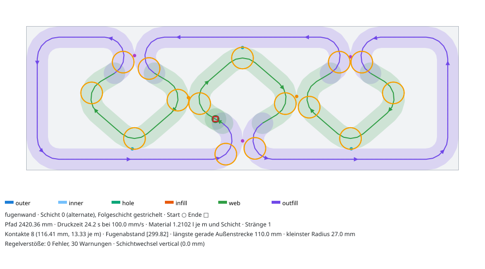 | 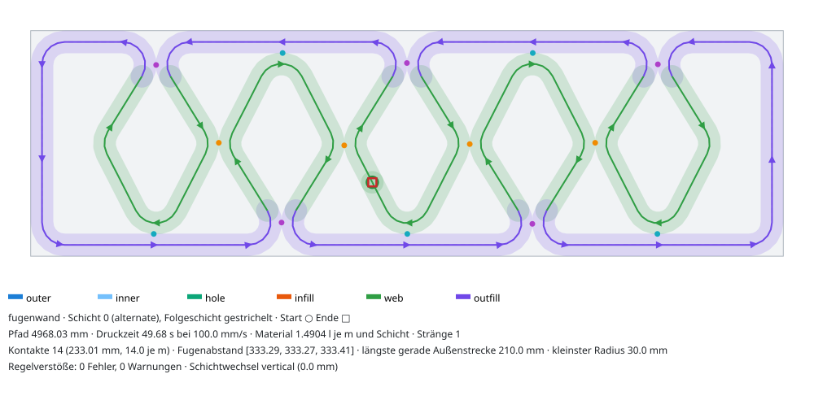 |
| a Gurt gespiegelt | 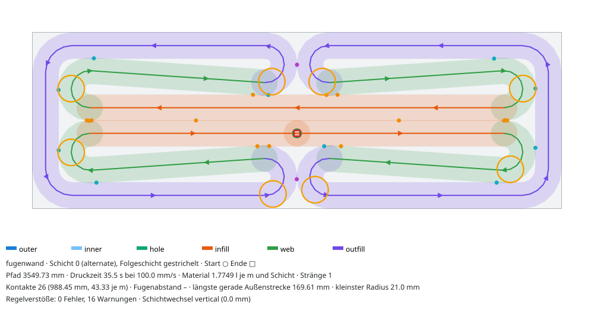 | 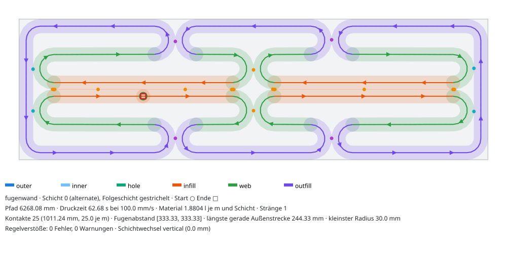 |
| c Gurt versetzt | 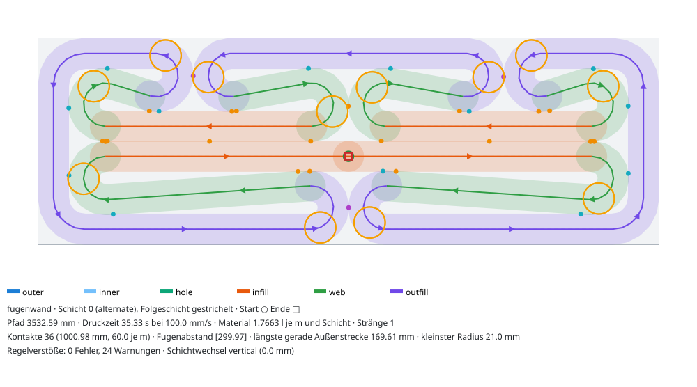 | 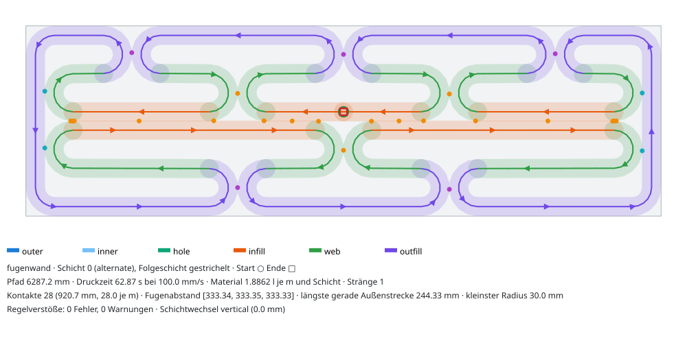 |
| a wie Foto (r = 20, F = 250) | 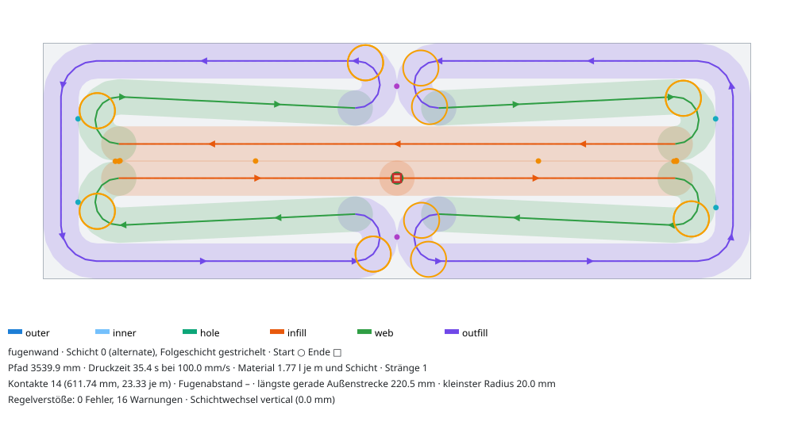 | 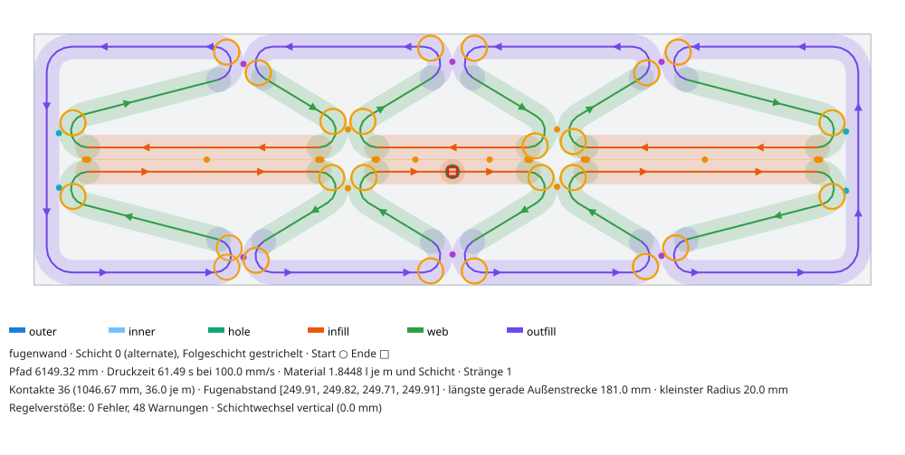 |

## Geometrie

Der Pfad ist eine **Riemenfolge über Kreise**: jeder Bogen ein Kreis mit festem Radius und
Drehsinn, dazwischen die gemeinsamen Tangenten. Das hat drei Gründe:

1. Kontakte sind exakt: Ein Kontakt ist ein Paar spiegelbildlicher Bögen, deren Extrempunkte genau δ
   auseinanderliegen (Mittelpunkt ± r).
2. Der Pfad ist tangentenstetig, jeder Bogen hat genau den gewählten Radius (M6).
3. Eine Eckenrundung im Nachhinein (`fillet_polyline`) scheitert an den spitzen Haken: Die
   Tangentenlänge r·cot(φ/2) beträgt bei 30° schon 3,7·r.

Die Punkte liegen auf der Sollkurve: Bögen mit Sehnenfehler ≤ 0,5 mm, Geraden mit ≤ 20 mm
Punktabstand und mindestens einem Zwischenpunkt. Ein Neu-Abtasten entfällt.

Segmentarten (ARTEFAKT-FORMAT, Nachtrag 18:45):

| Art | Teil |
|---|---|
| `outfill` | Felder, Fugenhaken, Endkappen und Ecken (Schale 0) |
| `web` | Stege, Knoten- und Rautenspitzen (`shell = params.shells`) |
| `infill` | Gurtstücke |

Stoßende Stücke gleicher Art werden zu einem Segment zusammengefasst. Zwischen zwei Segmenten liegt
ein Verbinder der Länge 0.

**Naht (M4).** Der Zug ist geschlossen, die Naht liegt in der Mitte des Gurtstücks bzw. Stegs mit
dem größten Abstand zu Außen- und Stoßflächen; bei Gleichstand gewinnt das Stück nächst der
Modulmitte. Der Materialpunkt des senkrechten Hubs (alternate: Schicht L + 1 ist die exakte
Umkehrung) sitzt so im Wandinneren auf einem Gurt bzw. Steg, nie auf der Sichtfläche und nie am
Modulstoß. In den Tests liegt die Raupenkante am Nahtpunkt immer mehr als w von jeder Fläche entfernt.

**Rückfälle.** Ist die Riemenfolge nicht baubar, versucht das Muster der Reihe nach:

1. die gewünschte Felderzahl mit kleineren Hakenradien (r·1,0 … 0,5, mindestens w/2);
2. weniger, längere Felder.

Gründe für „nicht baubar“: Es gibt keine Tangente, ein Bogen läuft über 300°, oder die
Schnellprüfung findet einen Selbstschnitt bzw. Stränge näher als (1 − ε)·w. `meta["adjusted"]`
nennt die Anpassung. Geht gar nichts, oder ist der Querschnitt kein Rechteck (L, Loch), liefert
das Muster das Grundmuster `shell_chain` und `meta["pattern_fallback"]` nennt den Grund. Inseln
neben einer Öffnung sind Rechtecke und bekommen je eine eigene Fugenwand.

## Abschrägung (Kopfmodule, S6)

Stand 21.10.2026, Fix-Aufgabe „Fugenwand an Abschrägungen“. Code:
`families/_fugenwand_kopf.py` (wird von `fugenwand.build` gerufen), Tests:
`core/tests/test_patterns_fugenwand_kopf.py`. **E** = gerechnet, **A** = Annahme.

**Problem.** In S6 tragen die 20 obersten Module (left r9: 10, right front r9: 3, right back r5: 7)
die 45°-Schräge des Wandkopfs: Ab Schicht 10 bzw. 13 wird die Wand je Schicht um 10 mm dünner (200 → 190,7 → … → 0,7 mm, eine Seite bleibt stehen).
Die prismatische Fugenwand teilte jede Schicht neu ein, ihre Raupen wanderten: M3-Überhang bis
4279 mm², M4 nur 35–41 % senkrecht, M2-Kreuzung 0,74 mm, M6-Radius 6,7 mm, ab 110 mm Rückfall auf
Schalen mit abgesetztem Strang (`S2-RAUTENKETTE.md`).

**Lösung: Einteilung aus dem ganzen Teil, Raupen fallen nur weg.** Das Muster ist jetzt schichtabhängig
registriert (`layer_invariant = False`) und sieht `ctx.sections` an. Trägt das Teil eine Abschrägung
(eine Insel je Schicht, gleiche Länge, die Dicke nimmt von einer Seite ab; Erkennung wie `topologie`,
leere Schichten oben werden übergangen), plant `_fugenwand_kopf` den ganzen Teil aus dem
Vollquerschnitt. Sonst bleibt alles wie bisher: Prismatische Teile bekommen genau den Inselpfad von
`build_plan` (Gleichheitstest `test_rectangle_sections_unchanged`, dazu sha256 über 39 Fälle vor
und nach der Änderung: gleich).

Seiten: **S** = Schrägseite (weicht zurück), **G** = Gegenseite (bleibt stehen).

| Schichten | Bahn | Bild |
|---|---|---|
| Vollquerschnitt (Dicke ≥ T − 1 mm) | S: Felder mit Fugen und Rauten **in den Fugenlagen des Vollquerschnitts** (dieselben wie in den Modulen darunter, S6: Rückseite x = −200, 0, 200 mm); die untere Rautenspitze berührt Spur 1 (Kontakt `shell`). G: zwei Spuren ohne Fuge, Stirnschenkel, Wende (r = w/2) am rechten Stirnende. Ein offener Strang: Start in der Mitte des Eckbogens oben rechts, Ende im Wandinneren auf Spur 1 links. | 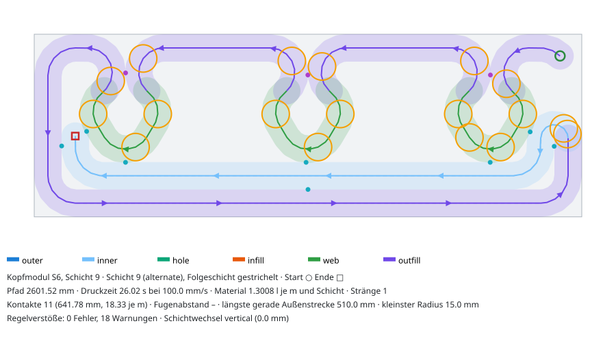 |
| Schräge, Dicke ≥ 104 mm | Doppel-U der Gegenseite (Spur 0 und Spur 1, Wende sinkt mit), wie `topologie` | 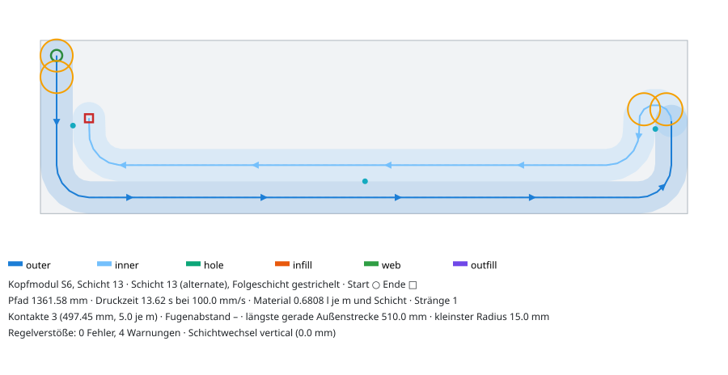 |
| 59 … 104 mm | einfaches U (Spur 0) | 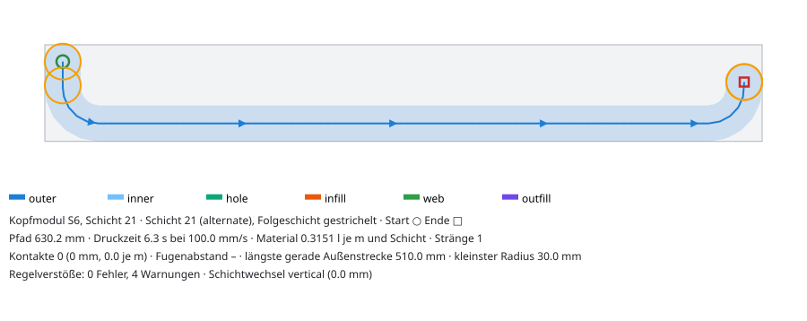 |
| 29 … 59 mm | ein Lauf auf Spur 0 an der Gegenseite | |
| < 29 mm (< w − 1) | nichts: eine Raupe passt nicht in den Querschnitt ⊕ 1 mm (M5) | |

Jede Bahn einer Schrägschicht ist ein Teil der Bahn der Schicht darunter (die Wende sinkt auf den
Schenkeln der tieferen Schicht). Deshalb gibt es keinen Überhang, auch nicht am Übergang
Vollschicht → Schräge: Dort fällt die Schrägseite mit Fugen und Rauten ganz weg, die U-Formen der
Gegenseite bleiben.

**M4 (senkrechter Wechsel).** Die Enden der U-Formen sinken mit; jede Schicht wird an der mit der
nächsten gemeinsamen Seite bis auf deren Strangende gekürzt (wie `topologie._align_bevel_ends`). Neu
gegenüber `topologie`:

- Am Übergang letzte Vollschicht → erste Schrägschicht ist das gemeinsame Ende immer das Ende von
  Spur 1 (es bleibt stehen). Liegt die letzte Vollschicht ungerade, wird die Bahn aller Schichten
  umgedreht (`meta.flipped`). Sonst würde die letzte Vollschicht gekürzt und wäre bei gleichem
  Querschnitt unvollständig (Orakel M3; `topologie` hat diesen Fehler im S6-Kopf: Schicht 9 nur 49 %
  statt 64 % Raupenfläche).
- Der rechte Schenkel des einfachen U endet höchstens auf Höhe der Wende darunter. Bei 60°-Schrägen
  (5,8 mm je Schicht) läge sein Ende sonst auf dem Wendenbogen, und der Wechsel wäre diagonal
  (`topologie` meldet dort einen M4-Fehler, E: 600 × 200 und 600 × 300 bei 60°).
- Zwei Schichten mit gleichem Querschnitt (Stufe in der Schräge) werden gleich gekürzt.

**Warum die Gegenseite keine Fuge hat (Beleg, E).** Eine Fuge ist eine Kerbe von der Außenfläche bis
zum Kontakt der Haken. Eine Kerbe kann nach oben nie schließen: Jede Raupe über ihr hinge (M3, δ = 2 mm).
Die obersten Schichten (Dicke < 59 mm) haben aber nur Platz für einen Lauf an der Gegenseite, und der
muss als ein Strang (M1) über jede Fugenlage laufen. Gemessen am vollen S6-Modul (600 × 200, F = 200):
ein durchgehender Lauf über der Rautenkette hängt an jeder der beiden Fugen der Vorderseite
**644 mm²** über (Toleranz 1 mm², `test_joint_notch_on_fixed_side_cannot_close`). Eine Fuge der
Gegenseite müsste also bis zum Wandkopf durchlaufen; dann druckten die obersten Schichten nur ein Feld
je Schicht (ein Strang je Insel), und der Kopf hätte über 2/3 der Länge keine Raupe. Deshalb hat die
Gegenseite im ganzen Kopfmodul keine Fuge, und die Fugenlinie dieser Seite endet am Modulstoß unter dem
Kopfmodul. Die Fugen der Schrägseite laufen bis zur letzten Vollschicht weiter.

**Warum die Rauten der Schrägseite nicht in die Schräge reichen.** Eine Raute hängt nur über die Felder
der Schrägseite am Strang. Die Schräge versetzt die Außenfläche je Schicht um 10 mm (45°) bzw. 5,8 mm
(60°), mehr als δ = 2 mm. Die Felder fallen also in der ersten Schrägschicht weg, und mit ihnen jede
Raute (sie wäre ein eigener Strang, M1). Eine tiefer gesetzte Rautenspitze hinge über dem Hohlraum der
Raute.

**Oberste Schichten.** Dicke 29…59 mm: ein Lauf auf Spur 0 an der Gegenseite (er liegt auf dem Lauf
der Schicht darunter). Ein Strang auf der Mittellinie der Schicht hinge dagegen: bei 40 mm Dicke
1602 mm² über dem Lauf darunter (E). Unter w − 1 = 29 mm ist nichts druckbar (M5). Der Hinweis steht
im `meta` der obersten gedruckten Schicht (`thin_note`, auch in `layer_notes`), die Messung meldet die
leeren Inseln als M1-Warnung „Kappe über tieferer Raupe“. Das Orakel `verify_muster` zählt sie als
M1-Fehler (Insel ohne Strang), und die G3-Abdeckung dieser Schichten ist 0 %. Das ist physikalisch
nicht behebbar: Die S2-Köpfe enden mit 20,7 / 10,7 / 0,7 mm Dicke.

**Rückfälle.** Passen die Rauten nicht zwischen Schrägseite und Spur 1, läuft die Schrägseite ohne
Fuge (`meta.adjusted`): Rauten gibt es im Kopfmodul ab T ≈ 175 mm (F = 200, E). Unter ≈ 140 mm passen
Wende und Eckbogen am Stirnende nicht übereinander; dann übernimmt `topologie` (`pattern_fallback`).
Der Hakenradius im Kopfmodul ist bei 200 mm 27 mm statt 30 mm (die Raute ist um Spur 1 kürzer, nur
M6-Warnungen).

**Ergebnisse (E, `measure` und eigene shapely-Nachrechnung von M3, w = 30 mm, F = 200 mm):**

| Teil | Schichten / Stränge | Vollschichten | Fehler M1–M7 | Überhang (eigene Rechnung) | senkrecht | Raupenfläche je Schrägschicht | Pfad |
|---|---|---|---|---|---|---|---|
| S6 left/front r9 (600 × 200 × 296) | 30 / 27 | 0–9 | 0 (Warnungen M6 180, M4 24, M1 3) | 0 mm² | 26/26 | 34–87 % | 42,7 m |
| S6 back r5 (600 × 200 × 326) | 33 / 30 | 0–12 | 0 (M6 239, M4 24, M1 3) | 0 mm² | 29/29 | 34–87 % | 50,6 m |
| 600 × 200, 45° | 25 / 22 | 0–4 | 0 | 0 mm² | 21/21 | 34–87 % | 29,7 m |
| 600 × 200, 60° | 39 / 34 | 0–4 | 0 | 0 mm² | 33/33 | 33–80 % | 41,5 m |
| 600 × 300, 45° | 35 / 32 | 0–4 | 0 | 0 mm² | 31/31 | 26–87 % | 47,8 m |
| 600 × 300, 60° | 56 / 52 | 0–4 | 0 | 0 mm² | 51/51 | 26–89 % | 71,2 m |

Vorher (prismatische Fugenwand) auf denselben S6-Köpfen: M2 4, M3 16, M4 17, M6 6 Fehler, eigener
M3-Überhang 4279 mm². Zum Vergleich `topologie` auf dem S6-Kopf: 0 Fehler, Pfad 42,2 m, Raupenfläche
32–87 %; Grundmuster „Schalen“: 43 Fehler. Breite Prüfung (E, `pytest` und ein Sweep über
X = 300…1200, T = 120…365, 30°/45°/60°, beide Seiten, 1/4/5 Vollschichten, Rautenkette, Gurt,
gespiegelt, F = 225, r = 20): kein Fehler, kein Überhang, keine unvollständige Schicht.

**Grenzen.** Nur Schrägen von einer Seite, nur abnehmend, eine Insel. Ein Sprung auf unter ≈ 104 mm
Dicke in einer Schicht (Stufe statt Schräge, w = 30 mm) lässt die erste dünnere Schicht ohne Spur 1;
dann wird die letzte Vollschicht für den senkrechten Wechsel bis auf Spur 0 gekürzt, nur sie
(`meta.cut_mm`, `step_note`; Orakel: unvollständige Schicht). Gegenprüfung 21.10.2026 (E): Vorher
kürzte `align_ends` über die Regel „gleicher Querschnitt“ alle Vollschichten mit, Spur 1 fehlte im
ganzen Teil (600 × 200, Sprung 100 mm: 60 039 statt 78 575 mm² Raupe je Vollschicht; 600 × 300, Sprung
200 mm: 80 059 statt 99 029 mm²), ohne Hinweis und ohne Fehler in `measure` (das Orakel vergleicht
gleiche Querschnitte nur untereinander, und die waren alle gleich gekürzt;
`test_thickness_jump_cuts_only_the_last_full_layer`). Beidseitige Schrägen (beide Außenflächen
weichen zurück) erkennt weder `fugenwand` noch `topologie`; sie bleiben prismatisch je Schicht
(unverändert gegenüber vorher, E: 600 × 200, 45°, je Seite 5 mm je Schicht: M3-Überhang
1550…2000 mm² je Schicht, dazu M2/M4/M6; `topologie` 2900…3600 mm²). Über einer Kerbe oder einem
Hohlraum kann keine Raupe nach innen wandern; ein Kopfmodul mit beidseitiger Schräge bräuchte
vermutlich einen Querschnitt ohne Kerben und Hohlraum am Rand (A), den keines der Muster plant. In S2/S6
kommt der Fall nicht vor. Gurt und gespiegelte Fugen gelten nur in Modulen mit vollem Querschnitt; im Kopfmodul hängen an der Schrägseite
immer Rauten (in den Fugenlagen der gewählten Variante).

## Parameter

| Name | Beschriftung | Standard | Wirkung |
|---|---|---|---|
| `field_length_mm` | Feldlänge (Ziel) | 300 | Fugenabstand je Seite; `fit_to_length` teilt die Modullänge in eine ganze Zahl gleicher Felder. Die tatsächliche Länge steht in `meta.fit` und `meta.field_length_mm`. |
| `web_angle_deg` | Stegwinkel (0 = aus Feldlänge) | 0 | > 0: Die Ziel-Feldlänge folgt per Bisektion aus dem tatsächlichen Tangentenwinkel Haken → Knoten (`meta.web_angle_reached_deg`). |
| `belt` | mit Gurt | aus | an: Varianten a/c; aus: Rautenkette (b) |
| `back_offset` | Rückseite | versetzt | `gespiegelt` / `versetzt` (um F/2) |
| `end_node` | Knoten im Endfeld | Endkappe | nur Gurt: Knoten des Endfelds an der Kappe (kleinere Endzelle) oder über der Feldmitte |
| `joint_gap_mm` | Fugenspalt (0 = stumpf) | 0 | > 0: Haken mit w + Spalt Abstand, kein Kontakt |
| `joint_contact_mm` | Kontaktlänge Fuge | 0 | gerade Berührstrecke der Fugenhaken (senkrecht zur Wand) |
| `node_length_mm` | Knotenlänge | 0 | gerade Berührstrecke an den Knoten |
| `apex_length_mm` | Kontaktlänge Rautenspitze | 0 | flache Rautenspitze am Feld der Gegenseite |
| `hook_radius_mm` | Radius an Fuge und Knoten (0 = Eckradius) | 0 (= w) | M6: hart ≥ w/2, Ziel ≥ w |
| `contact_overlap_mm` | Sollüberlappung an Kontakten | 1,0 | δ = w − Überlappung, erlaubt 0 … ε·w (größere Werte, z. B. 4,5 mm bei w < 30, klemmt das Muster auf ε·w und nennt das in `adjusted`). 1 mm deckt den Sehnenfehler (≤ 0,5 mm je Seite). |

Wanddicke und Modullänge kommen aus dem Querschnitt (Preset-`outline` bzw. Modul), w aus
`bead_width_mm`. Die Eckradien der Endkappen setzt `corner_radius_mm` (Kern, Standard w).

## Machbarkeit (M1–M7 ohne Fehler, w = 30 mm, Feldlänge 300 bzw. 250 bei „foto“)

Eintrag: Felder × tatsächliche Feldlänge, dazu `rNN`, wenn der Hakenradius unter w verkleinert
werden musste (dann gibt es nur M6-Warnungen). Alle Felder sind gültig: kein Fehler, nur
M6-Warnungen bei r < w. Gerechnet mit `scripts/muster_fugenwand.py --table`.

| Variante | Dicke | 300 mm | 400 mm | 500 mm | 600 mm | 750 mm | 900 mm | 1000 mm | 1200 mm |
|---|---|---|---|---|---|---|---|---|---|
| raute | 200 | 1×300 r27 | 1×400 r27 | 2×250 | 2×300 r27 | 2×375 r27 | 3×300 r27 | 3×333 r27 | 4×300 r27 |
| raute | 300 | 1×300 | 1×400 | 2×250 | 2×300 | 2×375 | 3×300 | 3×333 | 4×300 |
| raute | 365 | 1×300 | 1×400 | 2×250 | 2×300 | 2×375 | 3×300 | 3×333 | 4×300 |
| gurt | 200 | 2×150 r21 | 2×200 r21 | 2×250 r21 | 2×300 r21 | 2×375 r21 | 3×300 r21 | 3×333 r21 | 4×300 r21 |
| gurt | 300 | 2×150 | 2×200 | 2×250 | 2×300 | 2×375 | 3×300 | 3×333 | 4×300 |
| gurt | 365 | 2×150 | 2×200 | 2×250 | 2×300 | 2×375 | 3×300 | 3×333 | 4×300 |
| versetzt | 200 | 2×150 r15 | 2×200 r15 | 2×250 r18 | 2×300 r21 | 2×375 r21 | 3×300 r21 | 3×333 r21 | 4×300 r21 |
| versetzt | 300 | 2×150 r21 | 2×200 | 2×250 | 2×300 | 2×375 | 3×300 | 3×333 | 4×300 |
| versetzt | 365 | 2×150 r21 | 2×200 | 2×250 | 2×300 | 2×375 | 3×300 | 3×333 | 4×300 |
| foto | 200–365 | 2×150 r20 | 2×200 r20 | 2×250 r20 | 2×300 r20 | 3×250 r20 | 4×225 r20 | 4×250 r20 | 5×240 r20 |

Rautenkette bei 300–400 mm Länge: `fit_to_length` ergibt ein Feld. Dann hat nur die Rückseite eine
Fuge in Modulmitte, die Vorderseite reißt am Modulstoß. Wer dort Fugen auf beiden Seiten will,
stellt die Feldlänge auf ≤ 200 mm.

## Grenzen (mit Zahlen)

- **Gurt (a, c): Mindestdicke.** Der Knotenhaken darf das Feld nicht berühren. Daraus folgt
  d ≥ w + 2·(1 − ε)·w + 4·r + δ + 2·Knotenlänge. Mit r = w = 30 sind das **230 mm**, mit r = w/2
  **170 mm**. Gemessen: 230 bzw. 170 mm. Bei 200 mm Wand geht der Gurt also nur mit r ≈ 21 mm
  (M6-Warnung). Unter 170 mm fällt das Muster auf `shell_chain` zurück.
- **Gurt (a, c): schräge Stege brauchen dicke Wände.** Zwischen Fugen- und Knotenhaken bleiben
  in der Höhe d/2 − δ/2 − w/2 − 2·r. Liegt das nahe 2·r, ist die innere Tangente waagrecht und das
  Muster wird ein Mäander. Das gilt bei 300 mm und r = 30: Stegwinkel 0,1°, Bild `gurt_1000x300`.
  V-förmige Stege mit allen Winkeln ≥ 20° gibt es bei r = w erst ab **370 mm** Dicke (F = 200).
  Bei 300 mm braucht es r ≈ 20 mm, siehe Preset `foto`: 14–31°.
- **Rautenkette: Mindestdicke 120 mm (= 4·w).** Bei r = w/2 geht sie bis 120 mm, bei 110 mm fällt sie
  zurück. Bei 120 mm ist sie aber nur noch ein Mäander (Stegwinkel 0–1,3°), Rauten wie auf dem Foto
  gibt es erst ab etwa 150–170 mm (Gegenprüfung, F = 300, Stegwinkel: 130 mm 7–14°, 150 mm 17–20°,
  170 mm 27°, 200 mm 31–41°). Mit r = w braucht sie 185–210 mm. Bei 200 mm und F = 300 ist die Raute mit
  F/4 = 75 mm halber Breite zu schmal für r = 30: Die Tangente Fugenhaken → Spitze fehlt,
  Abstand 56,8 mm < 2·r. Deshalb r = 27.
- **Endzellen.** Am Modulende gibt es keinen halben Steg. Die Endkappe und ein weiterer Steg ergäben
  an der Ecke drei Äste, also einen ungeraden Grad, und damit keinen einzelnen Strang. Die Endzelle
  ist deshalb die größte Zelle, bei der Rautenkette 600 × 200 sind das 9238 mm². Beim Gurt
  verkleinert `end_node = Endkappe` sie, weil der Endknoten die Kappe berührt.
- **Fugenkontakt ist punktförmig.** Zwei Bögen mit r berühren sich nur kurz: gemessene
  Kontaktzone 10–14 mm bei r = 20–30 mm. Die Fuge bleibt so ein Gelenk (Recherche: kleine
  Kontaktlänge). Mehr Haftung gibt `joint_contact_mm`.
- **Nur Rechteckinseln.** L-, T- und Lochquerschnitte bekommen das Grundmuster (Rückfall). Querstege
  an künftigen Laibungen (M3 über Schichten) baut die Familie Topologie. Abschrägungen (Kopfmodule)
  plant die Fugenwand selbst, siehe „Abschrägung“.
- **G3-Abdeckung.** Die Fugenwand ersetzt die Schalen. `shell_coverage` (Maß wie G3) liegt deshalb
  weit unter den 95 %, die G3 vom Slicer verlangt: Rautenkette 600 × 200 65 %, Gurt 89 %,
  bei 1000 × 300 alle Varianten 60–65 %. Das ist kein Fehler des Musters. Es gehört zum
  Gate-Einwand des Kerns: G3 für Muster ersetzen.

## Kennzahlen je Variante (Schicht 0, v = 100 mm/s)

Zum Vergleich das Grundmuster „2 Schalen“:

| Querschnitt | Pfad | Material | längste Außenstrecke |
|---|---|---|---|
| 600 × 200 | 2552 mm | 1,276 l/(m·Schicht) | 510 mm |
| 1000 × 300 | 4552 mm | 1,366 l/(m·Schicht) | 910 mm |
| 1200 × 365 | 5612 mm | 1,403 l/(m·Schicht) | 1110 mm |

| Variante | Querschnitt | Felder × F | r | Pfad mm | Zeit s | Material l/(m·Schicht) | Kontakte Fuge/Knoten/Schale | längste Außenstrecke mm | größte Zelle mm² (Spannweite) | Stegwinkel ° | Warn. |
|---|---|---|---|---|---|---|---|---|---|---|---|
| raute | 600×200 | 2×300 | 27 | 2420 | 24 | 1.210 | 3/2/3 | 110 | 9238 (140) | 30.6, 40.9 | 15 |
| raute | 1000×300 | 3×333 | 30 | 4968 | 50 | 1.490 | 5/4/5 | 210 | 19137 (240) | 58.3, 62.9 | 0 |
| raute | 1200×365 | 4×300 | 30 | 7260 | 73 | 1.815 | 7/6/7 | 275 | 20358 (305) | 70.1, 74.3 | 0 |
| gurt | 600×200 | 2×300 | 21 | 3550 | 36 | 1.775 | 2/14/10 | 170 | 1108 (182) | 3.9 | 8 |
| gurt | 1000×300 | 3×333 | 30 | 6268 | 63 | 1.880 | 4/17/4 | 244 | 13096 (411) | 0.1, 0.4 | 0 |
| gurt | 1200×365 | 4×300 | 30 | 7709 | 77 | 1.927 | 6/26/4 | 211 | 18259 (361) | 10, 24.1 | 0 |
| versetzt | 600×200 | 2×300 | 21 | 3533 | 35 | 1.766 | 3/20/13 | 170 | 1108 (182) | 3.9, 10.2, 17.4 | 12 |
| versetzt | 1000×300 | 3×333 | 30 | 6287 | 63 | 1.886 | 5/19/4 | 244 | 13096 (411) | 0.1, 0.4, 0.6 | 0 |
| versetzt | 1200×365 | 4×300 | 30 | 7760 | 78 | 1.940 | 7/27/4 | 211 | 18259 (361) | 10, 24.1, 33.6 | 0 |
| foto | 600×200 | 2×300 | 20 | 3540 | 35 | 1.770 | 2/8/4 | 220 | 2729 (481) | 2.7 | 8 |
| foto | 1000×300 | 4×250 | 20 | 6149 | 61 | 1.845 | 6/26/4 | 181 | 10086 (286) | 14.5, 31.1 | 24 |
| foto | 1200×365 | 5×240 | 20 | 7786 | 78 | 1.947 | 8/35/4 | 171 | 14494 (271) | 25.8, 46.9 | 32 |

So liest du die Spalten:

- **Kontakte:** gemessene Kontaktzonen. Beim Gurt zählen die Doppelgurt-Berührungen als Knoten.
- **Längste Außenstrecke:** die längste gerade, ungestützte Außenstrecke, also die Rissneigung.
  Bei der Rautenkette stützt die Spitze der Gegenseite das Feld in der Mitte, die Strecke ist
  dort ≈ F/2.
- **Warn.:** Zahl der M6-Warnungen (r < w) in Schicht 0. Andere Warnungen gibt es nicht.

Alle Zeilen sind ohne Fehler. Jede Schicht ist ein geschlossener Strang, der Schichtwechsel ist
senkrecht (0,0 mm), der kleinste Mittellinienabstand bei Bogenlängenabstand > 2·w ist ≥ 28,5 mm.
Die Vorschau rechnet zwei Schichten plus Messung. Gemessen bei parallel laufenden Agenten:
Planung 15–50 ms je Insel (einmal je Querschnitt, danach aus dem Cache), Messung 40–90 ms je
Schicht. Das 100-ms-Ziel je Schicht hält also nur knapp. Den größten Teil kostet `metrics`.

## Empfehlung

1. **Standard: Rautenkette (b), F = 300 mm, r = w.** Sie verbraucht am wenigsten Material
   (600 × 200: 1,21 l/(m·Schicht), weniger als zwei Schalen mit 1,28) und hat die kürzeste Druckzeit.
   Jede Fuge beider Seiten ist echt. Das Feld der Gegenseite wird in der Mitte gestützt. Sie sieht
   aus wie das Foto: Raute über der Fuge, Dreieck über dem Feld, Knoten berühren sich. Ab 300 mm
   Dicke gibt es keine Warnung, bei 200 mm r = 27 mm (M6-Warnung, Ziel knapp verfehlt).
2. **Gurt (a, c)** nur bei Wänden ≥ 365 mm oder mit r ≈ 20 mm (Preset `foto`). Er ist steifer
   (Doppelgurt, viele Kontakte), braucht aber mehr Material als die Rautenkette (600 × 200: +47 %, 1000 × 300: +26 %, 1200 × 365: +6 %). In
   200–300 mm Wänden wird er bei r = w zum Mäander. Gespiegelt (a) gibt eine durchgehende
   Sollbruchebene durch die Wand, versetzt (c) verteilt die Fugen.
3. **Fugenabstand:** 300 mm, wie in der Recherche (160–300 mm, Fugenöffnung ≤ 3 mm bei 1 %
   Schwinden). Sie belegt aber keinen Wert für gedruckten Lehm. Das ist eine Weiche für den Testdruck.

## Offene Punkte

- **Orakel:** `verify_muster` wurde für die Fugenwand nicht gerechnet. Die Kern-Tests importieren
  es nicht, und für ein Artefakt fehlt der Einbau in den Slicer (M3).
- **M3-Stege:** Querstege an künftigen Laibungen behandelt die Fugenwand nicht (Öffnungen: Familie
  `topologie`). Abschrägungen sind gelöst (Abschnitt „Abschrägung“). Nicht-Rechtecke fallen auf das
  Grundmuster zurück.
- **Roboterprüfung:** Testkörper, S1-Quader und S2-Modul folgen in M3 bzw. M5. Am Gerät ist zu
  prüfen, ob die engen Haken (180°-Wende auf r = 20–30 mm) sauber laufen und ob der punktförmige
  Fugenkontakt beim Trocknen wie gewollt reißt.
