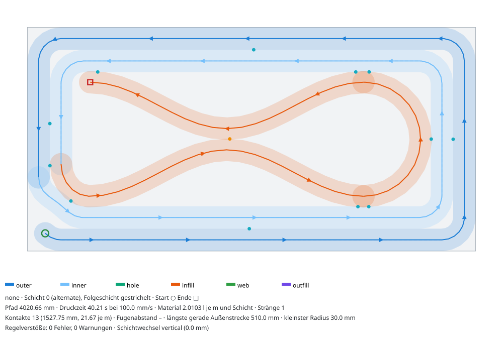
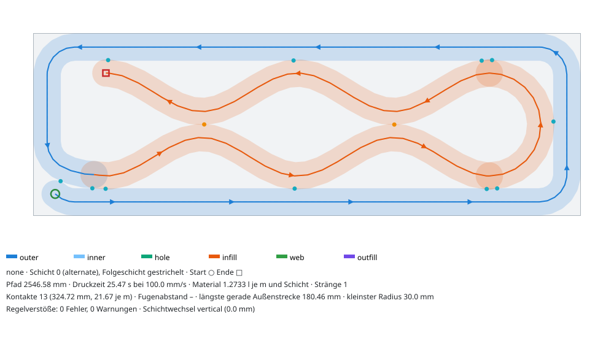
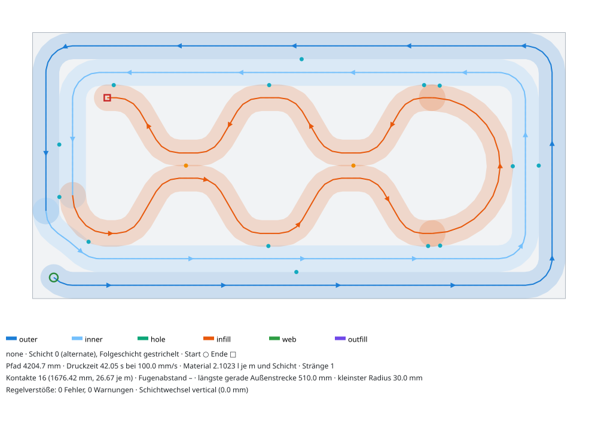
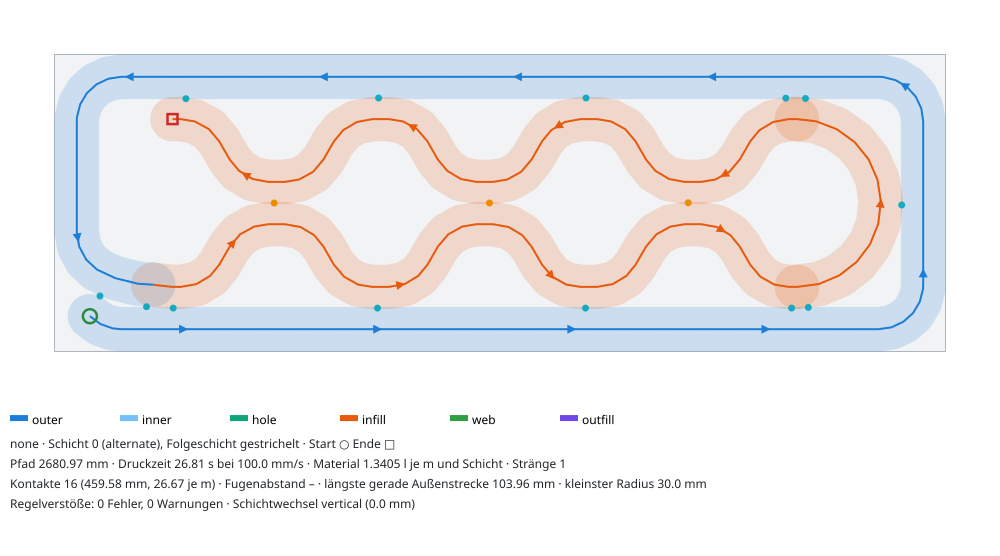
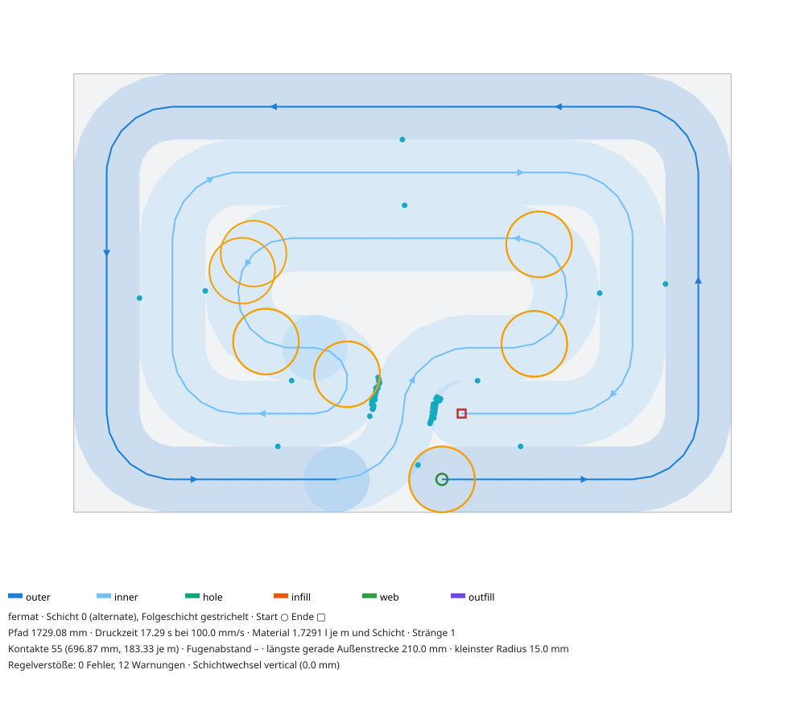
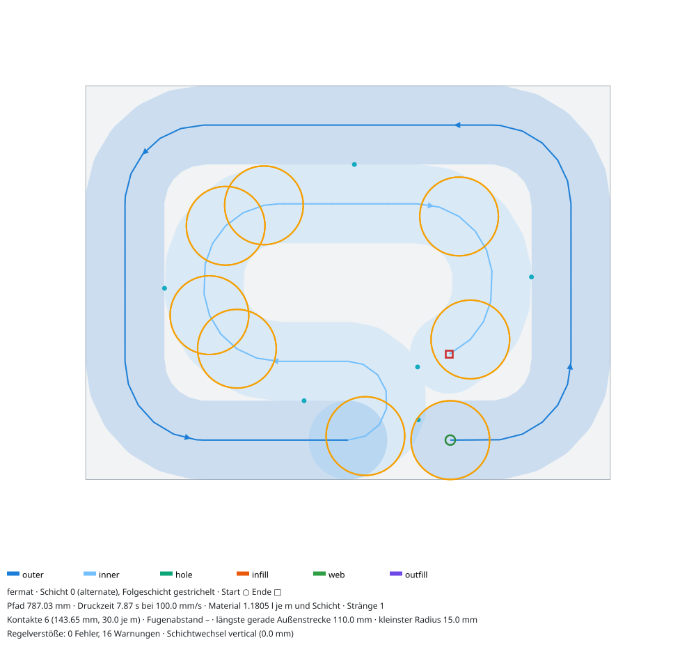
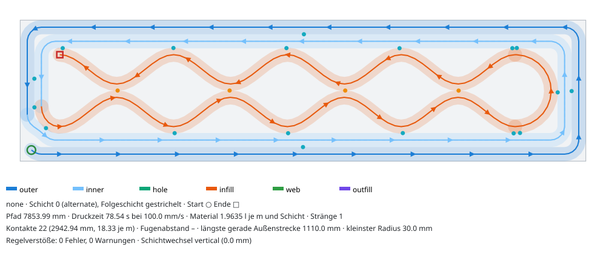

# Mehrfach-Muster: Doppelwelle, Waben, Fermat-Spirale

Familie `core/src/roboprint/patterns/families/mehrfach.py` (Fermat-Geometrie in
`_mehrfach_fermat.py`), Aufgabe I-Mehrfach im Nachtlauf „Druckmuster“. Presets:
`core/src/roboprint/patterns/presets/{doppelwelle,waben,fermat}.json`. Tests:
`core/tests/test_patterns_mehrfach.py` (Quader 200, 300 und 365 mm mit zwei Schalen und mit einer
Schale je Seite, Pfeiler 300 × 200 und kleinere Inseln, Orakel `verify_muster`).

Alle drei Muster sind je Schicht und Insel **ein Strang** ohne Absetzen und ohne Kreuzung. Mit
`layer_order = alternate` druckt Schicht L + 1 dieselbe Bahn rückwärts. Der Schichtwechsel ist
dann ein reiner Z-Hub (M4).

| Muster | Rolle | Wofür |
|---|---|---|
| `doppelwelle` | infill | Wände ≥ 300 mm mit 2 Schalen oder eine Schale je Seite (ab 200 mm) |
| `waben` | infill | wie Doppelwelle, Sechseckzellen statt Kettenglieder |
| `fermat` | full | kleine Inseln mit 2 bis 3 Ringen, z. B. Pfeiler 300 × 200 neben einer Öffnung |

## Bilder (Schicht 0, Folgeschicht gestrichelt, w = 30 mm)

| Doppelwelle 600 × 300, 2 Schalen | Doppelwelle 600 × 200, 1 Schale |
|---|---|
|  |  |
| **Waben 600 × 300, 2 Schalen** | **Waben 600 × 200, 1 Schale** |
|  |  |
| **Fermat, Pfeiler 300 × 200 (3 Ringe)** | **Fermat, Insel 200 × 150 (2 Ringe)** |
|  |  |

Längere Wand: 

## Doppelwelle und Waben

**Aufbau.** Zwei gegenphasige Wellen liegen im Infill-Band, je eine in einer Bandhälfte. Welle 1
läuft hin, am Bandende folgt eine halbkreisförmige Wende, Welle 2 läuft zurück. Welle 2 ist das
Spiegelbild von Welle 1 an der Bandachse. Wo Welle 1 ihr Tal hat, hat Welle 2 ihren Berg. Dort
berühren sich die beiden Raupen in der Bandmitte (Kontakt `node`) und kreuzen sich nicht. Zwischen
zwei Kontakten entsteht ein Kettenglied (Sinus) bzw. eine Sechseckzelle (Trapez).

Maße in Bandkoordinaten (B = Bandbreite, o = Kontaktüberlappung, Standard 5 % von w = 1,5 mm):

- Scheitel an der Schale bei v_t = B/2 + o. Die Raupe berührt die Innenschale wie bei den Wellen.
- Mittelkontakt bei v_b = (w − o)/2. Die beiden Wellen haben dort den Mittellinienabstand w − o =
  28,5 mm, das liegt in [(1 − ε)·w, w].
- Hub jeder Welle: 2A = v_t − v_b = (B − w)/2 + 1,5·o.
- Wende: Halbkreis mit Radius v_t. Sein Scheitel berührt die Stirnschale. Welle 1 endet deshalb in
  einem Scheitel an der Schale, und zwischen Wellenanfang und Wende liegt eine ganze Zahl k von
  Wellenlängen.
- Sinus (Doppelwelle): kleinster Radius λ²/(4π²A) ≥ w. Ist die Sollwellenlänge zu kurz, wird k
  verringert.
- Trapez (Waben): Flankenwinkel θ (Standard 60°), Plateau P = λ/2 − 2A/tan θ, Ecken mit Radius r
  (Standard w). Mit Wellenlänge 0 gilt das regelmäßige Sechseck: Seite s = 2A/sin θ,
  λ = 2s + 2·2A/tan θ.
- Einlauf wie bei den Wellen: tangentenstetiger Biarc von `ctx.entry` auf den ersten Scheitel. Die
  Seite und der Wellenanfang werden gesucht, gewählt wird der größte Einlaufradius (bis w), bei
  Gleichstand der früheste Einstieg.
- Welle 2 endet neben dem Einlauf im Hohlraum. Dort liegt die Naht, also weder an der Außenfläche
  noch an der Stoßfläche.

**Parameter.**

| Name | Regler | Standard | Wirkung |
|---|---|---|---|
| `wavelength_mm` | Wellenlänge | 250 mm (Doppelwelle), 0 = Sechseck (Waben) | Sollwert. Er wird auf k ganze Wellenlängen bis zur Wende angepasst. |
| `flank_angle_deg` | Flankenwinkel (Waben) | 60° | 60° ergibt das regelmäßige Sechseck |
| `round_radius_mm` | Eckradius (Waben) | 30 mm | wirksam mindestens w/2 + 0,5 mm |
| `contact_overlap_pct` | Kontaktüberlappung | 5 % | an der Schale und am Mittelkontakt, wirksam höchstens ε·w − 0,6 mm |
| `min_stroke_mm` | Mindesthub je Welle | 15 mm (w/2) | Unter diesem Hub entfällt das Muster (`meta.infill.skipped`). |

**Kennzahlen** (Quader 600 mm, Schicht 0, v = 100 mm/s; Material in Litern je m Wand und Schicht):

| Muster | Wand | Schalen | Pfad mm | Zeit s | Material | Mittelkontakte | Schalenkontakte | k | λ mm | größte Zelle mm |
|---|---|---|---|---|---|---|---|---|---|---|
| Schalen | 300 | 2 | 2952 | 29,5 | 1,48 | 0 | – | – | – | 509 |
| Sinus | 300 | 2 | 3551 | 35,5 | 1,78 | 0 | 8 | – | 441 | 413 |
| Doppelwelle | 300 | 2 | 4021 | 40,2 | 2,01 | 1 | 12 | 1 | 366 | 331 |
| Doppelwelle | 365 | 2 | 4385 | 43,9 | 2,19 | 1 | 12 | 1 | 334 | 308 |
| Doppelwelle | 200 | 1 | 2547 | 25,5 | 1,27 | 2 | 11 | 2 | 210 | 186 |
| Doppelwelle | 300 | 1 | 2829 | 28,3 | 1,41 | 1 | 9 | 1 | 371 | 342 |
| Waben | 300 | 2 | 4205 | 42,0 | 2,10 | 2 | 14 | 2 | 183 | 142 |
| Waben | 365 | 2 | 4460 | 44,6 | 2,23 | 1 | 12 | 1 | 334 | 236 |
| Waben | 200 | 1 | 2681 | 26,8 | 1,34 | 3 | 13 | 3 | 140 | 119 |
| Waben | 300 | 1 | 2913 | 29,1 | 1,46 | 1 | 9 | 1 | 371 | 253 |

In allen Fällen gibt es keine Verstöße und keine Warnungen. Der kleinste Radius ist 30 mm, der
kleinste Abstand 25,9 mm (2 Schalen, Einlauf an der Innenschale) bzw. 28,5 mm (Mittelkontakt). Die
Werte für die Mittelkontakte gelten bei 600 mm Länge. Die 1200-mm-Wand mit 300 mm Dicke hat 4
Mittelkontakte. Bemerkenswert ist eine Schale je Seite mit Doppelwelle bei 200 mm Wand: Sie braucht
dasselbe Material wie zwei Schalen ohne Infill (1,27 gegenüber 1,28 l/m), hat aber 2 Kettenglieder
und 11 Kontakte zur Schale.

**Grenzen mit Zahlen.**

- **S1 (200 mm Wand, 2 Schalen, Hohlraum 80 mm, Band 50 mm): geht nicht.** Der Hub je Welle ist
  2A = (50 − 30)/2 + 1,5·1,5 = 12,25 mm, also A = 6,1 mm. Die beiden „Wellen“ wären fast gerade
  Raupen. Die Zelle zwischen Welle und Schale wäre an der breitesten Stelle 10,75 mm breit (< w/2),
  die Wende hätte Radius 26,5 mm < w (M6-Warnung). Deshalb gibt es den Mindesthub 2A ≥ w/2. Mit
  `min_stroke_mm = 0` ist die Bahn geometrisch gültig, sie ist aber keine Doppelwelle mehr (Test
  `test_s1_doppelwelle_without_min_stroke_is_degenerate`).
- **Waben bei S1 gehen auch ohne Mindesthub nicht:** Zwei Eckbögen einer 60°-Flanke mit
  r ≥ w/2 = 15 mm brauchen den Hub 2·r·(1 − cos 60°) = 15 mm > 12,25 mm (M6 hart). Flachere Flanken
  wären möglich: r ≥ w/2 bei θ ≤ 53,8°, r ≥ w bei θ ≤ 37,3°. Die Zellen blieben aber unter w/2.
- **Kleinstes Band** für 2A ≥ w/2: B ≥ w + 2·(w/2) − 3·o = 55,5 mm, also Hohlraum ≥ 85,5 mm. Das
  sind 2 Schalen ab ≈ 206 mm Wand oder eine Schale je Seite ab 145 mm.
- **Wenige Kettenglieder auf 600 mm.** Bei 300 mm Wand und 2 Schalen ist A = 31,1 mm. Für
  R ≥ w braucht der Sinus λ ≥ 2π·√(A·w) = 192 mm. Die Wende verbraucht B/2 = 75 mm Bandlänge, für
  die Wellen bleiben 366 mm, also k = 1. Waben schaffen dort k = 2, weil ihr Radius nur an den
  Ecken zählt. Längere Wände bekommen mehr Glieder (1200 × 300: k = 4).

## Fermat-Spirale (kleine Inseln)

Vorbild sind die Connected Fermat Spirals (Zhao et al. 2016, recherche.md §4.1). Die Iso-Konturen
werden an einer Bruchstelle aufgeschnitten und so neu verbunden, dass ein Arm einwärts und einer
auswärts läuft. Start und Ende liegen am Rand nebeneinander.

**Ringe.** Ring i ist der Rand von Insel ⊖ (i + 0,5)·w, gerundet wie die Schalen. Die Ringe liegen
im Abstand w und berühren sich (Kontakt, kein Doppelmaterial). Ein Ring zählt nur, wenn er innen
Platz für Eckbögen mit r ≥ w/2 hat. Was in der Mitte übrig bleibt (< w), bleibt als Zelle offen.

**Drei Ringe (Pfeiler 300 × 200: Ringe bei 15, 45 und 75 mm).** Lokale Koordinate u läuft entlang
des längsten geraden Stücks des innersten Rings, v zeigt nach innen.

1. Ring 0 einwärts: Start bei u_s = 18 mm, ein Umlauf gegen den Uhrzeigersinn bis u = −30 mm.
2. Ringwechsel 0 → 2: S-Kurve aus zwei Viertelbögen r = w durch die Lücke in Ring 1.
3. Ring 2 einwärts: ein Umlauf bis u_h = −40 mm.
4. Kehre: Halbkreis r = w/2 = 15 mm auf Ring 1, der Drehsinn kehrt um.
5. Ring 1 auswärts (im Uhrzeigersinn) bis u_e = 27 mm. Das Ende liegt eine Raupe innen neben dem
   Start (Abstand 31,3 mm).

Zwei Ringe: Ring 0 einwärts, Kehre bei u = 0 auf Ring 1, Ring 1 auswärts. Start und Ende liegen bei
u = 39 mm. u_s, u_h und u_e werden im 1-mm-Raster gesucht: Gewählt wird der kleinste Abstand, bei
dem alle Punkte mit Bogenlängenabstand > 2·w mindestens (1 − ε)·w + 1 mm entfernt bleiben. Danach
prüft `metrics.measure_path` die ganze Bahn.

**Kennzahlen** (Schicht 0; Füllgrad = Raupenfläche / Querschnitt):

| Insel | Muster | Ringe | Pfad mm | Zeit s | Füllgrad | Kehre r | Lücke Ring 0 | kleinster Abstand |
|---|---|---|---|---|---|---|---|---|
| 300 × 200 | Schalen (2) | – | 1352 | 13,5 | 0,688 | – | – | 29,7 |
| 300 × 200 | Fermat | 3 | 1729 | 17,3 | 0,873 | 15 mm | 48 mm | 26,6 |
| 200 × 150 | Fermat | 2 | 787 | 7,9 | 0,808 | 15 mm | 39 mm | 27,1 |
| 200 × 200 | Fermat | 2 (Ring 2 verworfen) | 985 | 9,9 | 0,755 | 15 mm | 39 mm | 26,9 |

**Fallunterscheidung.**

- 2 oder 3 Ringe: Fermat-Spirale.
- Findet sich bei 3 Ringen keine Anordnung, gilt die Variante mit 2 Ringen. Das passiert, wenn das
  gerade Stück des innersten Rings kürzer als 2·a + w/2 = 75 mm ist (Pfeiler 200 × 200: Ring 2
  misst nur 50 × 50) oder wenn die Ringe an der Bruchstelle nicht parallel liegen (L-Querschnitt).
- 1 Ring (Insel < 4·w): geschlossener Einzelring.
- 4 und mehr Ringe (z. B. 600 × 365): Grundmuster `shell_chain` (`meta.fermat_skipped`). Ab 4
  Ringen müssten zwei Ringwechsel durch dieselben Lücken. Dafür wären Lücken ≥ 5·w nötig, und die
  Welle füllt solche Inseln besser.

**Grenzen.**

- Die Kehre in der Mitte hat r = w/2 = 15 mm. Das hält M6 hart ein, verfehlt aber das Ziel w
  (Warnung). Auch bei Zhao ist die Mitte der engste Bogen. Ring 2 des Pfeilers hat Eckradius 24 mm
  (Warnung).
- Ring 0 hat an der Bruchstelle eine Lücke von 48 mm Mittellinie (2 Ringe: 39 mm). An der
  Außenfläche entsteht eine senkrechte Kerbe von etwa 20 mm Breite, an derselben Stelle wie die
  Naht. Am Pfeiler berührt jede Seite eine Außen- oder Laibungsfläche. Die Naht liegt deshalb am
  Rand (M4-Warnung „Naht berührt Außenfläche“). Gewählt wird ein gerades Stück, dessen Außenring
  keine geschützte Fläche berührt; gibt es keins, das Stück nahe `seam_corner`.
- Laufzeit: Planung 50 bis 110 ms je Insel (gecacht für gleiche Schichten).

## Einwände

- `shells.shell_chain` (Kern) bricht bei Inseln unter etwa 4·w mit zwei Schalen ab (Insel
  100 × 100: `ValueError` in `clear_end`, leere S-Kurve). Das trifft auch das Grundmuster
  `schalen`. Die Fermat-Spirale umgeht es mit einem eigenen Einzelring. Die Korrektur gehört in den
  Ausweichfall von `shell_chain` (Familie Topologie).
