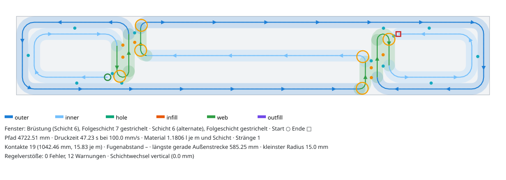
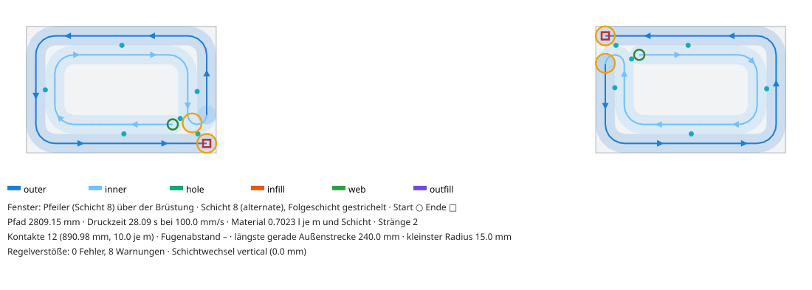
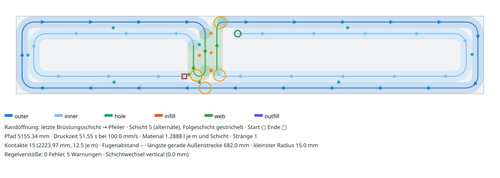
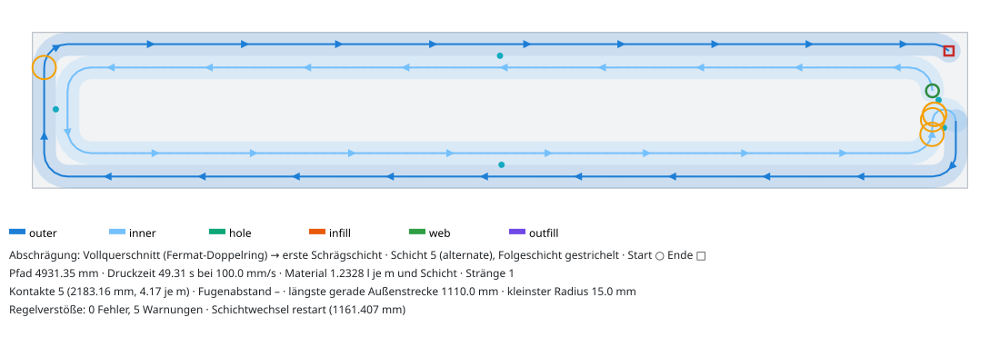
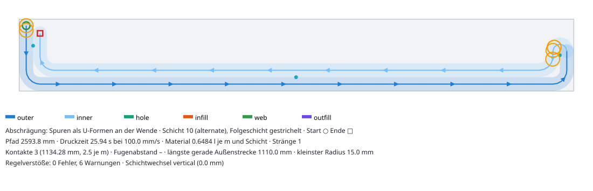

# Topologie: Öffnungen, Inseln, Laibungsstege, Naht

Musterfamilie `topologie` (Rolle `full`, schichtabhängig), Code in
`core/src/roboprint/patterns/families/topologie.py` mit den Hilfsmodulen `_topologie_bahnen.py`
(Bahnbausteine für Rechteckwände) und `_topologie_naht.py` (geprüfte Naht). Tests:
`core/tests/test_patterns_topologie.py`. Preset: `patterns/presets/topologie.json`.

Das Muster sieht die Querschnitte des **ganzen Teils** an und wählt je Teil eine Betriebsart.
Die gewählte Art und ihre Gründe stehen in `meta["topology"]` jedes Inselpfads.

| Betriebsart | Wann | Ergebnis |
|---|---|---|
| `allgemein` | gleichbleibender Querschnitt, beliebige Polygone, mehrere Inseln, L/U/T, Kerben | je Insel ein Strang, Naht geprüft |
| `abschraegung` | Rechteck, Länge gleich, Dicke nimmt von einer Seite ab (S2-Wandkopf) | Fermat-Doppelring, baut zu U-Formen ab |
| `oeffnung` | Rechteck, ab Schicht k ein oder zwei Randpfeiler voller Dicke (Fenster, Randöffnung) | Pfeiler laufen unten schon mit, Querstege an den künftigen Laibungen |

Parameter: `sill_middle_mm` (Lage des Mittellaufs im Brüstungsfeld, 0 = Wandmitte) und
`seam_check` (Nahtkandidaten prüfen, Standard an). Nicht passende Fälle (Mittelpfeiler,
Schräge und Öffnung im selben Teil, Pfeiler < 151 mm, Wand < 150 mm, `shells` ≠ 2) laufen als
`allgemein` mit Hinweis in `meta["topology"]["note"]`.

## Befund zu S2

`examples/Building-Architecture.ifc` enthält **keine Öffnungen** (kein `IfcOpeningElement`,
`IfcWindow`, `IfcDoor`; alle Schnitte haben eine Insel). Der einzige Querschnittswechsel in S2 ist
die **45°-Schräge am Kopf** der Außenwände: In den obersten ≈ 200 mm nimmt die Dicke je 10-mm-Schicht
um 10 mm ab (200 → 194,7 → … → 4,7 mm). Das „reale S2-Modul“ der Tests ist deshalb das oberste
Modul der Wand „house right front“ (900 × 200 × 600 mm, 60 Schichten). Fenster und Randöffnung
werden synthetisch geprüft (Wand 1200 × 200 × 2000 mm, Fenster 600 mm breit ab 800 mm Höhe).

| Teil | Grundmuster `schalen` | `topologie` |
|---|---|---|
| S2-Kopfmodul 900 × 200 × 600 (60 Schichten) | 64 Fehler (M2, M3, M6) | ok, 57 Stränge (3 Schichten < w), 1,3 s Planung + Prüfung |
| Fenster 1200 × 200 × 2000, Brüstung 800 | M3: 9378 mm² Überhang an der Brüstungsoberkante | ok, alle 200 Schichten, 0,35 s Planung, 5,5 s Prüfung |
| Randöffnung (Pfeiler links oder rechts) | M3 | ok |
| Kerbe 60 × 60 mm, 2 Schalen | M2 + M6 (Spur 1 scharfkantig, r = 13,4 mm) | ok (Ecken 22,5 mm) |
| Kerbe 100 mm tief (Hals 100 mm < 4·w) | M2, M6 | ok mit einer Schale an dieser Insel |
| L, U, T, V-Kerbe, Tür (zwei Inseln) | ok | ok |
| L-Ecke 365 mm, 3 Schalen | M2 (S-Kurven nebeneinander) | ok |

Gegenprobe mit der Fugenwand (Stand `origin/v2/muster-fugenwand`, nur gelesen, Kern dieses
Zweigs + Familie `topologie`): Prisma ok; Fenster, Randöffnung und Schräge mit Fugenwand M3-Fehler
wie das Grundmuster (die Fugenwand ist prismatisch); `topologie` auf diesem Kernstand ok.

## Öffnung: Laibungsstege aus dem ganzen Teil (M3)

**Pfeiler** (über der Brüstung, je Insel ein Strang): Start innen auf Spur 1, Spur 1 im
Uhrzeigersinn bis an die Laibung, Wende (Halbkreis r = w/2) auf Spur 0, Spur 0 die Laibung hinauf,
um den Pfeiler herum, Ende auf der Außenfläche an der Laibungsecke.

**Brüstung** (alle Schichten darunter, ein Strang): genau dieselben Pfeilerbahnen, nur heißen ihre
Laibungsschenkel hier `web` (Querstege an der künftigen Laibung, beide Spuren). Die Außenspur des
linken Pfeilers läuft an der Laibungsecke ohne Knick weiter in das **Brüstungsfeld**: unten (+x),
Flanke an der rechten Laibung (`web`), Mittellauf (−x), Flanke an der linken Laibung (`web`), oben
(+x) und von dort ohne Knick in die Außenspur des rechten Pfeilers, rückwärts bis in dessen Inneres.
Bei einer Randöffnung läuft das Feld als Spirale aus zwei Spuren bis zum Modulende.

Dadurch liegt jede Pfeilerraupe **exakt** auf einer Raupe der Schicht darunter (Überhang 0 mm²),
und der Schichtwechsel an der Brüstungsoberkante ist sogar senkrecht (Ende Brüstung = Start Pfeiler).
Bei der Randöffnung bleibt die Inselzahl 1, der Wechsel muss also senkrecht sein (M4). Beginnt der
Pfeiler in einer ungeraden Schicht (mit `alternate` umgekehrt gedruckt), läuft das ganze Teil
umgekehrt (`meta.topology.reversed` an der Brüstung): Die letzte Brüstungsschicht endet dann am
Pfeileranfang. Vorher war der Wechsel bei ungerader Brüstungsschichtzahl 163 mm diagonal.

**Warum eine Fuge nötig ist (Beleg).** Lässt man die Brüstungsschalen durchlaufen, muss ein
Steg die Laibungsschenkel des Pfeilers tragen. Überhang über der Laibungszone (x 200…300 mm,
Standardpfeiler, δ = 2 mm, Grenze 1 mm²):

| Stützung unter der Laibung | Überhang | freie Strangenden |
|---|---|---|
| keine | 4214 mm² | – |
| ein Steg auf dem Laibungsschenkel (Kappen) | 2059 mm² | 2 |
| Haarnadel aus Spur 1 (Bögen statt Kappen) | 130 mm² | 0 |
| Doppelsteg mit Kappen | 39 mm² | 4 |
| **Pfeilerbahn läuft unten mit (diese Familie)** | **0 mm²** | 0 |

Ein Steg braucht an beiden Enden Kappen (jeder Bogen lässt einen Zwickel, über dem der Pfeiler
hängt), und selbst dann bleibt Überhang an den gerundeten Pfeilerecken. Kappen sind freie
Strangenden, ein Strang hat aber nur zwei. Also muss die Brüstungsschale an jeder Laibung einmal
unterbrochen werden. Das Ergebnis ist **je Laibung eine Fuge auf einer Wandseite** (links oben,
rechts unten): V-Rücksprung bis 40,7 mm tief, 53 mm breit, darunter berühren sich Feldflanke und
Laibungsschenkel über die Brüstungshöhe. Das ist genau die Stelle, an der Brüstungen beim Schwinden
reißen (Fensterecke); die Fuge wirkt als Sollbruchstelle (vgl. Fugenwand, Nutzer-Nachtrag 18:20).
Die andere Wandseite läuft an jeder Laibung durch.

Laibung im Pfeiler: zwischen 50 und 150 mm Höhe glatt (Rücksprung ≤ 2 mm; Grundmuster dort 18,6 mm
auf 32 mm Länge durch den Nahtzwickel). An der Laibungsecke unten ein schmaler V-Spalt zwischen
Kappe der Außenspur und Wende (bis 26,9 mm tief, ≈ 10 mm hoch über 5 mm Tiefe).

## Abschrägung (S2-Wandkopf)

Eine 45°-Schräge versetzt die Außenfläche je Schicht um 10 mm = 1/3·w, fünfmal mehr als δ = 2 mm.
Eine hohle Wand kann der Fläche deshalb nicht folgen: Jede Raupe einer höheren Schicht muss auf
einer Raupe der Schicht darunter liegen, Raupen können nur **wegfallen**, nicht wandern. (Eine
volle Kopfzone müsste wegen M3 bis Schicht 0 voll sein.)

Lösung: **Fermat-Doppelring** schon ab Schicht 0. Spur 0 läuft von der Mitte des Eckbogens am
Stirnende gegen den Uhrzeigersinn um, eine Wende am Stirnende führt auf Spur 1, die im
Uhrzeigersinn umläuft und neben der Wende endet. Passt der obere Lauf einer Spur nicht mehr in den
Querschnitt, wird sie zur U-Form, die an der Wende hängen bleibt; die Wende sinkt mit (immer
unter t − w). Unter 105 mm Dicke fällt Spur 1 weg (die Wende hätte keinen geraden Schenkel mehr),
unter 59 mm bleibt der untere Lauf, unter 29 mm nichts. Im S2-Kopfmodul deckt die Raupenfläche je
Schicht 41…80 % des Querschnitts (Vollquerschnitt 62,5 %); die Schrägseite bleibt bis 24,7 mm
hinter der IFC-Fläche zurück.

## Naht (M4)

- **Vollquerschnitt, allgemein:** Kandidaten sind die Punkte des Außenrings mit dem größten
  Freiabstand zu Außen- (y) und Stoßflächen (x) des Teils, Gleichstand nächst `seam_corner`, also
  zuerst dieselbe Naht wie `layout.choose_seam`. Jeder Kandidat wird gebaut und mit
  `metrics.measure_path` geprüft; der erste fehlerfreie gewinnt. Am Rechteck: Mitte des Eckbogens
  (Freiabstand 8,8 mm), identisch mit dem Grundmuster.
- **Fermat (Schräge):** Mitte des Eckbogens am Stirnende (8,8 mm Freiabstand); in den Schrägschichten
  am oberen Ende des Stirnschenkels (jedes freie Ende einer U-Form liegt an einer Fläche; die
  Stoßfläche ist dem Sichtbereich vorzuziehen) → M4-Warnung. Der Schichtwechsel bleibt senkrecht
  (die Inselzahl ändert sich nicht, AUFTRAG M4 nimmt das nicht aus): Weil die freien Enden mit der
  Dicke sinken, wird Schicht L an der gemeinsamen Seite bis auf das Strangende von L + 1 gekürzt
  (`_align_bevel_ends`); das nimmt nur Raupe weg, über der nichts mehr liegt.
- **Öffnung:** Brüstung beginnt und endet innen auf Spur 1 der Pfeiler (frei von allen Flächen);
  Pfeiler beginnen innen und enden an der Laibungsecke auf der Außenfläche → M4-Warnung (die Bahn
  muss dort enden, weil sie in der Brüstung an genau dieser Stelle weiterläuft).

## Übergänge Schale → Schale ohne Doppelmaterial

- Allgemein: S-Kurve des Grundmusters (`shells.lane_change`), aber auf Ringen mit **schrittweiser
  Eckenrundung** (r, ¾·r, w/2): Der Kern fällt bei Topologiewechsel (Hals hinter einer Kerbe) auf
  scharfe Ecken zurück (M6-Fehler), hier bleibt die Rundung ≥ w/2.
- Fermat und Pfeiler: **Wende** (Halbkreis r = w/2) zwischen benachbarten Spuren; Strangenden halten
  zur Wende (1 − ε)·w + 1 mm Abstand (`turn_clearance`). Kein Doppelmaterial, aber M6-Ziel
  (r ≥ w) an der Wende verfehlt (Warnung).
- Infill: Diese Familie baut nur Schalen (Rolle `full`). Ein Infill-Muster kann nicht kombiniert
  werden; Übergänge Schale → Infill an L/U-Formen hängen am Infill-Muster (I-Wellen) und am
  Grundmuster des Kerns.

## Grenzen (mit Zahlen)

- Öffnung: Pfeiler ≥ 151 mm, Wand ≥ max(2·(1,5·w + r), 3,5·w + r) = 150 mm (w = r = 30 mm),
  Fensterfeld zwischen den Laibungen ≥ 61 mm, Randfeld bis zum Modulende ≥ 3·w + 2·r = 150 mm;
  nur Randpfeiler (Mittelpfeiler: zwei Öffnungen in einem Modul, nicht unterstützt); nur eine
  Teilung je Teil. Mittellauf `sill_middle_mm` wird auf 1,5·w … T − 1,5·w begrenzt.
- Schräge: nur von einer Seite und nur kleiner werdend; Schräge und Öffnung im selben Teil nicht.
- Hals schmaler als 2·Schalen·w (Kerbe 100 mm tief in 200 mm): Schalenzahl der Insel sinkt.
- Wachsender Querschnitt (z. B. Sturz über einer Öffnung im selben Teil) ist Überhang und bleibt
  ein M3-Fehler; die Zerlegung schneidet an der Sturzlinie, deshalb kommt das nicht vor.
- Warnungen bleiben: M6 an jeder Wende (r = 15 mm) und an den Feldecken, M4 an den Pfeilerenden
  und Schrägschichten, dazu Schätzwerte „Sehnenfehler“ am Übergang Bogen → Gerade (Schätzer
  überschätzt dort; `resample_curve` hält 0,5 mm ein).

## Empfehlungen und Einwände

1. **Weiche für den Nutzer: Brüstungsfuge.** Die Fuge je Laibung ist mit δ = 2 mm und einem Strang
   je Insel unvermeidbar (Beleg oben). Alternative ohne Fuge: In der Zerlegung auch an der
   Brüstungsoberkante (z0 der Öffnung) einen Pflichtschnitt setzen (heute nur Sturzlinie z1,
   `decompose.mandatory_cuts`); dann sind Brüstung und Pfeiler eigene prismatische Module.
   Empfehlung: Pflichtschnitt an der Brüstung, `topologie` für Module, die trotzdem teilen.
2. **Einwand δ = 2 mm bei Schrägen:** 45°-Schrägen (10 mm je Schicht) sind hohl nicht formtreu
   druckbar. Vorschlag für den SPEC-Nachtrag: eine Schrägregel (Versatz ≤ k·w je Schicht für
   Außenspuren mit Stützung durch die Nachbarspur) oder die Schräge bewusst stufen und nacharbeiten.
3. **Kern:** Die schrittweise Eckenrundung (`island_lanes`) und die geprüfte Naht (`best_chain`)
   wären auch im Grundmuster sinnvoll (Rechteckkerbe heute M2/M6-Fehler). Nicht übernommen, weil
   Kerndateien parallel bearbeitet werden; Vorschlag an den Kern-Agenten.

## Gegenprüfung (adversarial, nach Merge von Kern 074763c)

Eigene Nachrechnung mit shapely (Raupen von L + 1 ⊆ Raupen von L ⊕ 2 mm über alle Schichten,
Strangzahl = Inselzahl, keine Kreuzung der Mittellinie, Mindestabstand nicht benachbarter
Bahnteile ≥ (1 − ε)·w − 1 mm) und Zufallsprüfung (rund 1200 Teile aus neun Startwerten: Fenster, Randöffnung, Schräge mit
w 25…40 mm, r 10…50 mm, Mittellauf 0…400 mm, Wand 90…400 mm).

| Fall | Ergebnis |
|---|---|
| Fenster (Standard, 2000 mm hoch, am Rand 152 mm, schmal 62 mm, Brüstung 1 Schicht, Wand 150/300/365) | ok, Überhang 0 mm², ein Strang je Insel, keine Kreuzung |
| Randöffnung links/rechts, Pfeiler 160…1000 mm | ok, Überhang 0 mm² |
| Tür bis zum Boden (zwei Inseln ab Schicht 0) | ok (prismatisch, allgemein) |
| Zwei Fenster (Mittelpfeiler) | nicht unterstützt: allgemein mit Hinweis, M3 18 161 mm² |
| Sturz im Modul (Tür oder Fenster schließt oben) | M3 73 943 mm² (Brücke, physikalisch unvermeidbar; Zerlegung schneidet an der Sturzlinie) |
| Randfeld 100 mm (Pfeiler 1100 von 1200 mm) | allgemein, M3 5171 mm² (Randfeld < 150 mm) |
| `layer_order = same` | M4-Fehler „Schichtwechsel nicht senkrecht“, wie beim Grundmuster (Kernsemantik) |

Behobene Fehler: Abbruch (`ValueError: Rückwärtsfahrt`) bei Wänden 136…149 mm, bei Mittellauf
außerhalb 45…155 mm und bei Schrägen mit w = 40 mm und T < w + 2·r; Überhang 4,4 mm² am
Stirnschenkel der Schräge bei w = 40 mm (Kappe ragte 10 mm über die Wende, Grenze 9,1 mm,
`turn_cap_reach`); M6-Fehler bei Eckradius < w/2 (jetzt auf w/2 angehoben); Abbruch in
`shells.clear_end` (Kern) bei Inseln, deren innere Spur kürzer als 2·w ist (Kandidat wird
verworfen, weniger Schalen).

**Warum ein Mittelpfeiler nicht als ein Strang geht (Begründung, kein Beweis für jede Bahn):** Die
Pfeilerbahn über der Brüstung hat einen Endpunkt innen auf Spur 1, der von Spur 0 eingeschlossen
ist. Liegt sie unten als zusammenhängendes Stück im Brüstungsstrang, ist dieser innere Endpunkt ein
Strangende. Die beiden Randpfeiler belegen schon die zwei Enden. Eine Mittelpfeilerbahn mit beiden
Enden außen braucht zwei Durchgänge durch Spur 0 an derselben Stelle. Dann liegen beide Enden
nebeneinander auf einer Laibungsseite, und das andere Feld ist nicht erreichbar. Empfehlung: Die
Zerlegung schneidet bei zwei Öffnungen im Mittelpfeiler (senkrechte Fuge) oder an der Brüstung.
