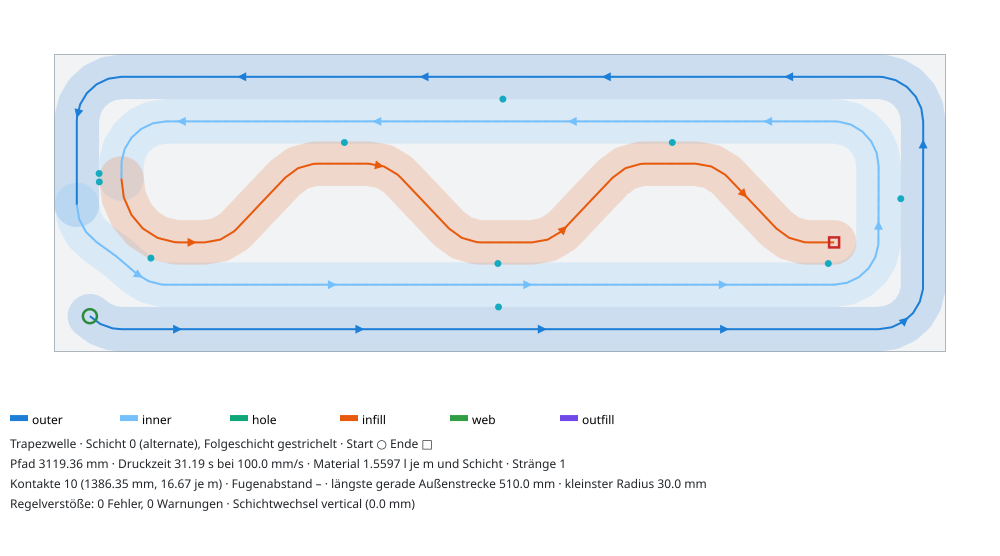
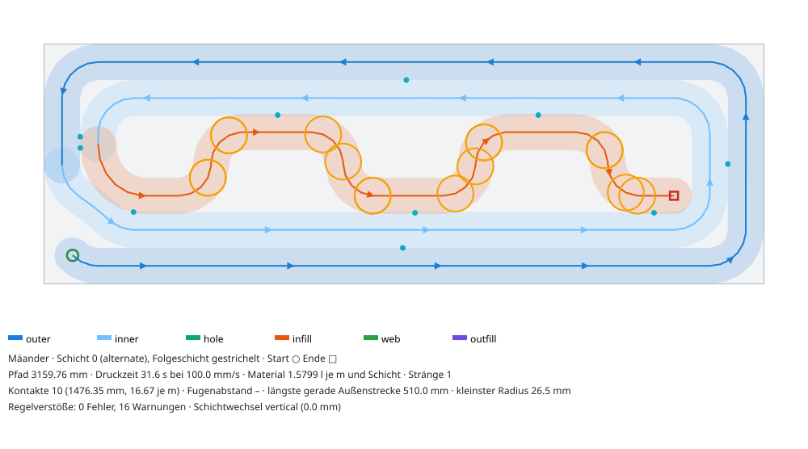
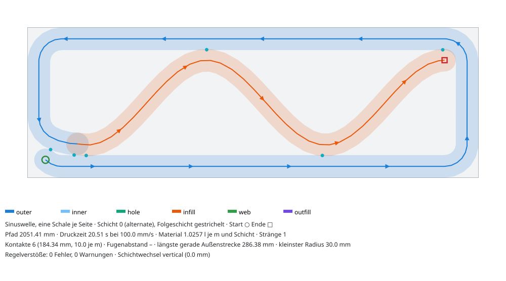
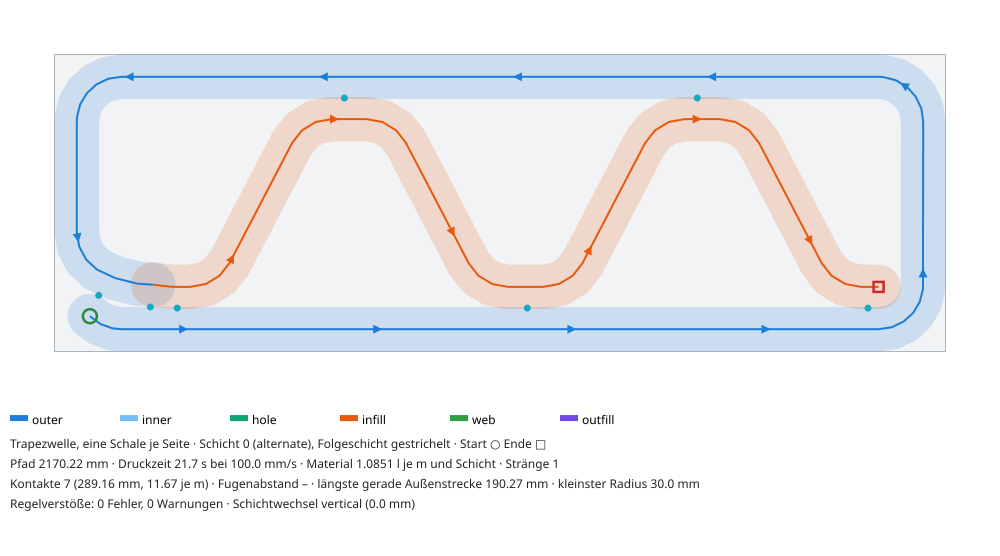

# Infill-Wellen: Sinus, Zickzack, Trapez, Mäander

Familie `core/src/roboprint/patterns/families/wellen.py` (Rolle `infill`), Aufgabe I-Wellen im
Nachtlauf „Druckmuster“. Presets: `core/src/roboprint/patterns/presets/{sinus,zickzack,trapez,maeander}.json`.
Tests: `core/tests/test_patterns_wellen.py`.

Die Welle liegt im Hohlraum zwischen den inneren Schalen. Sie wird als Fortsetzung des
Schalenstrangs gedruckt: ein Strang je Schicht und Insel, ohne Absetzen und ohne Kreuzung. Berge
und Täler berühren abwechselnd beide Innenschalen. Mit `layer_order = alternate` druckt Schicht
L + 1 dieselbe Bahn rückwärts. Der Schichtwechsel ist dann ein reiner Z-Hub am Wellenende im
Hohlraum, also weder an der Außen- noch an der Stoßfläche.

## Bilder (S1 600 × 200 mm, w = 30 mm, Schicht 0, Folgeschicht gestrichelt)

| Sinus | Zickzack |
|---|---|
|  |  |
| **Trapez** | **Mäander** |
|  |  |
| **Sinus, eine Schale je Seite** | **Trapez, eine Schale je Seite** |
|  |  |

## Parameter

| Name | Regler | Standard | Bereich | Wirkung |
|---|---|---|---|---|
| `wavelength_mm` | Wellenlänge | 250 mm | 80–2000 | Sollwert. Er wird auf eine ganze Zahl Halbwellen zwischen Einlauf und Bandende angepasst, mit höchstens so vielen Halbwellen, dass der Radius das Ziel erreicht. |
| `phase_deg` | Phase | 0° | 0–360 | 0° bedeutet: ein Scheitel am Einlauf und einer am Bandende. Andere Phasen verschieben die Welle; der Einlauf steigt dann später ein. |
| `contact_overlap_pct` | Kontaktüberlappung | 5 % von w | 0–15 | Überlappung der Raupe mit der Innenschale an Berg und Tal (M7: 0 … ε·w). Die Amplitude ist A = halbe Bandbreite + Überlappung. Wirksam höchstens ε·w − 0,6 mm (w = 30: 3,9 mm = 13 %), sonst läge der Kontakt genau auf der M2-Grenze (`meta.infill.overlap_clamped`). |
| `round_radius_mm` | Rundungsradius (Zickzack, Trapez, Mäander) | 30 mm | 15–300 | Radius der Scheitel bzw. Ecken; wirksam mindestens w/2 + 0,5 mm, damit die abgetastete Polylinie hart ≥ w/2 bleibt |
| `plateau_mm` | Trapez-Plateaulänge | 60 mm | 0–1000 | Gerade Kontaktstrecke an der Schale. Ist sie zu lang für die Eckbögen, wird sie halbiert bzw. entfällt; λ/2 ergibt den Mäander. |

Die Amplitude ist kein Regler. Sie folgt aus dem Band, damit jede Welle beide Innenschalen
berührt.

## Aufbau

1. **Band.** Das Band ist die Fläche der Infill-Mittellinien, deren Raupe die innerste Schale gerade
   berührt. Bei S1 mit zwei Schalen misst es 450 × 50 mm. Bei einer Schale je Seite und 200 mm Wand
   misst es 510 × 110 mm. Der Hohlraum ist dort 140 mm breit, die Mittellinien brauchen auf jeder
   Seite w/2 Abstand. Die Welle läuft entlang der Längsachse des Bands.
2. **Wellenform** in Bandkoordinaten:
   - Sinus: kleinster Radius λ²/(4π²·A).
   - Zickzack: gerade Flanken, Scheitel mit Radius r. Die Scheitelpunkte liegen so weit außen, dass
     der Bogenscheitel genau A erreicht: H − r·(√(1 + (4H/λ)²) − 1) = A.
   - Trapez: Plateaus der Länge P an den Schalen, Ecken mit Radius r.
   - Mäander: Trapez mit senkrechten Flanken (P = λ/2).
3. **Einlauf.** Das Infill beginnt genau am Ende des Schalenpfads (`ctx.entry`, Verbinder der Länge 0)
   mit einem tangentenstetigen Biarc auf die Welle. Die Suche läuft in drei Stufen: (a) Wellenanfang
   in 1-mm-Schritten verschieben, (b) später in die festgehaltene Welle einsteigen, alle 2 mm bis
   eine Wellenlänge weit, (c) beide Seiten des ersten Scheitels probieren. Gewählt wird der größte
   Einlaufradius bis w, bei Gleichstand der früheste Einstieg. Alle Punkte mit einem
   Bogenlängenabstand > 2·w zu den Schalen und zur Welle bleiben mindestens (1 − ε)·w + 0,3 mm
   entfernt. Passt die gewählte Phase gar nicht, gilt Phase 0 (`meta.infill.phase_deg`). Passt gar
   nichts, entfällt das Infill (`meta.infill.skipped`), und der Schalenpfad bleibt gültig.
4. **Ende.** Die Welle endet bei Phase 0 im Scheitel am Bandende und berührt dort die Stirnschale.
5. **Abtastung.** Die Abtastung hält Sehnenfehler ≤ 0,5 mm und Wegpunktabstand ≤ 20 mm ein. Übergänge
   zwischen Gerade und Bogen sowie Wendepunkte bleiben Wegpunkte. Sonst überschätzt die
   M6-Sehnenschätzung, die aus den Radien der Nachbarpunkte rechnet, den Fehler auf bis zu 1,1 mm.

## Kernänderung `shell_chain(open_end=True)` (nur wirksam, wenn ein Infill folgt)

Ohne diese Änderung gibt es kein gültiges Infill (Commit `feat(muster): shell_chain open_end …`):

- **Eine Schale je Seite.** Der Ring ist geschlossen, Ende und Anfang fallen zusammen. Jeder Abgang
  ins Band liegt dann näher als (1 − ε)·w am Ringanfang (M2). Deshalb endet der Ring jetzt vor der
  Naht. Eine S-Kurve führt auf die gedachte nächste Bahn neben ring(Naht + 1,5·w). Bei S1 ist das
  ein Viertelbogen mit R = 45 mm, der den Ringstart in 30,4 mm Abstand berührt. Die Wand bleibt
  dicht (Test `test_wall_stays_closed`, 170/200/365 mm). Zwei Alternativen wurden verworfen:
  - Ziel direkt neben der Eck-Naht, Bahn wie eine Schale gerundet: 38,8 mm Abstand, also ein
    **8,8 mm breiter Durchgang durch die Wand**.
  - Gleiches Ziel, Bahn konzentrisch: 25,4 mm Abstand, also 4,6 mm Überlappung an der M2-Grenze.
    Dazu trifft die Kurve unter 45° auf den Bandrand. Bis zur Raupe der Außenschale bleiben 4,6 mm
    Fall, das Infill bräuchte also eine Kehre mit R ≤ 15,9 mm.
- **Mehrere Schalen.** Die innerste Schale endete mit der Spitze an der ankommenden S-Kurve des
  Schalenwechsels (Abstand w). Jede Viertelkehre ins Band kommt dieser S-Kurve zu nahe: 24,4 mm
  bei R = 15 mm, 22,4 mm bei R = 20 mm, 18,6 mm bei R = 30 mm, Grenze 25,5 mm (Test
  `test_core_without_open_end_leaves_no_room_for_lead_in`). Jetzt endet sie dort, wo ein
  Schalenwechsel auf den Bandrand beginnen würde. Der Einlauf hat dann R = 30 mm. Es bleibt ein
  geschlossener Zwickel zwischen den Schalen, aber kein Durchgang.

## Kennzahlen (Standardparameter, Quader 600 mm lang, je Schicht)

Kontakte sind die Kontaktzonen Welle ↔ Schale (beide Seiten zusammen) auf 0,6 m Wand. „Material
rel. 2 Schalen“ bezieht sich auf die Pfadlänge des Grundmusters mit zwei Schalen ohne Infill bei
gleicher Wanddicke (gleiche w und h, also Volumenverhältnis). Druckzeit bei 100 mm/s. Gerechnet
mit `plan_pattern` und `measure`.

| Muster | Wand | Schalen | Band (mm) | λ (Halbwellen) | Pfad (mm) | Zeit (s) | Material rel. 2 Schalen | Kontakte | Kontakte je m | Kontaktlänge (mm) | kleinster Radius (mm) | Einlauf r (mm) | größte Zelle (mm) | Prüfung |
|---|---|---|---|---|---|---|---|---|---|---|---|---|---|---|
| Sinus | 200 | 2 | 450 × 50 | 220 (4) | 3097 | 31,0 | 1,21 | 5 | 8,3 | 137 | 30,0 | 30,0 | 200 | ok |
| Sinus | 300 | 2 | 450 × 150 | 441 (2) | 3551 | 35,5 | 1,20 | 3 | 5,0 | 95 | 30,0 | 30,0 | 413 | ok |
| Sinus | 365 | 2 | 450 × 215 | 441 (2) | 3901 | 39,0 | 1,21 | 3 | 5,0 | 85 | 30,0 | 30,0 | 415 | ok |
| Sinus | 200 | 1 | 510 × 110 | 317 (3) | 2051 | 20,5 | 0,80 | 3 | 5,0 | 64 | 30,0 | 30,0 | 293 | ok |
| Sinus | 300 | 1 | 510 × 210 | 476 (2) | 2311 | 23,1 | 0,78 | 2 | 3,3 | 43 | 30,0 | 30,0 | 450 | ok |
| Sinus | 365 | 1 | 510 × 275 | 476 (2) | 2539 | 25,4 | 0,79 | 2 | 3,3 | 34 | 30,0 | 30,0 | 453 | ok |
| Zickzack | 200 | 2 | 450 × 50 | 220 (4) | 3093 | 30,9 | 1,21 | 5 | 8,3 | 116 | 29,9 | 30,0 | 200 | ok |
| Zickzack | 300 | 2 | 450 × 150 | 220 (4) | 3794 | 37,9 | 1,29 | 5 | 8,3 | 125 | 30,0 | 30,0 | 300 | ok |
| Zickzack | 365 | 2 | 450 × 215 | 220 (4) | 4297 | 43,0 | 1,34 | 5 | 8,3 | 117 | 29,9 | 30,0 | 365 | ok |
| Zickzack | 200 | 1 | 510 × 110 | 237 (4) | 2128 | 21,3 | 0,83 | 4 | 6,7 | 71 | 29,9 | 30,0 | 216 | ok |
| Zickzack | 300 | 1 | 510 × 210 | 237 (4) | 2681 | 26,8 | 0,91 | 4 | 6,7 | 72 | 30,0 | 30,0 | 300 | ok |
| Zickzack | 365 | 1 | 510 × 275 | 238 (4) | 3059 | 30,6 | 0,95 | 4 | 6,7 | 65 | 29,9 | 30,0 | 365 | ok |
| Trapez | 200 | 2 | 450 × 50 | 220 (4) | 3119 | 31,2 | 1,22 | 5 | 8,3 | 257 | 30,0 | 30,0 | 200 | ok |
| Trapez | 300 | 2 | 450 × 150 | 220 (4) | 3835 | 38,4 | 1,30 | 5 | 8,3 | 189 | 30,0 | 30,0 | 300 | ok |
| Trapez | 365 | 2 | 450 × 215 | 220 (4) | 4333 | 43,3 | 1,35 | 5 | 8,3 | 176 | 30,0 | 30,0 | 365 | ok |
| Trapez | 200 | 1 | 510 × 110 | 238 (4) | 2170 | 21,7 | 0,85 | 5 | 8,3 | 174 | 30,0 | 30,0 | 200 | ok |
| Trapez | 300 | 1 | 510 × 210 | 238 (4) | 2721 | 27,2 | 0,92 | 5 | 8,3 | 127 | 30,0 | 30,0 | 300 | ok |
| Trapez | 365 | 1 | 510 × 275 | 238 (4) | 3094 | 30,9 | 0,96 | 4 | 6,7 | 120 | 30,0 | 30,0 | 365 | ok |
| Mäander | 200 | 2 | 450 × 50 | 220 (4) | 3160 | 31,6 | 1,24 | 5 | 8,3 | 345 | **26,5** | 30,0 | 200 | ok, M6-Warnung |
| Mäander | 300 | 2 | 450 × 150 | 220 (4) | 3948 | 39,5 | 1,34 | 5 | 8,3 | 326 | 30,0 | 30,0 | 300 | ok |
| Mäander | 365 | 2 | 450 × 215 | 220 (4) | 4468 | 44,7 | 1,39 | 5 | 8,3 | 326 | 30,0 | 30,0 | 365 | ok |
| Mäander | 200 | 1 | 510 × 110 | 238 (4) | 2274 | 22,7 | 0,89 | 5 | 8,3 | 309 | 30,0 | 30,0 | 200 | ok |
| Mäander | 300 | 1 | 510 × 210 | 238 (4) | 2874 | 28,7 | 0,97 | 5 | 8,3 | 309 | 30,0 | 30,0 | 300 | ok |
| Mäander | 365 | 1 | 510 × 275 | 238 (4) | 3264 | 32,6 | 1,02 | 5 | 8,3 | 309 | 30,0 | 30,0 | 365 | ok |

Mit „ok“ ist `measure(...).ok` ohne Warnungen gemeint, über zwei Schichten mit M3 und M4. Alle
Schichtwechsel sind senkrecht (0,0 mm). Die Parameterstudie in den Tests umfasst 288
Kombinationen: 4 Muster × Wand 200/300/365 × 1/2 Schalen × λ 150/250/400 × Phase 0/90/180/270°.
Keine davon hat einen Regelfehler, kein Infill entfällt, keine Phase muss ersetzt werden. Die
einzige Warnung ist der Mäander im 50-mm-Band. Rechenzeit je Inselgeometrie: 0,05–0,9 s (die
Schichten werden zwischengespeichert). `preview` für S1 mit Sinus braucht etwa 120 ms.

**Unabhängige Prüfung.** Das Muster-Orakel `verify_muster` (Stand `origin/v2/muster-orakel`, noch
nicht in `v2/muster`) wurde ohne Trajektorie auf alle 24 Fälle der Tabelle angewandt, je 4
Schichten. Dafür wurden `toolpath.json`, `part.stl` und `part.json` aus `plan_pattern` geschrieben,
mit T_WP = I. Ergebnis: alle Fälle **GRÜN** (M1–M7, M6b). Das Orakel meldet überall die M6-Warnung
„Ziel ≥ w“ mit 26,6–28,0 mm, beim Mäander im 50-mm-Band 24,0 mm. Dieselbe Warnung mit 28,0 mm
erscheint aber schon beim Grundmuster `schalen`, dessen Bögen genau r = 30 mm haben. Die
Fenstermethode des Orakels (Umkreis über ±w/2) unterschätzt also abgetastete 30-mm-Bögen um
etwa 7 %.

## Was nicht geht (mit Zahlen)

- **Mäander im 50-mm-Band (S1, zwei Schalen):** Die senkrechte Flanke braucht zwei Viertelbögen
  übereinander, also 2·r ≤ 2·A. Mit A = 25 + 1,5 = 26,5 mm folgt r ≤ 26,5 mm < w = 30 mm. Das ergibt
  eine M6-Warnung, die harte Grenze w/2 = 15 mm ist eingehalten. Mit 12 % Kontaktüberlappung
  (A = 28,6 mm ≥ 0,95·w) verschwindet die Warnung. Ab 300 mm Wand oder mit einer Schale je Seite
  gilt r = 30 mm.
- **Zickzack mit r = w braucht λ > 4·r = 120 mm.** Darunter wächst der Abzug am Scheitel schneller
  als die Scheitelhöhe, A ist dann unerreichbar. Der Kern verringert in diesem Fall die Zahl der
  Halbwellen. Beispiel: Wunsch λ = 100 mm, Ergebnis λ > 120 mm.
- **Sinus mit R ≥ w braucht λ ≥ 2π·√(w·A).** Das sind 177 mm bei A = 26,5 (200 mm Wand, zwei
  Schalen), 301 mm bei A = 76,5 (300 mm), 359 mm bei A = 109 (365 mm) und 259 mm bei A = 56,5 (eine
  Schale, 200 mm). In dicken Wänden wird der Sinus deshalb lang (λ ≈ 440–480 mm, 2 Halbwellen), mit
  wenigen Kontakten (3,3–5 je m) und großen Zellen (bis 453 mm). Für dicke Wände eignen sich
  Zickzack oder Trapez besser (λ ≈ 220–240 mm, 6,7–8,3 Kontakte je m), oder die Doppelwelle der
  Familie I-Mehrfach.
- **Einlauf bei mehreren Schalen ohne Kernänderung:** höchstens 24,4 mm Abstand bei R = 15 mm, siehe
  oben. Ohne `open_end` ist kein Einlauf möglich.
- **Pfeiler mit der Naht an der Laibung** (zwei Inseln 250 × 200 mm): Das Band ist nur 100 mm lang.
  Der Sinus hat dort eine Halbwelle mit R ≈ 15,2 mm, das ergibt eine M6-Warnung. Das Trapez ist
  warnungsfrei.
- **Nicht rechteckige Bänder** (L-Querschnitt, Kerben): Hier entfällt das Infill
  (`meta.infill.skipped`), der Schalenpfad bleibt gültig: Der Kern baut ihn dann ohne `open_end`,
  also identisch zum Grundmuster (vorher fehlte ein Stück der innersten Schale, beim L mit zwei
  Schalen 836 mm² Raupe, und an der Kerbe mit einer Schale ragte die S-Kurve aus dem Teil, M5).
  Diese Fälle sind Aufgabe der Familie „Topologie“.
- **Kreuzungen:** Bei keiner geprüften Kombination tritt eine auf (Prüfung M2 mit Paaren im Abstand
  > 2·w und exaktem Selbstschnitttest).

## Bewertung und Empfehlung

- **S1-Wand 200 mm, zwei Schalen:** **Sinus** oder **Zickzack** mit λ ≈ 220 mm (Wunsch 250 mm). Beide
  haben 8,3 Kontakte je m, 21 % mehr Material und Radius ≥ w. Das Trapez hat die längsten
  Kontaktzonen (257 mm je 0,6 m) bei gleicher Pfadlänge (+0,7 %). Der Mäander verfehlt das
  Radiusziel (26,5 mm).
- **300 bzw. 365 mm Wand:** **Trapez** oder **Zickzack** mit zwei Schalen (λ ≈ 220 mm, 8,3 Kontakte
  je m, Zellen ≤ Wanddicke). Mit einer Schale je Seite sinkt das Material auf 0,91–0,96 bei gleicher
  Kontaktzahl.
- **Eine Schale je Seite** spart bei 200 mm Wand 11–20 % Material gegenüber zwei Schalen ohne
  Infill. Dafür ist die Außenhaut nur eine Raupe dick. Ob das reicht, muss der Testdruck zeigen.

## Einwände und offene Punkte

- Im AUFTRAG steht für eine Schale je Seite ein „Infill-Band von 140 mm bei 200 mm Wand“. 140 mm ist
  die Hohlraumbreite. Das Band der Mittellinien ist 110 mm breit (140 − w), die Amplitude also
  56,5 mm. Das ist kein Widerspruch, nur eine Begriffsfrage.
- Infill-Kontakte deklariert die Familie mit `segments = (−1, 0)` (Schale nicht zugeordnet,
  Infill-Segment 0); seit der Kern-Gegenprüfung verschiebt `build_island` jeden Index ≥ 0 für sich.
  Die gemessenen Kontakte in `metrics` tragen die echten Indizes.
- Orakel M6 (Vorschlag G9): Die Zielwarnung (Radius < w) schlägt beim Grundmuster mit exakt 30 mm
  Bögen an (gemessen 28,0 mm). Vorschlag: dieselbe Toleranz von 5 % wie im Kern (`RADIUS_TOL`),
  bezogen auf das Fenster, sonst warnt jedes Muster.
- Die M6-Sehnenschätzung (`chord_error_estimate`) meldet bei Polylinien aus Gerade und Bogen bis
  1,1 mm, obwohl die Abtastung gegen die Sollkurve ≤ 0,5 mm hält. Die Familie umgeht das durch
  Wegpunkte an den Übergängen. Ein Orakel, das die Sollkurve nicht kennt, sollte dieselbe Schätzung
  nur als Warnung werten (so ist es im Kern bereits).
